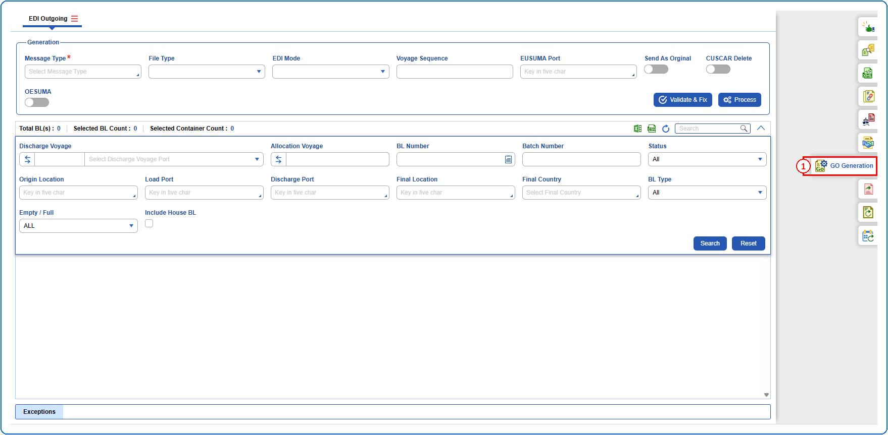
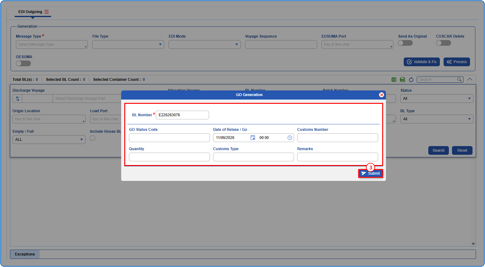
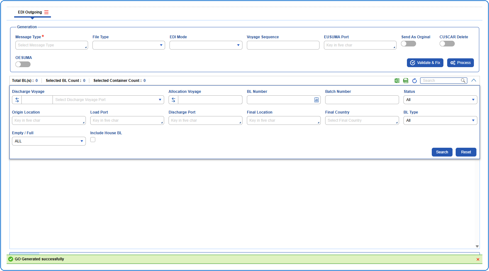

## Steps
**Step 1** : Click on the {img:../img/side_go.png} (GO Generation side icon) given on the right side of the EDI Outgoing screen.

**Step 2** : Upon clicking {img:../img/side_go.png}, the user is shown GO Generation pop up screen.
**Step 3** : Enter the details as given below and click on {img:../img/btn_submit_go.png}.

If successfully submitted, a success message is shown as given below.

