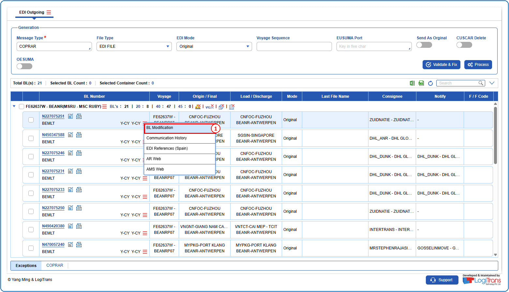
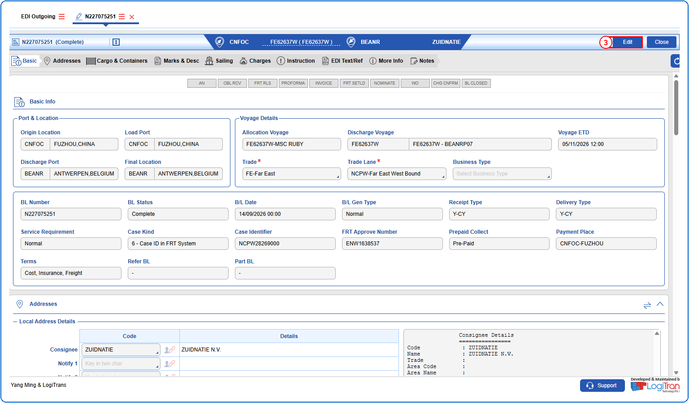
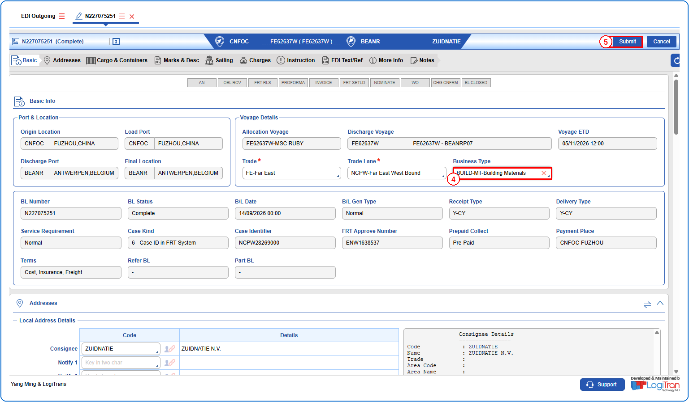
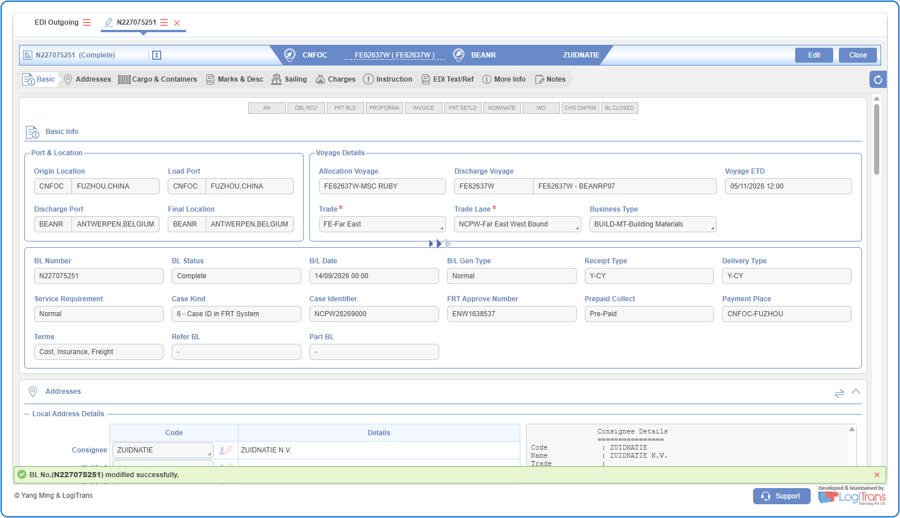

## Steps
**Step 1** : The user should drag the cursor to the record menu icon {icon:record_menu} in the respective record, click on it, and then select "**BL Modification**" from the menu.

**Step 2** : Upon clicking "**BL Modification**" User will be shown the BL Modification screen.
**Step 3** : Click on {img:../img/btn_edit.png}.

**Step 4** : Select the required Business Type.
**Step 5** : Click on {img:../img/btn_submit.png}.

If successfully submitted, a success message is shown as given below.

