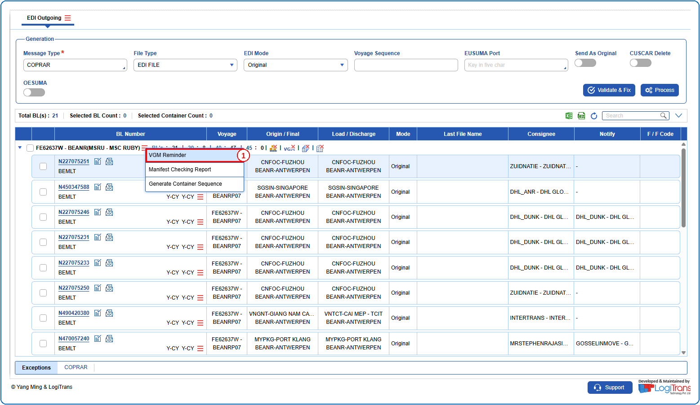
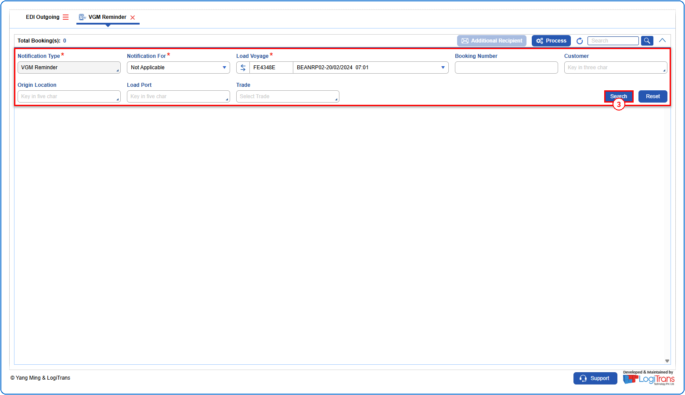
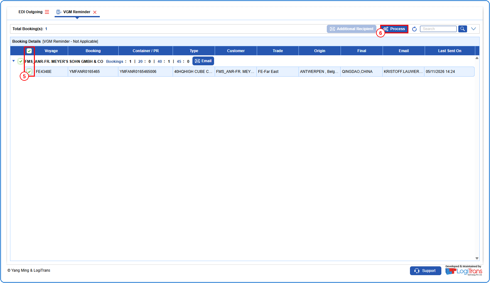
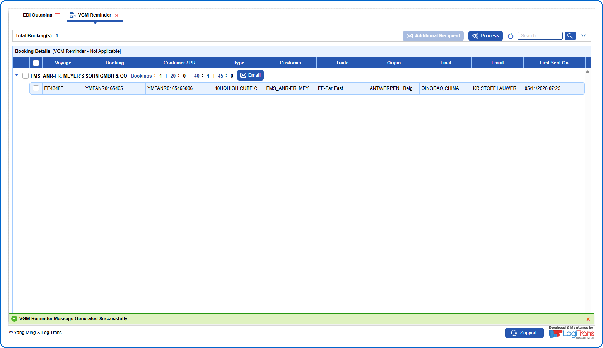

## Steps
**Step 1** : The user should drag the cursor to the record menu icon {icon:record_menu} in the respective record, click on it, and then select "**VGM Reminder**" from the menu.

**Step 2** : Upon clicking "**VGM Reminder**" User will be shown the VGM Reminder screen.
**Step 3** : Enter the query fields with desirable input for querying data and click on {img:../img/btn_search.png}.

**Step 4** : Upon clicking {img:../img/btn_search.png}, bookings with matching information are returned.
**Step 5** : Either select all bookings available by clicking on {img:../img/chk_select_all.png}(select all checkbox) or select individual bookings by clicking on {img:../img/chk_single.png}(single select checkbox).
**Step 6** : Click on {img:../img/btn_process_vgm.png}.

If successfully processed, a success message is shown as given below.

