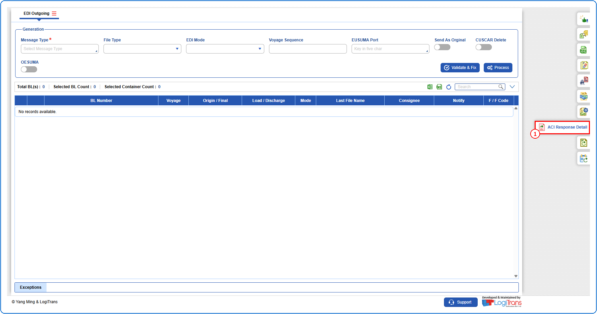
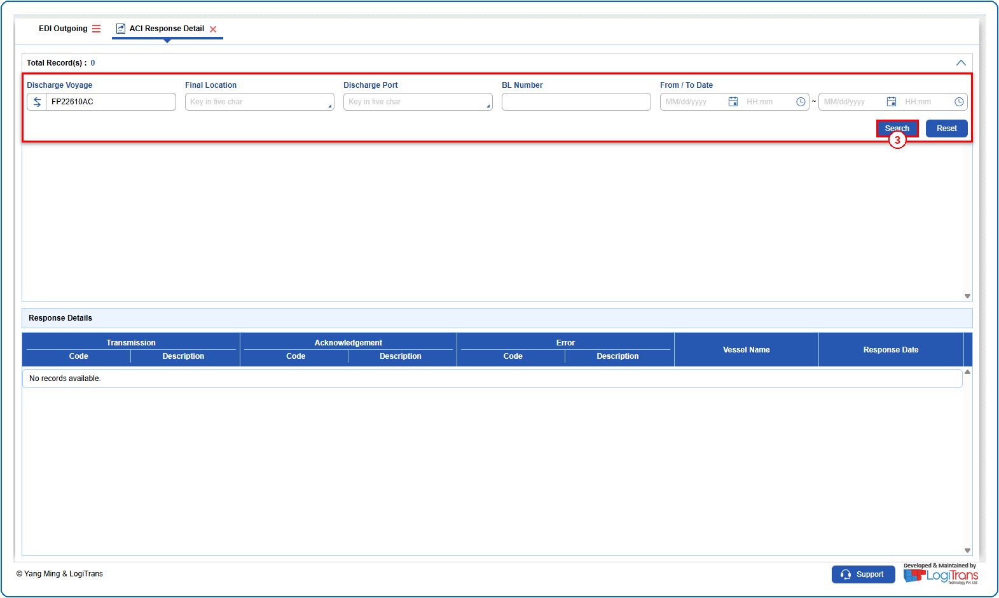
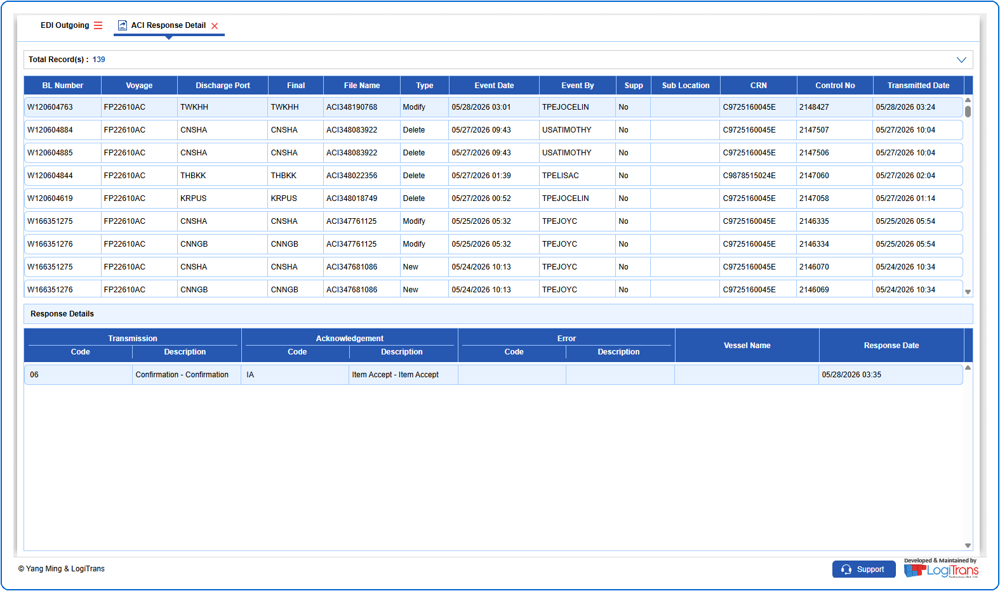

## Steps
**Step 1** : Click on the {img:../img/side_aci.png} (ACI Response Detail side icon) given on the right side of the EDI Outgoing screen.

**Step 2** : Upon clicking {img:../img/side_aci.png}, User will be shown the ACI Response Detail screen.
**Step 3** : Enter the query fields with desirable input for querying data and click on {img:../img/btn_search.png}.

**Step 4** : Upon clicking {img:../img/btn_search.png}, ACI response details with matching information are returned.
If data is available, the queried data is displayed as given below.

