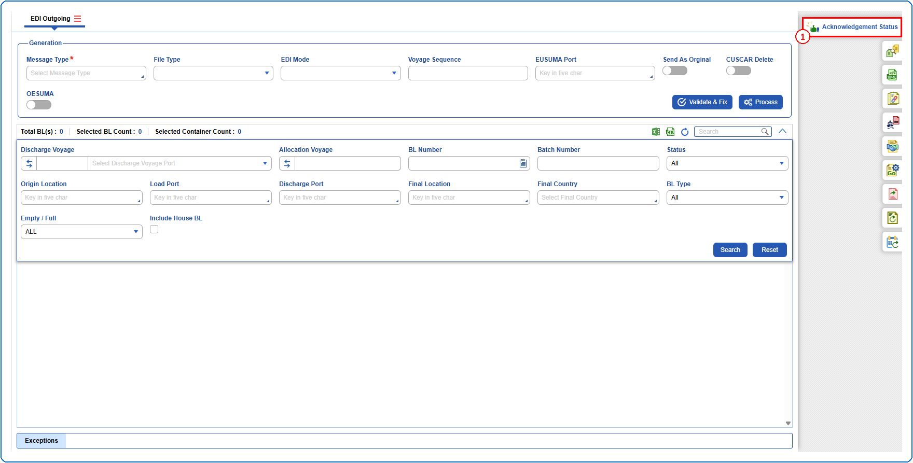
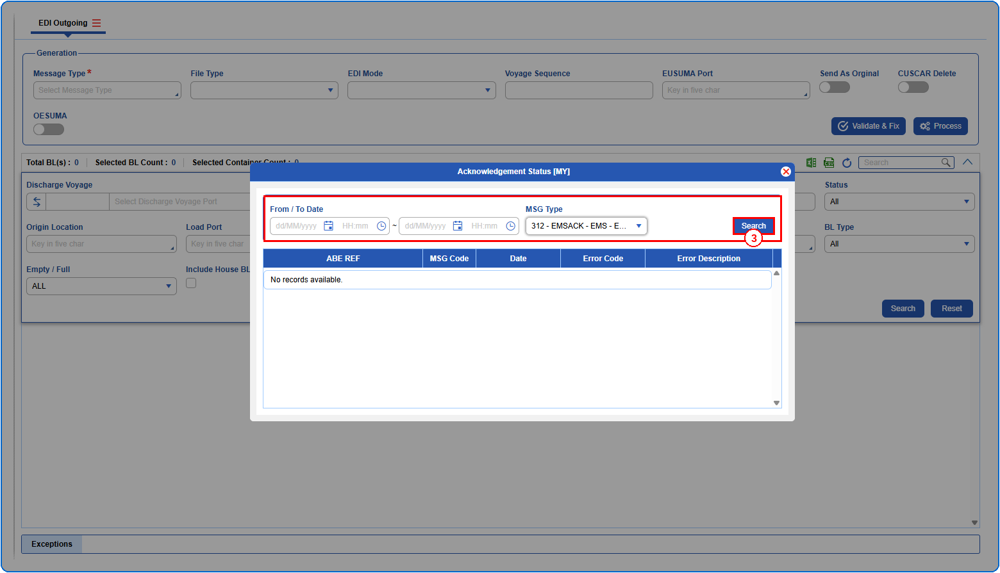
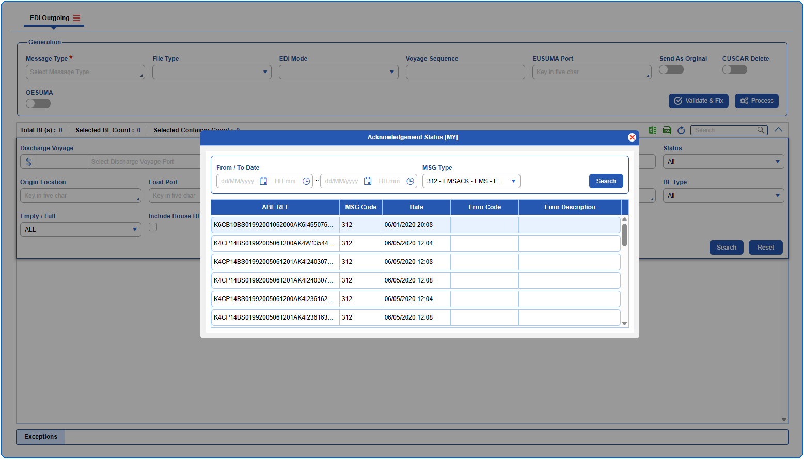

## Steps
**Step 1** : Click on the {img:../img/side_ack.png} (Acknowledgement Status side icon) given on the right side of the EDI Outgoing screen.

**Step 2** : Upon clicking {img:../img/side_ack.png}, the user is shown Acknowledgement Status [MY] pop up screen.
**Step 3** : Enter the query fields with desirable input for querying data and click on {img:../img/btn_search_ack.png}.

**Step 4** : Upon clicking {img:../img/btn_search_ack.png}, acknowledgement status records with matching information are returned.
If data is available, the queried data is displayed as given below.

