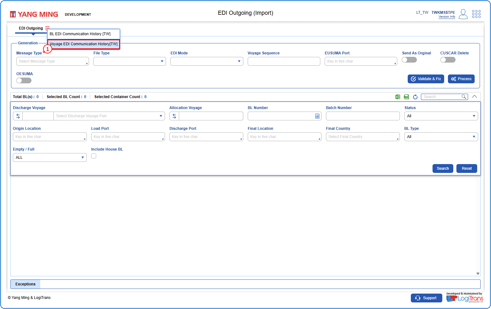
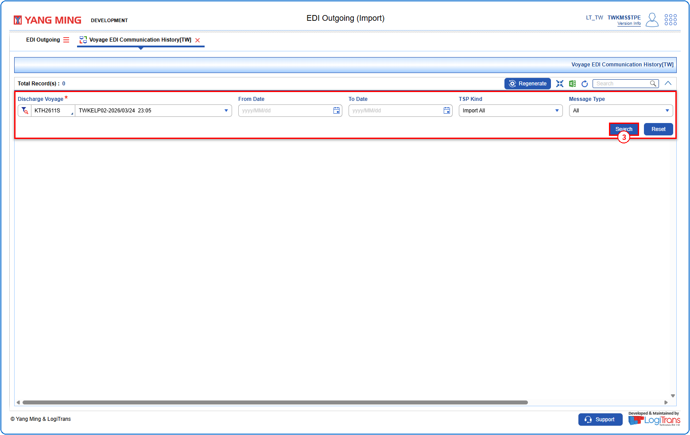
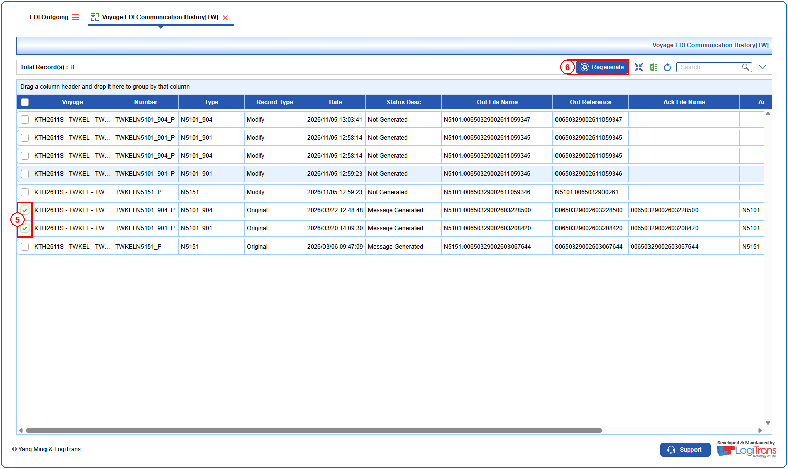
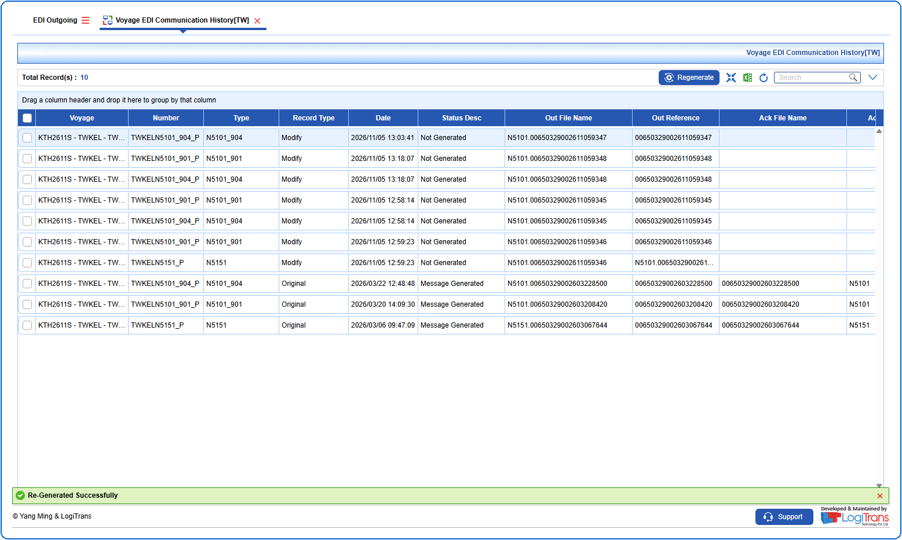

## Steps
**Step 1** : The user should drag the cursor to the batch function menu icon {icon:batch_menu}, click on it, and then select "**Voyage EDI Communication History[TW]**" from the menu.

**Step 2** : Upon clicking "**Voyage EDI Communication History[TW]**" User will be shown the Voyage EDI Communication History[TW] screen.
**Step 3** : Enter the query fields with desirable input for querying data and click on {img:../img/btn_search.png}.

**Step 4** : Upon clicking {img:../img/btn_search.png}, voyage records with matching information are returned.
**Step 5** : Either select all voyage records available by clicking on {img:../img/chk_select_all.png}(select all checkbox) or select individual voyage records by clicking on {img:../img/chk_single.png}(single select checkbox).
**Step 6** : Click on {img:../img/btn_regenerate.png}.

If successfully regenerated, a success message is shown as given below.

