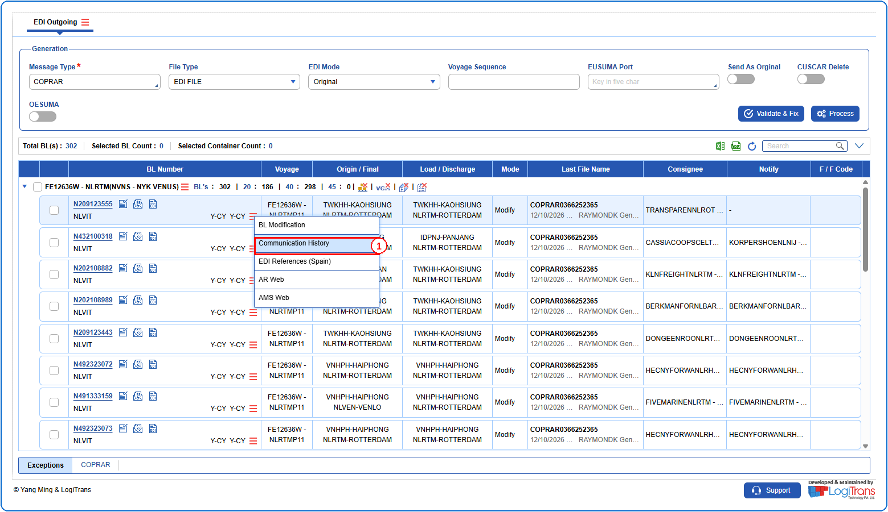
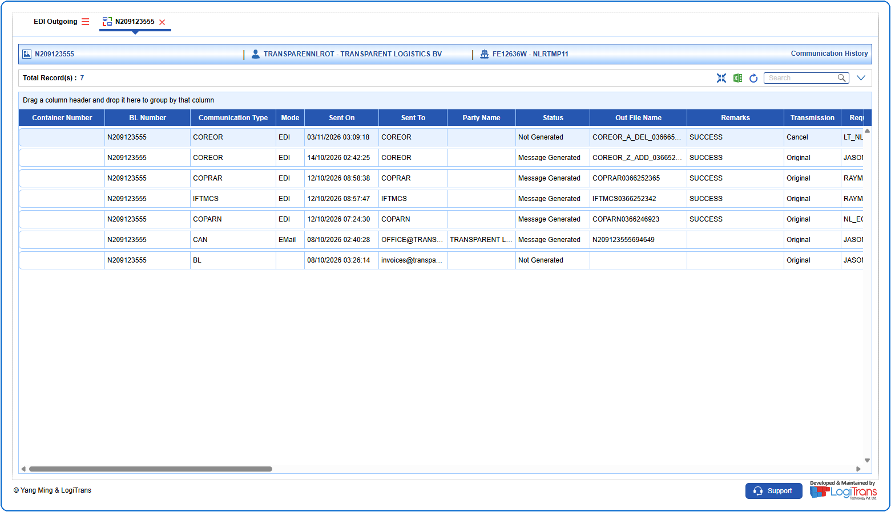

## Steps
**Step 1** : The user should drag the cursor to the record menu icon {icon:record_menu} in the respective record, click on it, and then select "**Communication History**" from the menu.

**Step 2** : Upon clicking "**Communication History**" User will be shown the Communication History screen.

