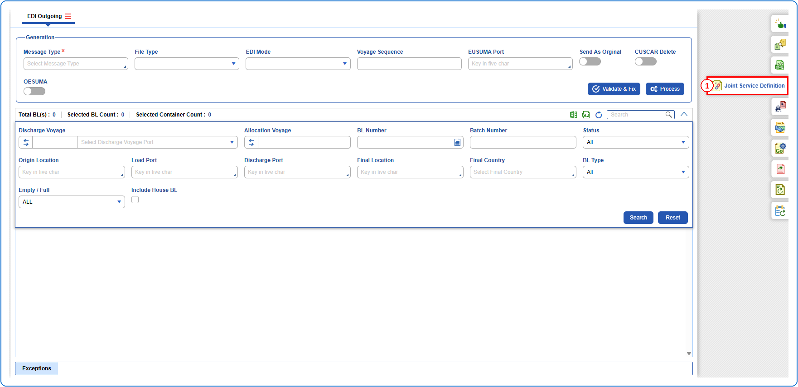
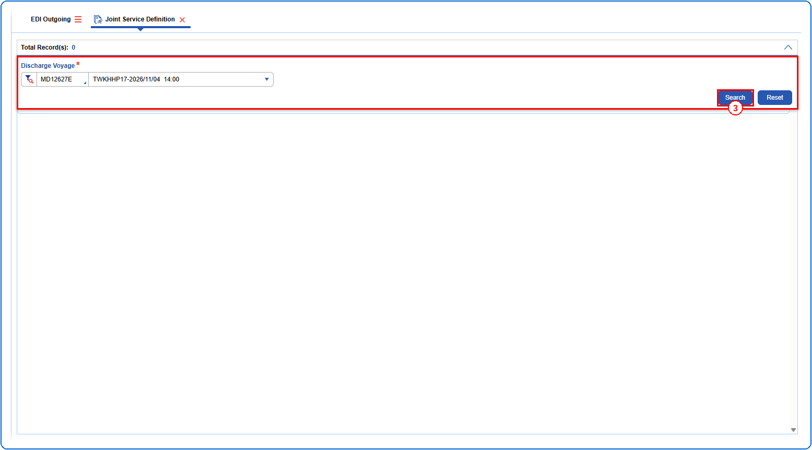
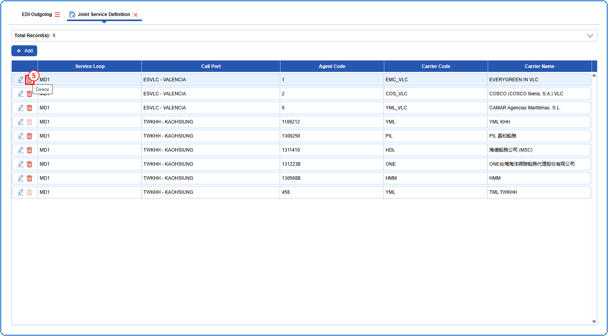
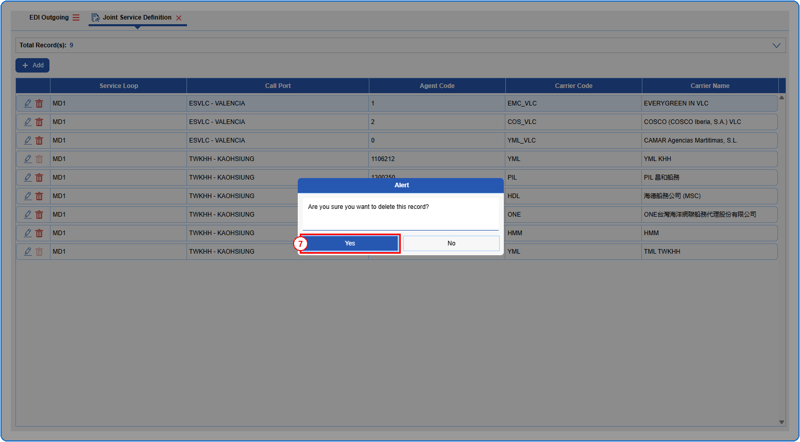
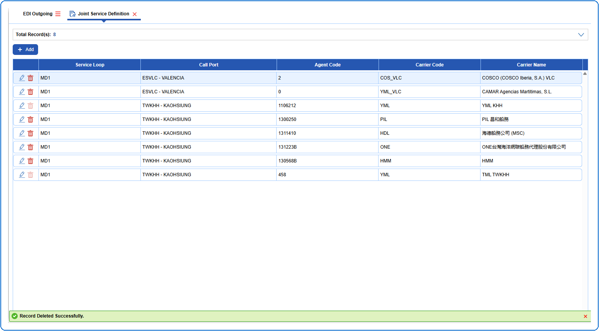

## Steps
**Step 1** : Click on the {img:../img/side_jsd.png} (Joint Service Definition side icon) given on the right side of the EDI Outgoing screen.

**Step 2** : Upon clicking {img:../img/side_jsd.png}, User will be shown the Joint Service Definition screen.
**Step 3** : Enter the query fields with desirable input for querying data and click on {img:../img/btn_search.png}.

**Step 4** : Upon clicking {img:../img/btn_search.png}, joint service definitions with matching information are returned.
**Step 5** : Click on {img:../img/btn_jsd_delete.png} in the respective record.

**Step 6** : Upon clicking {img:../img/btn_jsd_delete.png}, an alert is shown as given below.
**Step 7** : Click on {img:../img/btn_jsd_yes.png}.

If successfully deleted, a success message is shown as given below.

