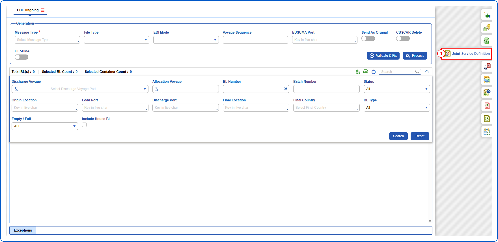
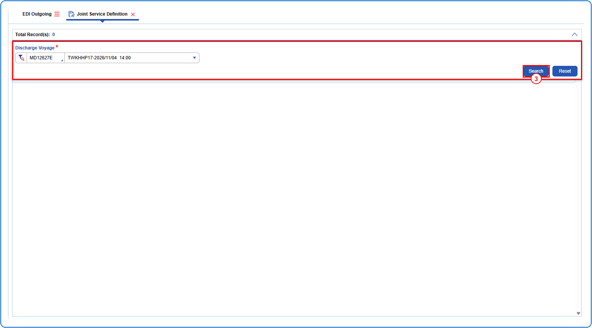
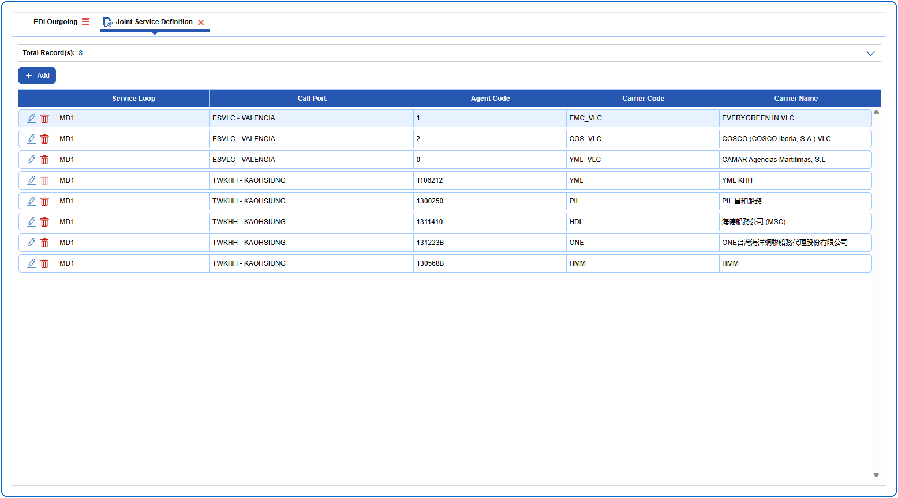
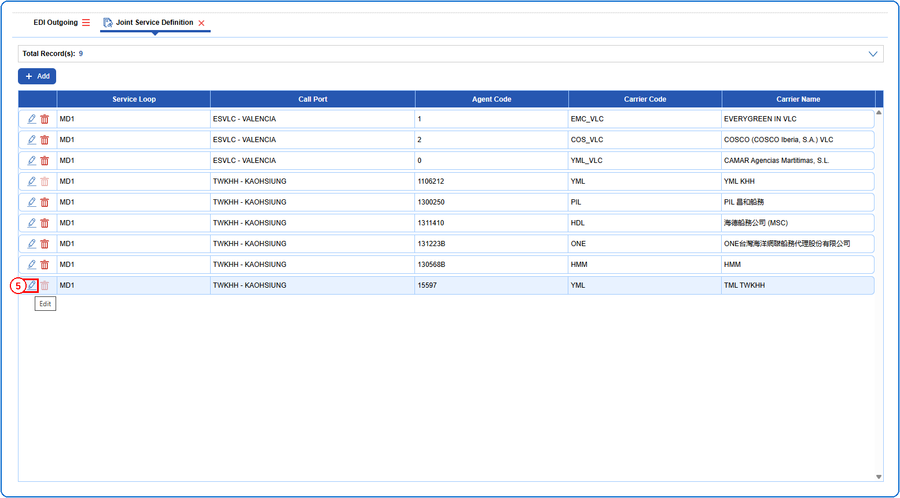
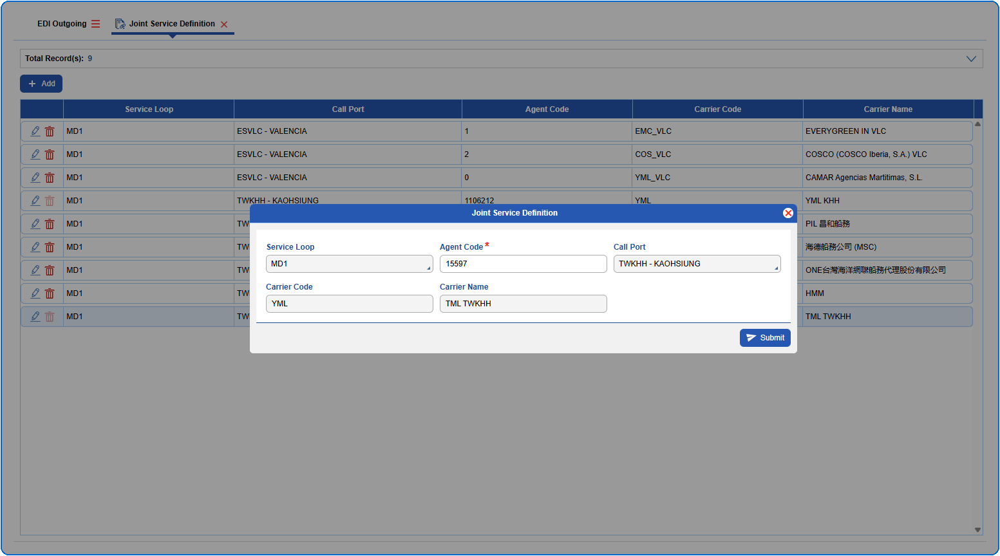
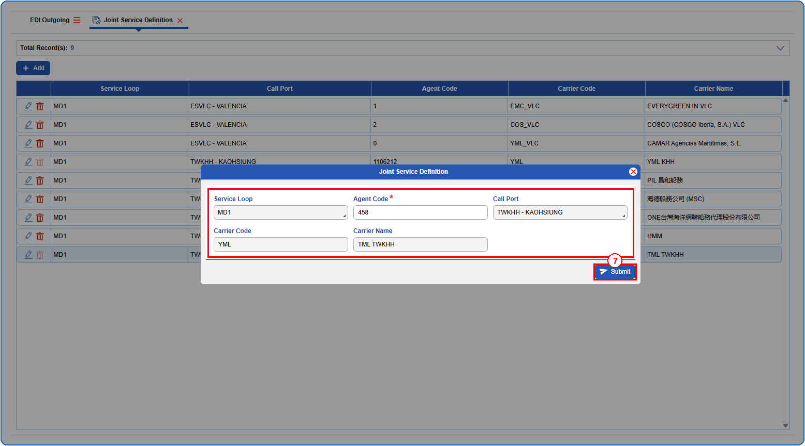
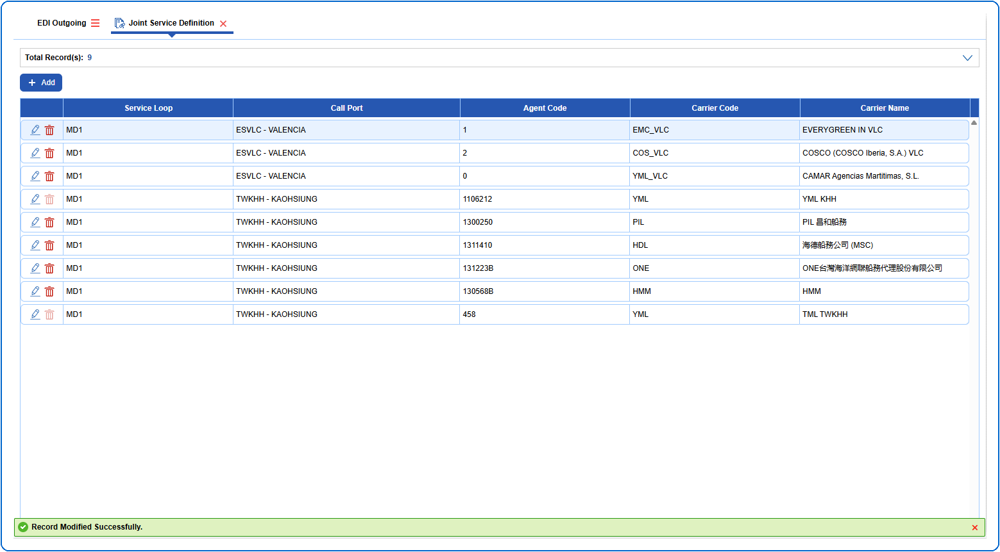

## Steps
**Step 1** : Click on the {img:../img/side_jsd.png} (Joint Service Definition side icon) given on the right side of the EDI Outgoing screen.

**Step 2** : Upon clicking {img:../img/side_jsd.png}, User will be shown the Joint Service Definition screen.
**Step 3** : Enter the query fields with desirable input for querying data and click on {img:../img/btn_search.png}.

**Step 4** : Upon clicking {img:../img/btn_search.png}, joint service definitions with matching information are returned.

**Step 5** : Click on {img:../img/btn_jsd_edit.png} in the respective record.

**Step 6** : Upon clicking {img:../img/btn_jsd_edit.png}, the user is shown Joint Service Definition pop up screen.

**Step 7** : Enter the details as given below and click on {img:../img/btn_jsd_submit.png}.

If successfully submitted, a success message is shown as given below.

