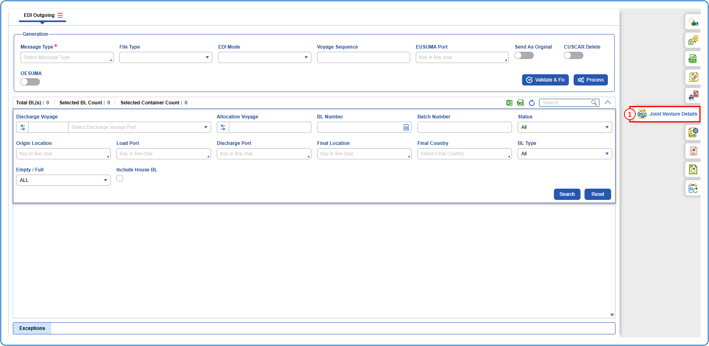
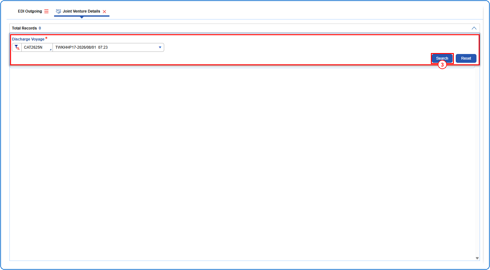
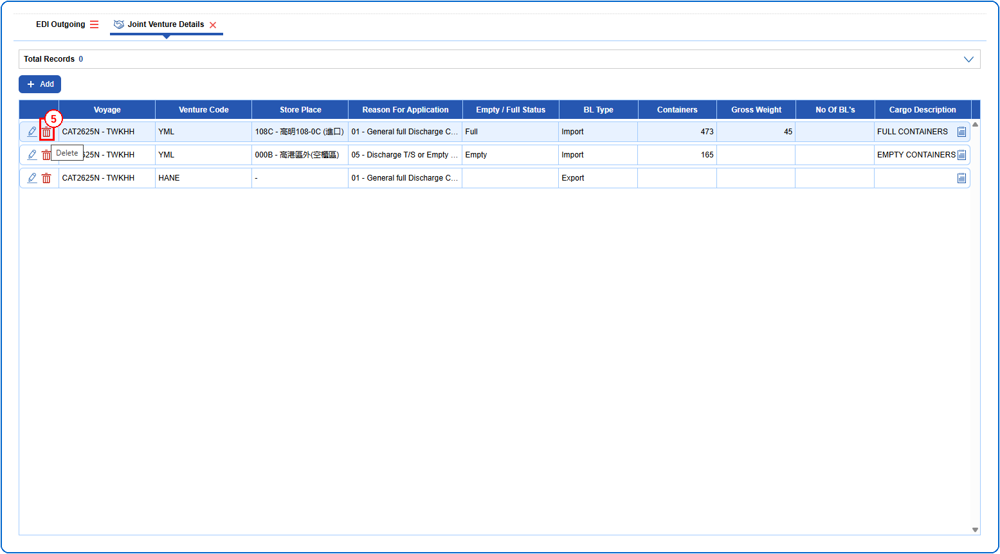
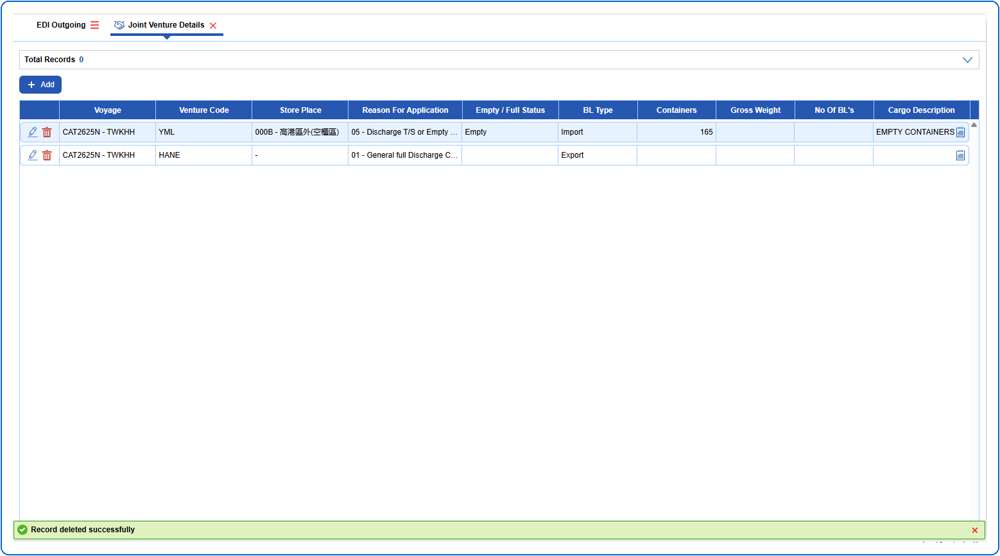

## Steps
**Step 1** : Click on the {img:../img/side_jv.png} (Joint Venture Details side icon) given on the right side of the EDI Outgoing screen.

**Step 2** : Upon clicking {img:../img/side_jv.png}, User will be shown the Joint Venture Details screen.
**Step 3** : Enter the query fields with desirable input for querying data and click on {img:../img/btn_search.png}.

**Step 4** : Upon clicking {img:../img/btn_search.png}, joint venture details with matching information are returned.
**Step 5** : Click on {img:../img/btn_jv_delete.png} in the respective record.

If successfully deleted, a success message is shown as given below.

