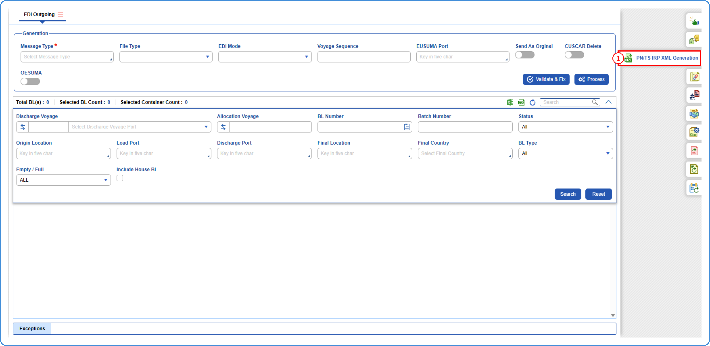
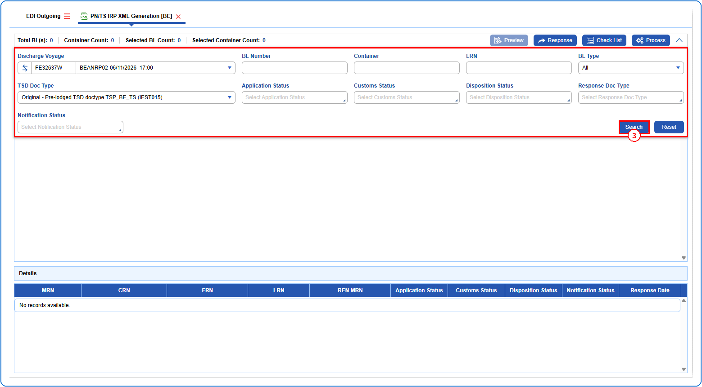
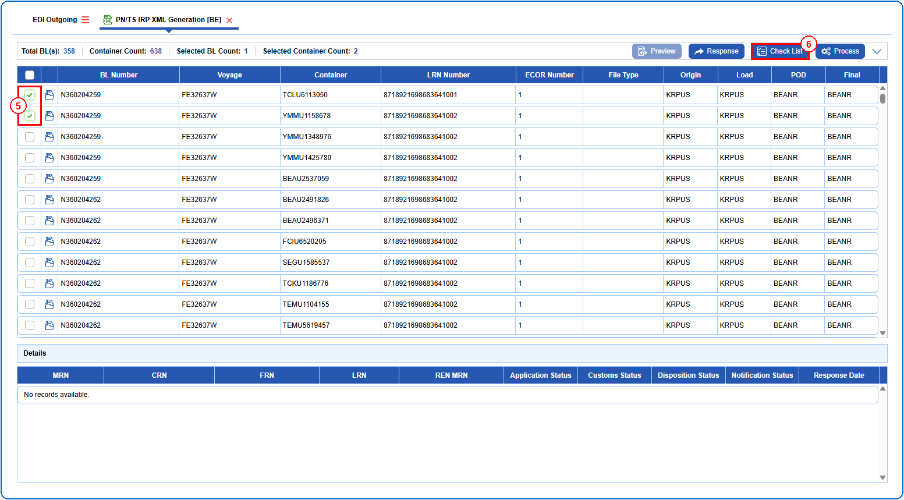
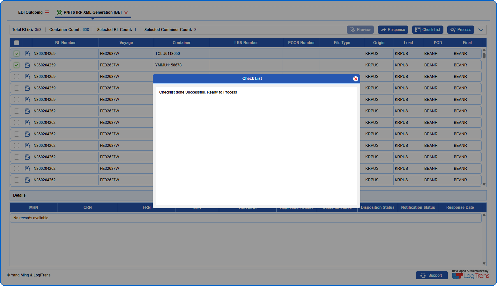

## Steps
**Step 1** : Click on the {img:../img/side_pnts.png} (PN/TS IRP XML Generation side icon) given on the right side of the EDI Outgoing screen.

**Step 2** : Upon clicking {img:../img/side_pnts.png}, User will be shown the PN/TS IRP XML Generation screen.
**Step 3** : Enter the query fields with desirable input for querying data and click on {img:../img/btn_search.png}.

**Step 4** : Upon clicking {img:../img/btn_search.png}, BL records with matching information are returned.
**Step 5** : Either select all BL records available by clicking on {img:../img/chk_select_all.png}(select all checkbox) or select individual BL records by clicking on {img:../img/chk_single.png}(single select checkbox).
**Step 6** : Click on {img:../img/btn_pnts_checklist.png}.

If successfully validated, an alert is shown as given below.

