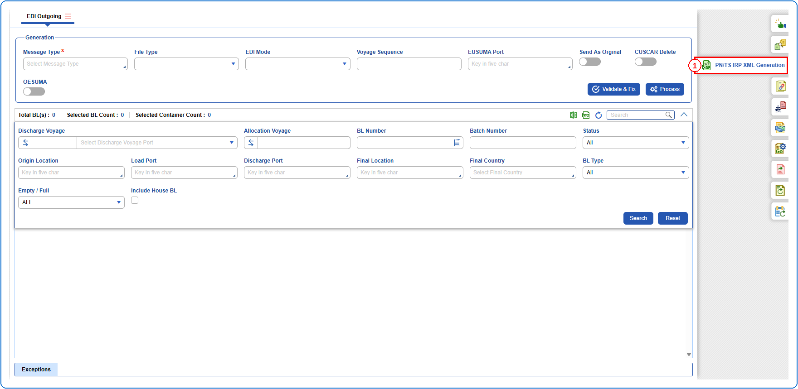
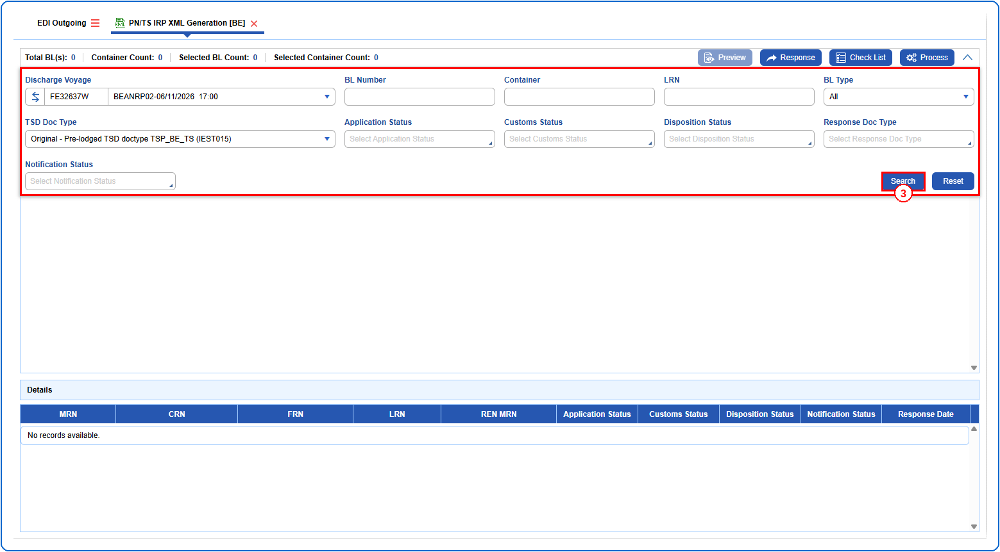
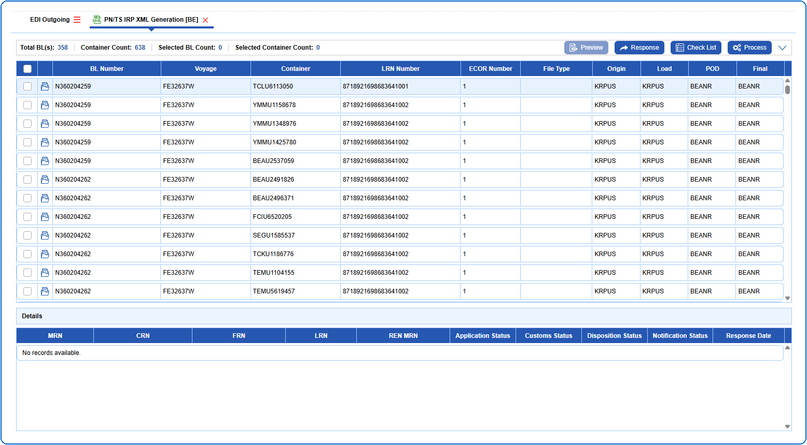
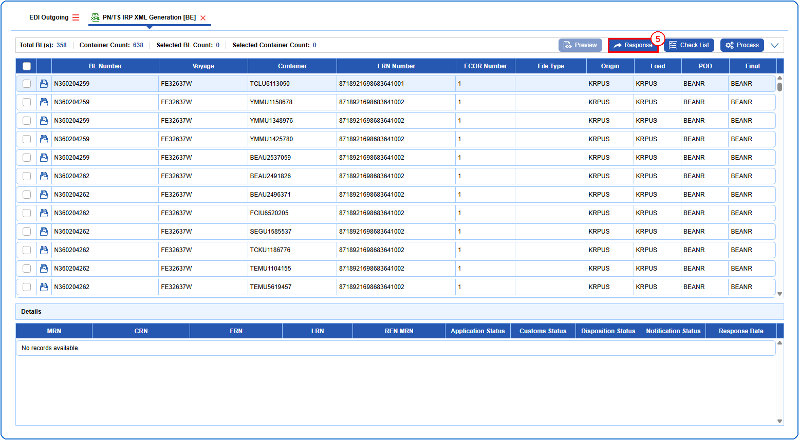
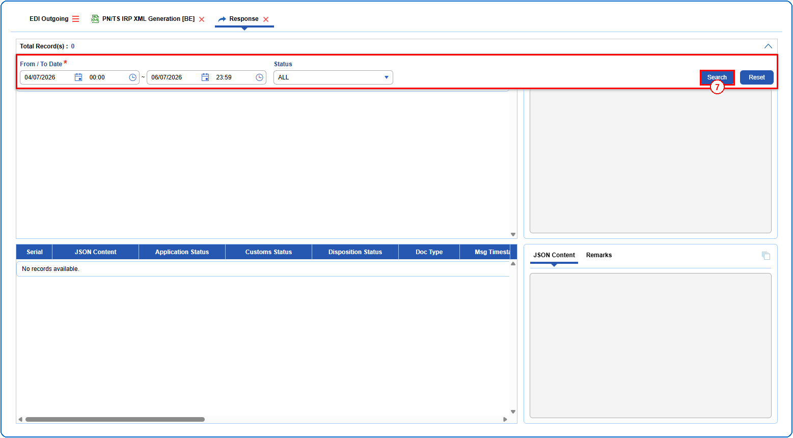
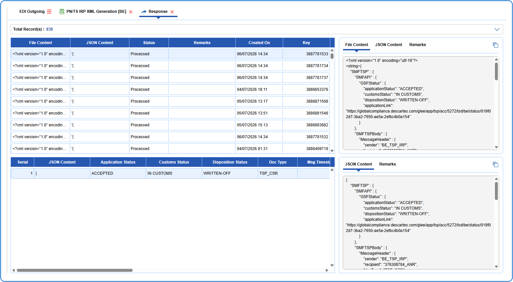

## Steps
**Step 1** : Click on the {img:../img/side_pnts.png} (PN/TS IRP XML Generation side icon) given on the right side of the EDI Outgoing screen.

**Step 2** : Upon clicking {img:../img/side_pnts.png}, User will be shown the PN/TS IRP XML Generation screen.
**Step 3** : Enter the query fields with desirable input for querying data and click on {img:../img/btn_search.png}.

**Step 4** : Upon clicking {img:../img/btn_search.png}, BL records with matching information are returned.

**Step 5** : Click on {img:../img/btn_pnts_response.png}.

**Step 6** : Upon clicking {img:../img/btn_pnts_response.png}, User will be shown the Response screen.
**Step 7** : Enter the query fields with desirable input for querying data and click on {img:../img/btn_search.png}.

If data is available, the queried data is displayed as given below.

