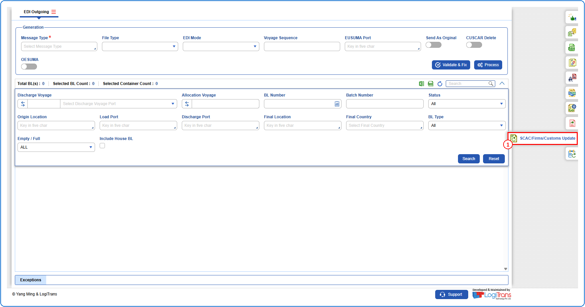
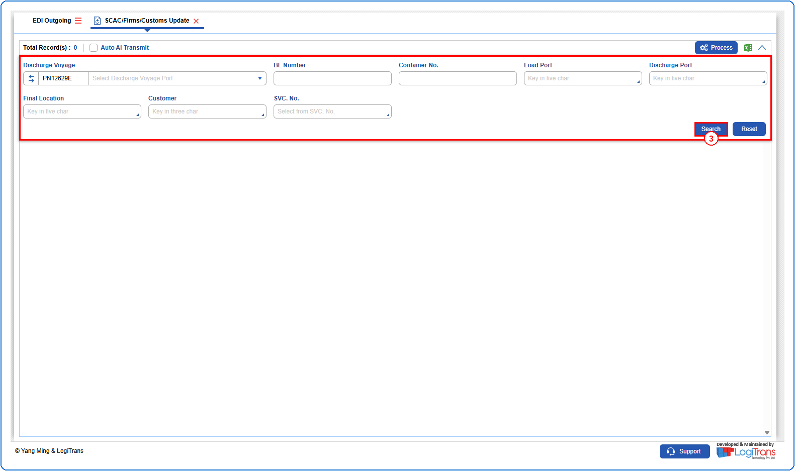
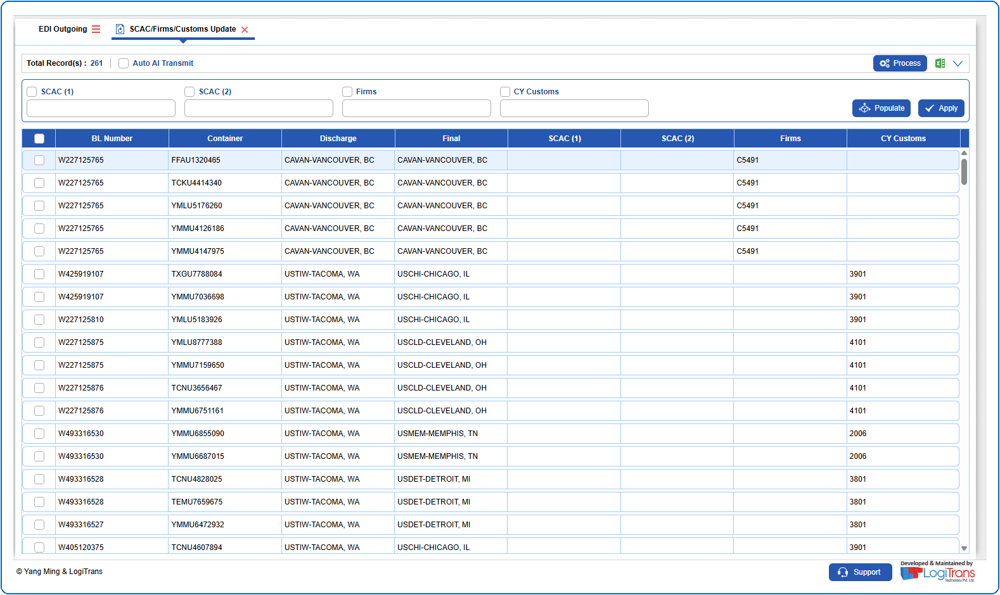
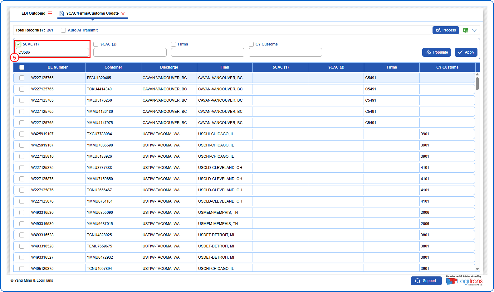
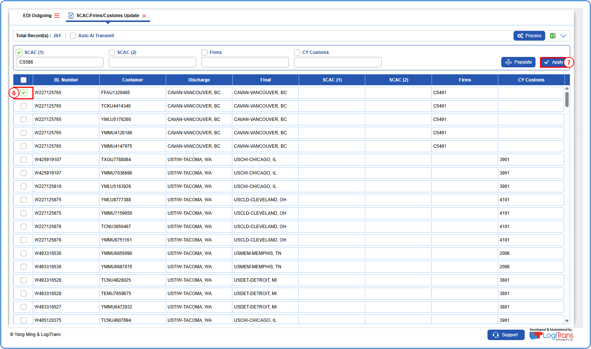
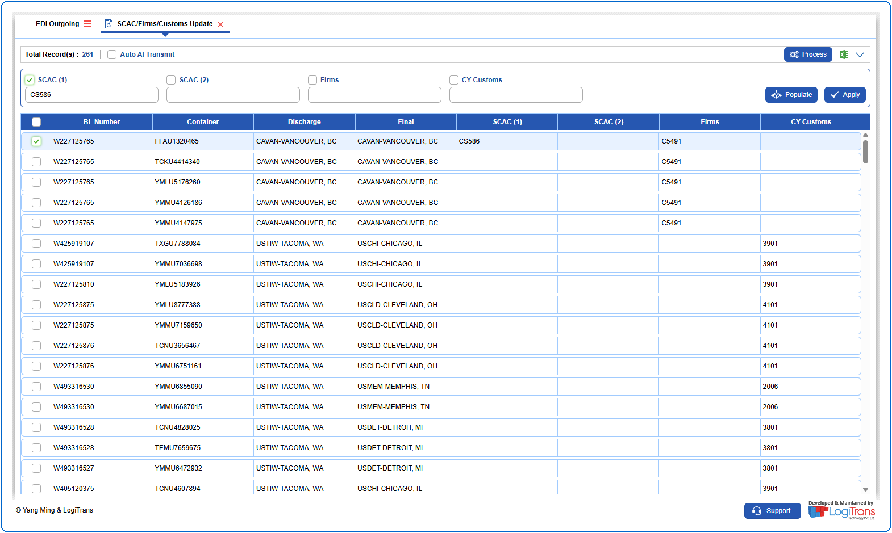
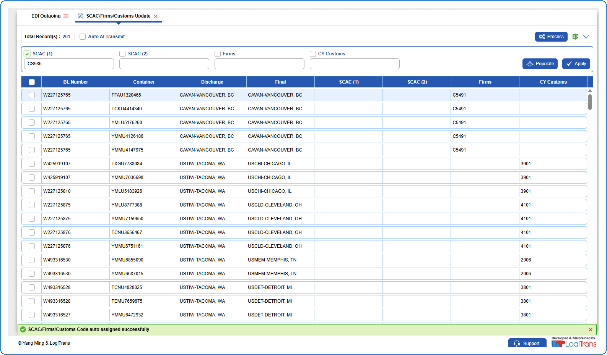
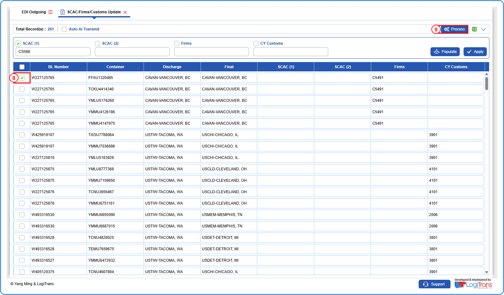
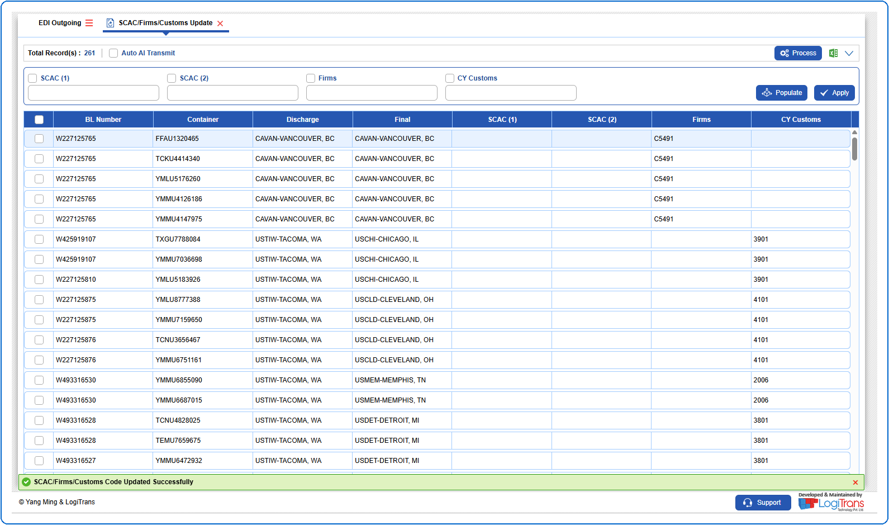

## Steps
**Step 1** : Click on the {img:../img/side_scac.png} (SCAC/Firms/Customs Update side icon) given on the right side of the EDI Outgoing screen.

**Step 2** : Upon clicking {img:../img/side_scac.png}, User will be shown the SCAC/Firms/Customs Update screen.
**Step 3** : Enter the query fields with desirable input for querying data and click on {img:../img/btn_search.png}.

**Step 4** : Upon clicking {img:../img/btn_search.png}, records with matching information are returned.

**Step 5** : Select the "**SCAC (1)**" checkbox and enter the data in the "**SCAC (1)**" field.

**Step 6** : Either select all records available by clicking on {img:../img/chk_select_all.png}(select all checkbox) or select individual records by clicking on {img:../img/chk_single.png}(single select checkbox).
**Step 7** : Click on {img:../img/btn_scac_apply.png}.

Upon clicking {img:../img/btn_scac_apply.png}, the entered "**SCAC (1)**" value is populated in the selected record as shown below.

If successfully applied, a success message is shown as given below.

**Step 8** : Either select all records available by clicking on {img:../img/chk_select_all.png}(select all checkbox) or select individual records by clicking on {img:../img/chk_single.png}(single select checkbox).
**Step 9** : Click on {img:../img/btn_scac_process.png}.

If successfully processed, a success message is shown as given below.

