**Afsys**

>> {img:../img/afsys_joint_service_definition_01.png}
>> {img:../img/afsys_joint_service_definition_02.png}
>> {img:../img/afsys_joint_service_definition_03.png}
>> {img:../img/afsys_joint_service_definition_04.png}
>> {img:../img/afsys_joint_service_definition_05.png}
>> {img:../img/afsys_joint_service_definition_06.png}

**Add**

>> {img:../img/afsys_joint_service_definition_07.png}
>> {img:../img/afsys_joint_service_definition_08.png}
>> {img:../img/afsys_joint_service_definition_09.png}

**Edit**

>> {img:../img/afsys_joint_service_definition_10.png}
>> {img:../img/afsys_joint_service_definition_11.png}

**Delete**

>> {img:../img/afsys_joint_service_definition_12.png}
>> {img:../img/afsys_joint_service_definition_13.png}

**ILISCyber**

>> [Query screen screenshot - placeholder]
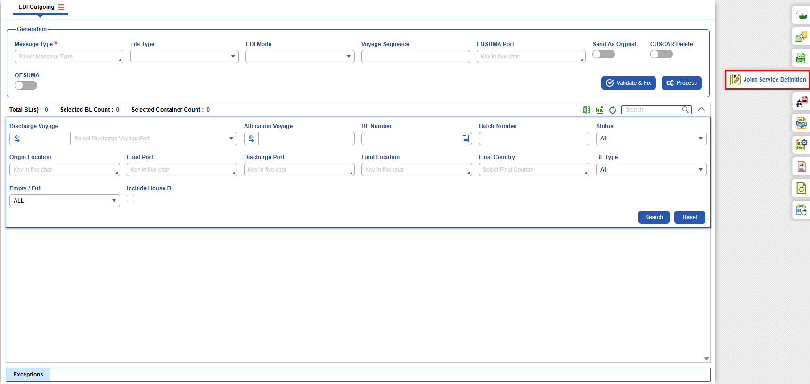
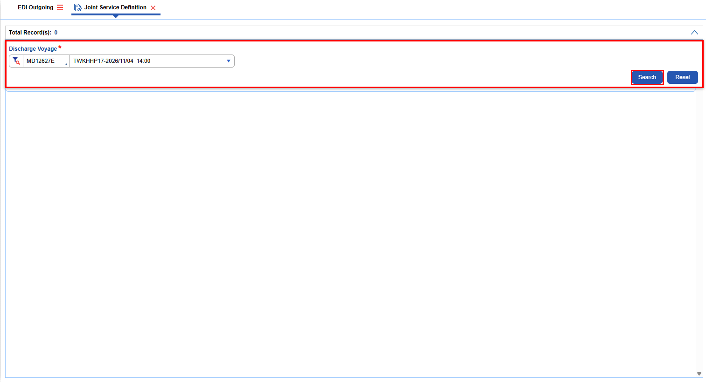

**Add**

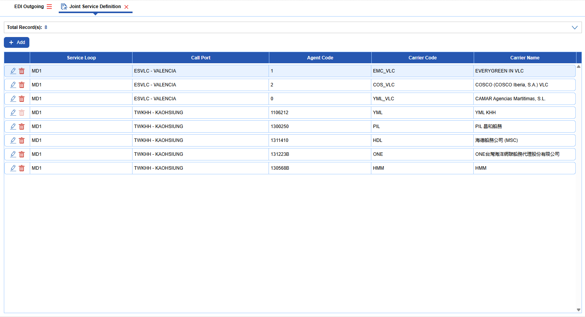
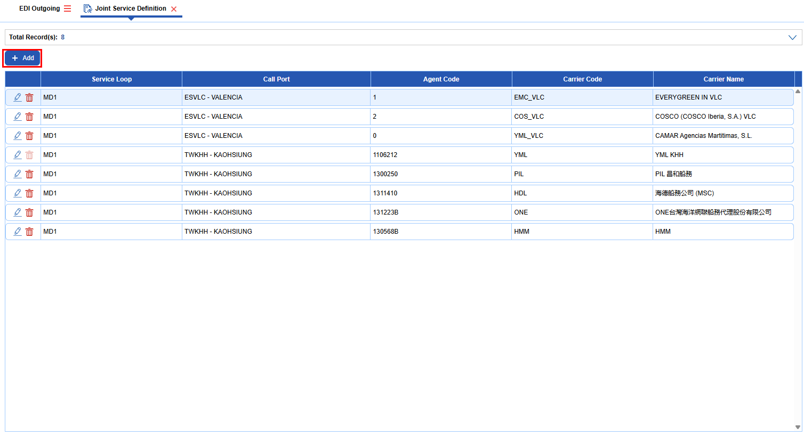
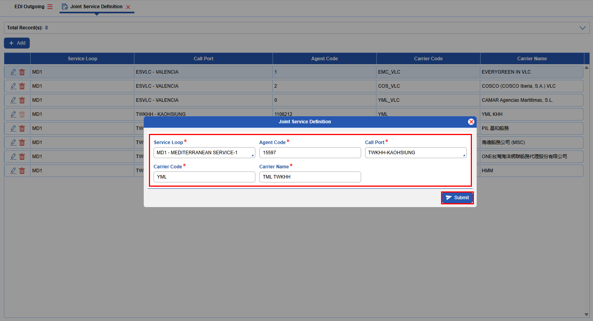
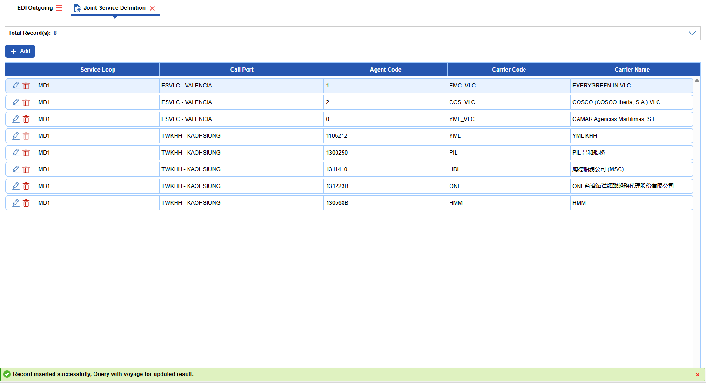

**Edit**

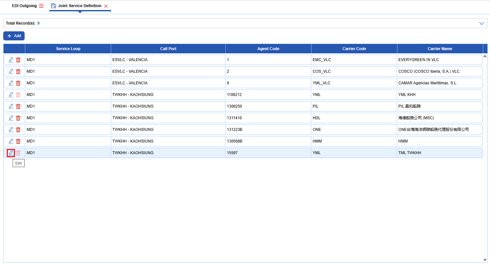
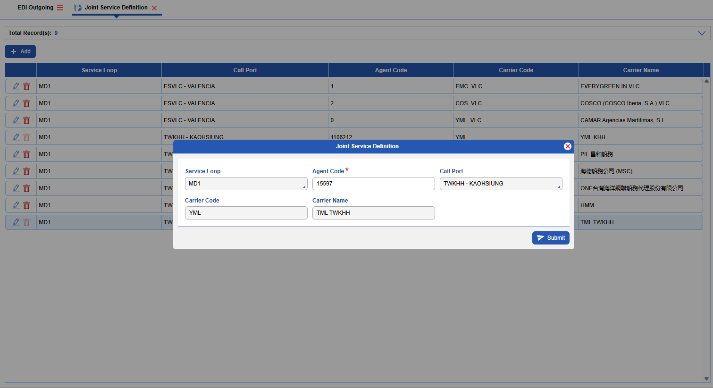
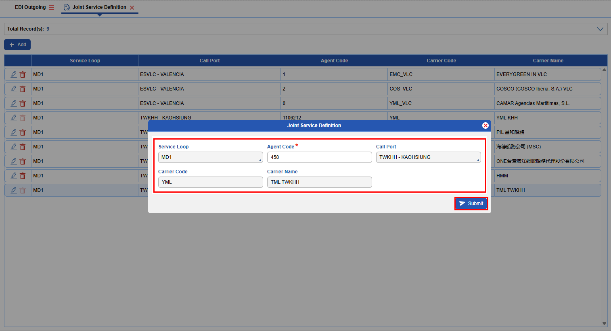
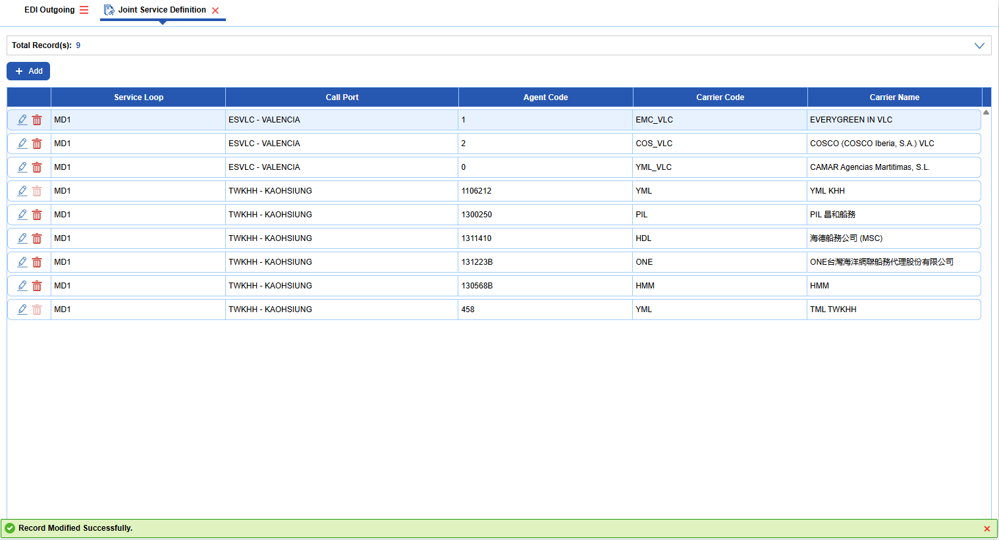

**Delete**

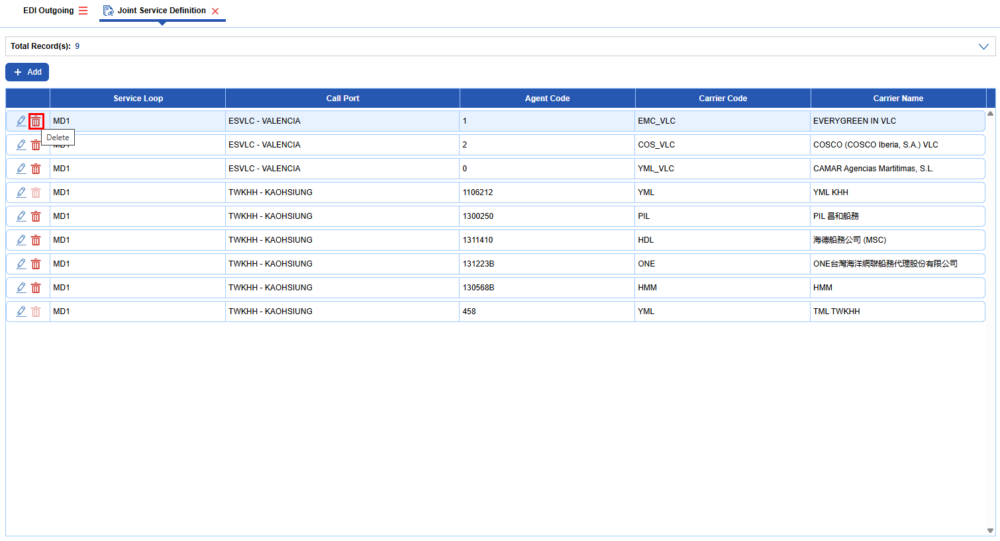
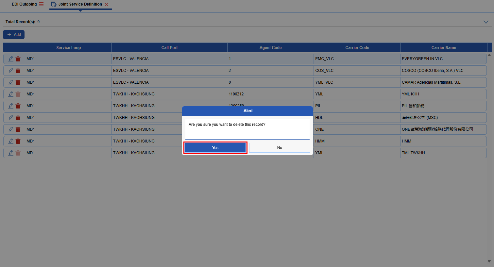
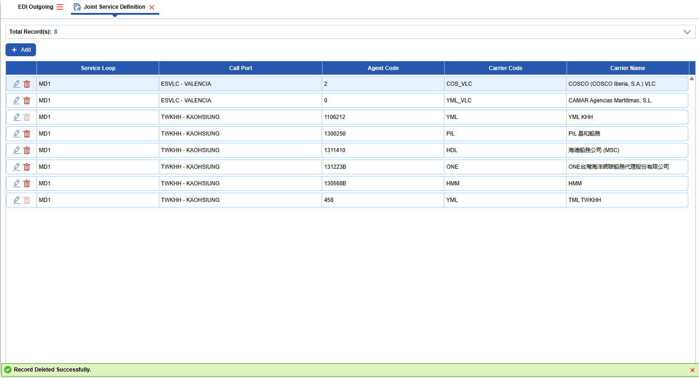
