**Afsys**

>> {img:../img/afsys_pnts_irp_xml_01.png}
>> {img:../img/afsys_pnts_irp_xml_02.png}
>> {img:../img/afsys_pnts_irp_xml_03.png}
>> {img:../img/afsys_pnts_irp_xml_04.png}
>> {img:../img/afsys_pnts_irp_xml_05.png}

**File Log Details**

>> {img:../img/afsys_pnts_irp_xml_06.png}
>> {img:../img/afsys_pnts_irp_xml_07.png}
>> {img:../img/afsys_pnts_irp_xml_08.png}
>> {img:../img/afsys_pnts_irp_xml_09.png}

**Response**

>> {img:../img/afsys_pnts_irp_xml_10.png}
>> {img:../img/afsys_pnts_irp_xml_11.png}
>> {img:../img/afsys_pnts_irp_xml_12.png}

**Check List**

>> {img:../img/afsys_pnts_irp_xml_13.png}
>> {img:../img/afsys_pnts_irp_xml_14.png}
>> {img:../img/afsys_pnts_irp_xml_15.png}

**Process**

>> {img:../img/afsys_pnts_irp_xml_16.png}
>> {img:../img/afsys_pnts_irp_xml_17.png}

**ILISCyber**

>> [Query screen screenshot - placeholder]
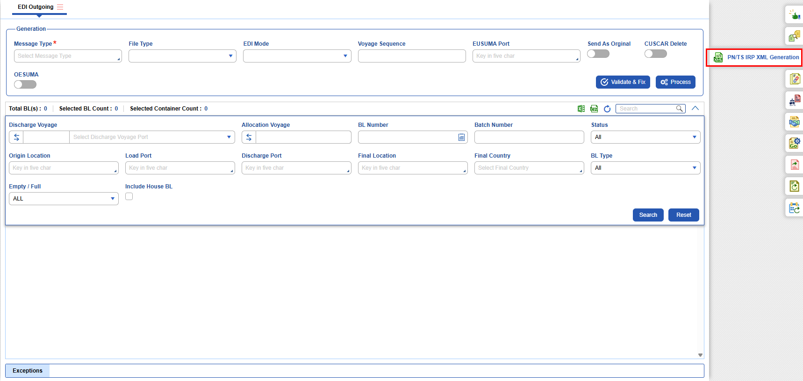
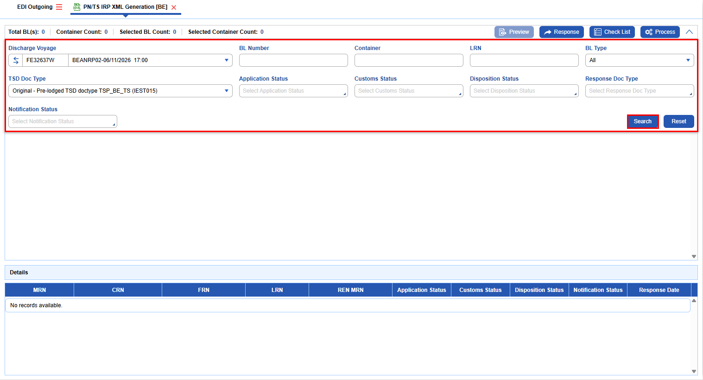

**File Log Details**

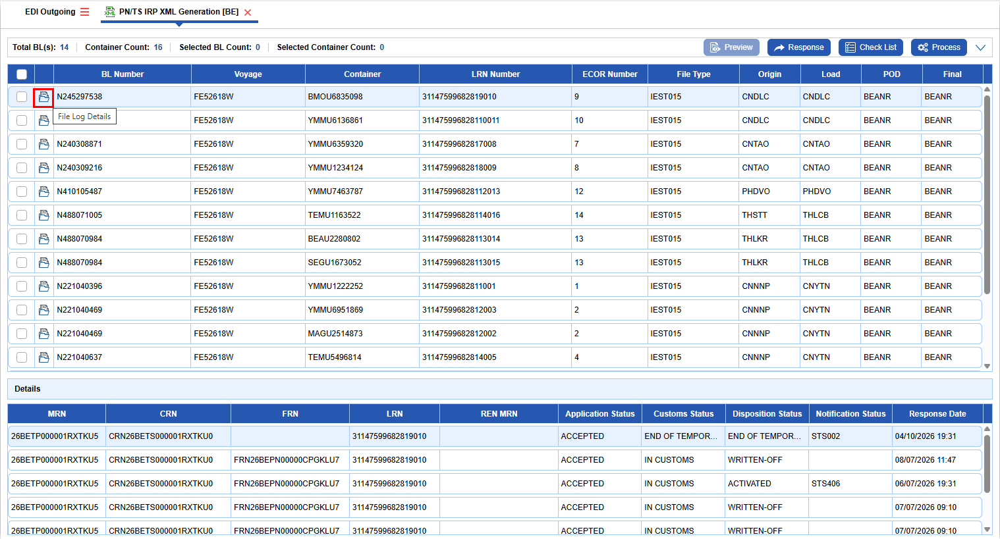
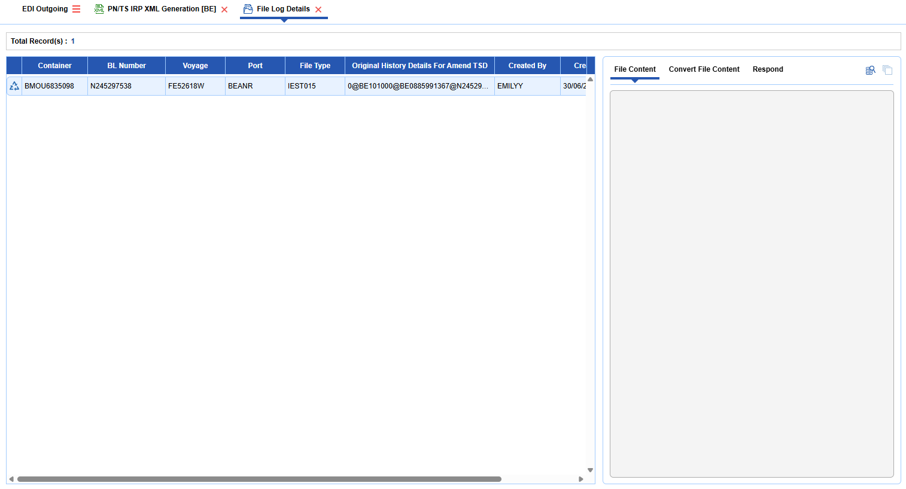
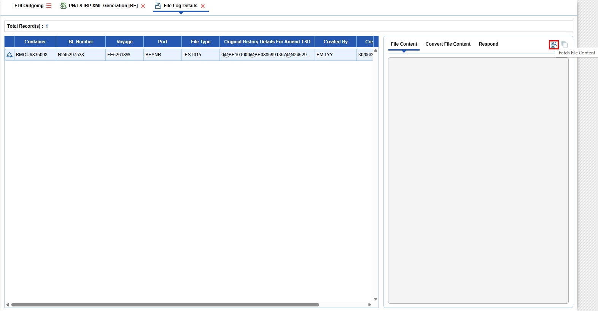
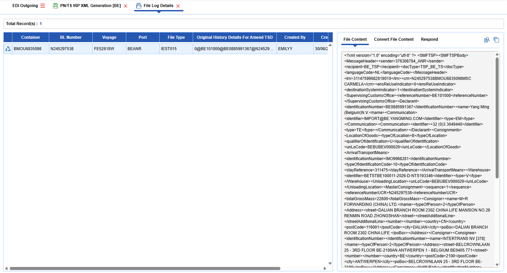

**Response**

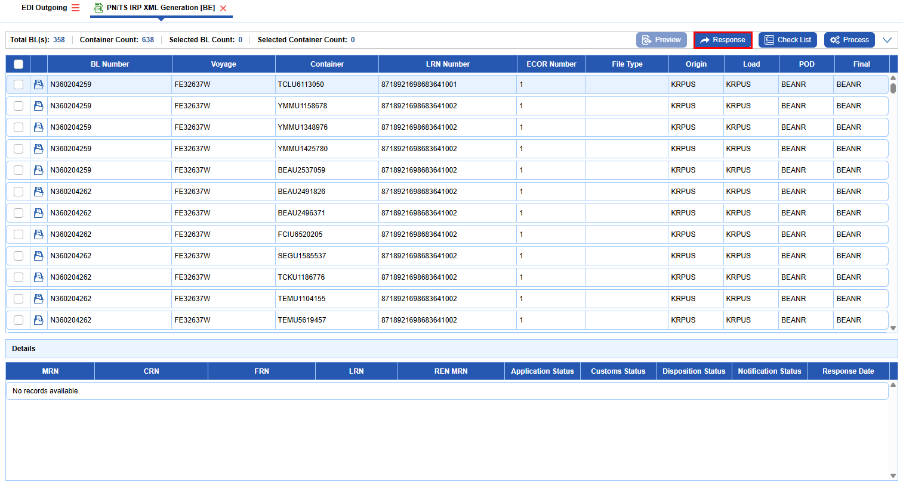
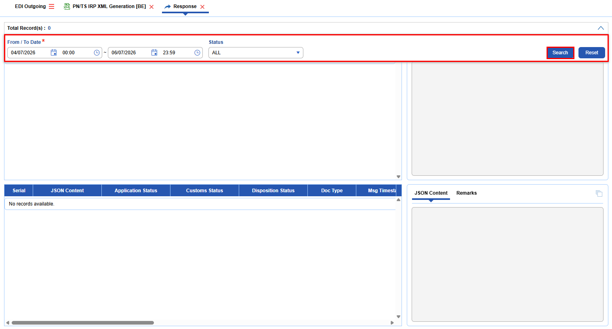
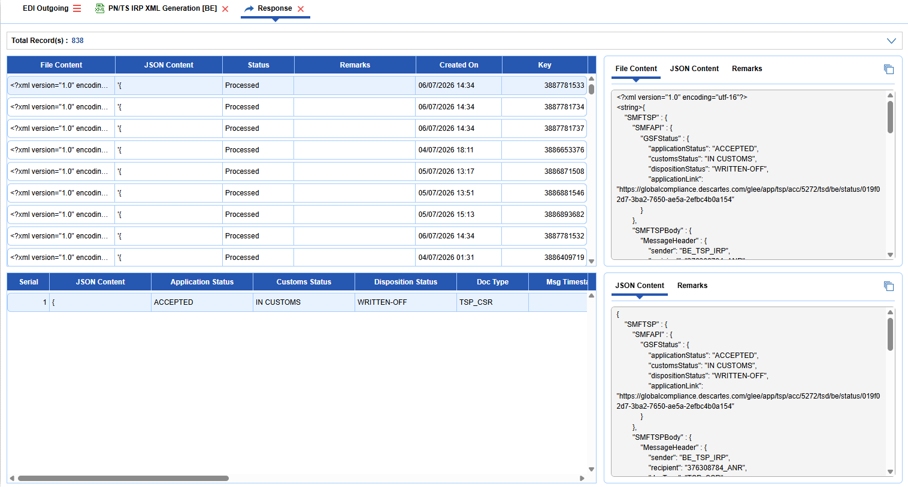

**Check List**

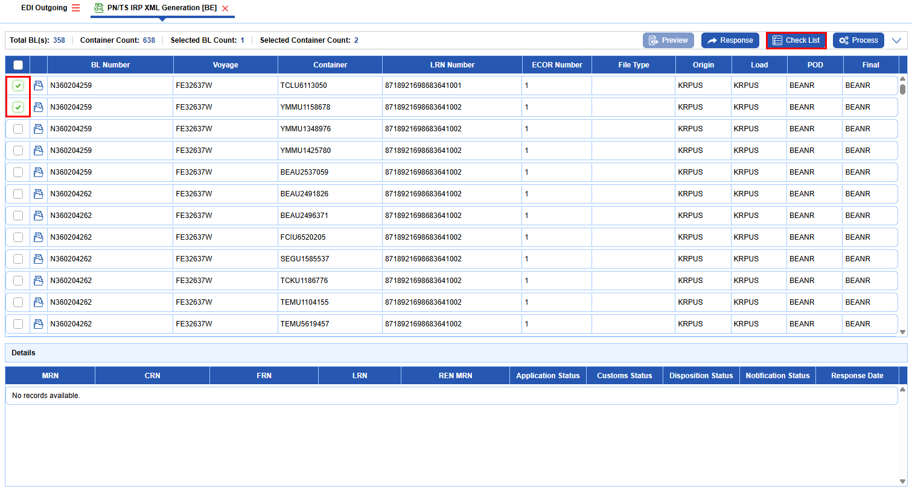
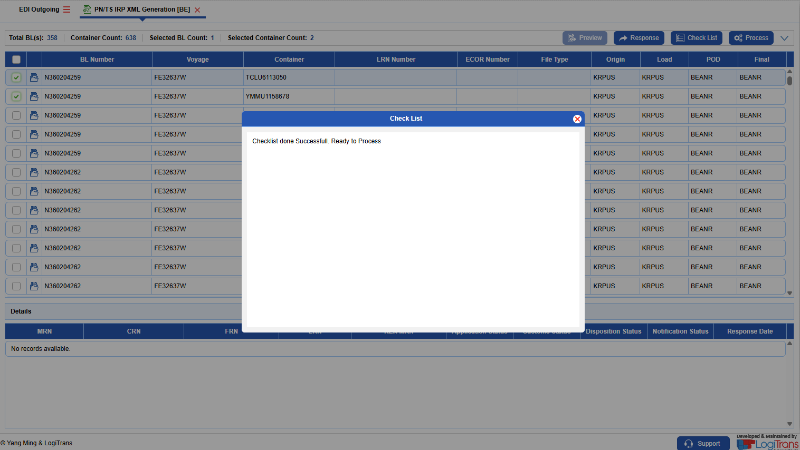

**Process**

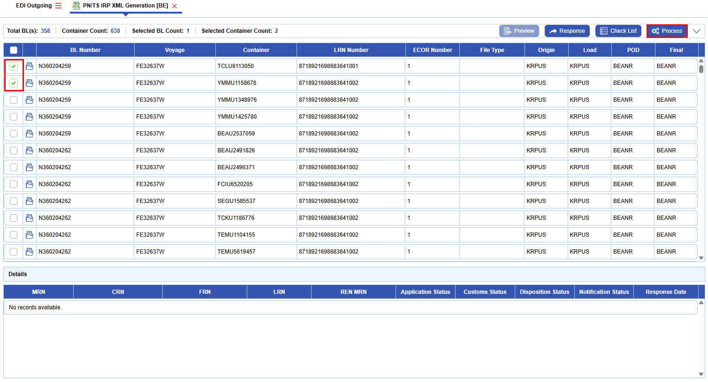
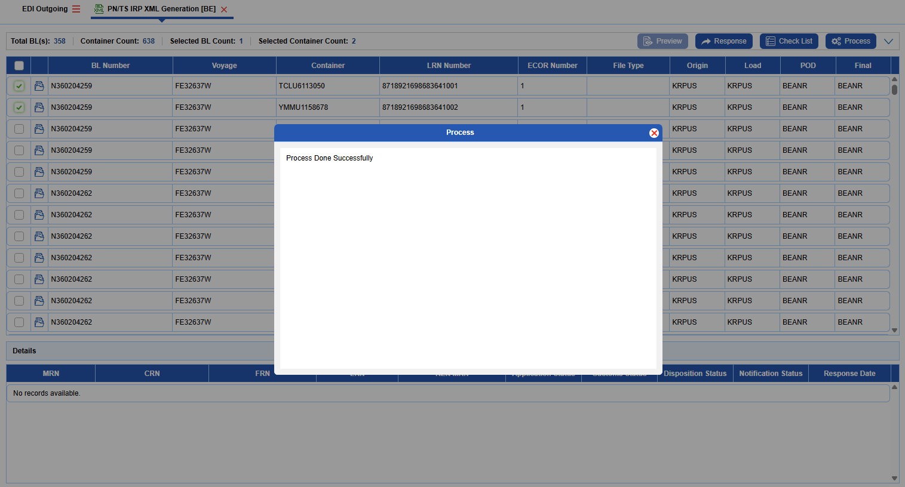
