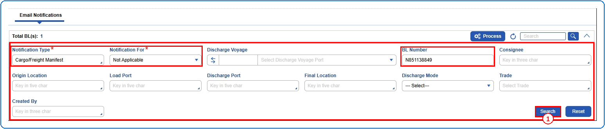
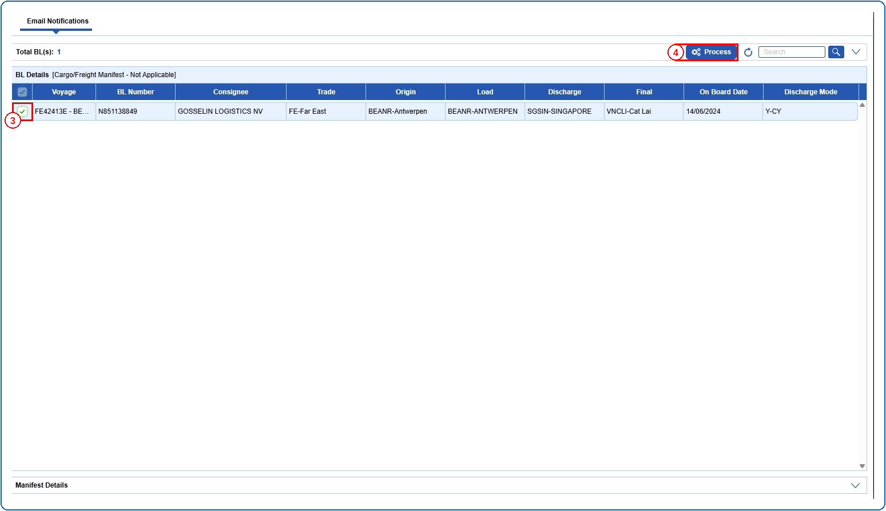
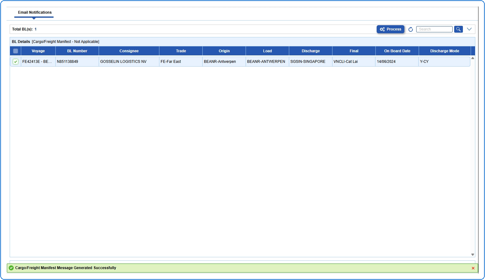

## Pre defined conditions

## Steps
**Step 1** : Enter the query fields with desirable input for querying data and click on {img:../img/btn_search_q.png}.

**Step 2** : Upon clicking {img:../img/btn_search_q.png}, BLs with matching information are returned.
**Step 3** : Select the required BL by clicking on {img:../img/cb_single_select.png}(single select checkbox).
**Step 4** : Click on {img:../img/btn_process.png}.

If successfully processed, a success message is shown as given below.

