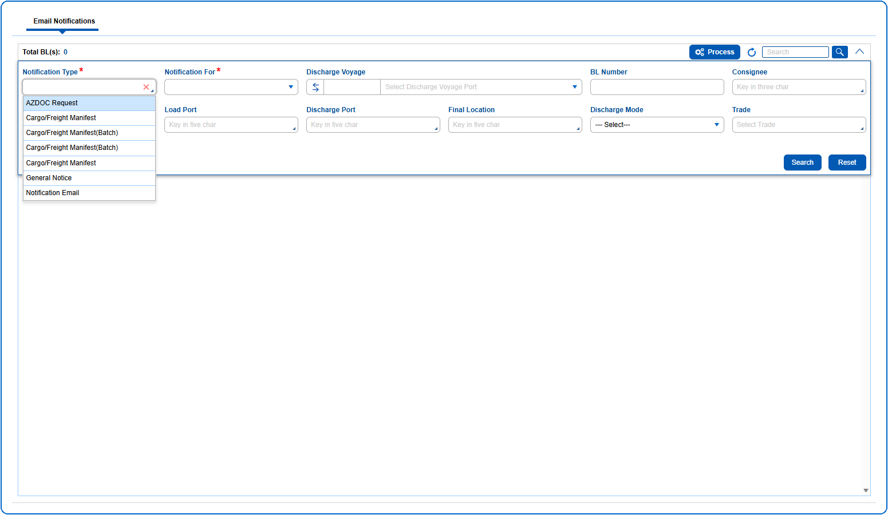

1. The query section can be expanded or collapsed by clicking on {img:../img/icon_collapse.png}
2. The User can search BLs using the Query Parameters like Notification Type (This is a mandatory query field), Notification For (This is a mandatory query field), Discharge Voyage, BL Number, Consignee, Load Port, Discharge Port, Final Location, Discharge Mode and Trade.

{img:../img/btn_search.png} Used to search the data based on the information entered in the query fields.
{img:../img/btn_reset.png} Used to clear the information entered in the query fields.
