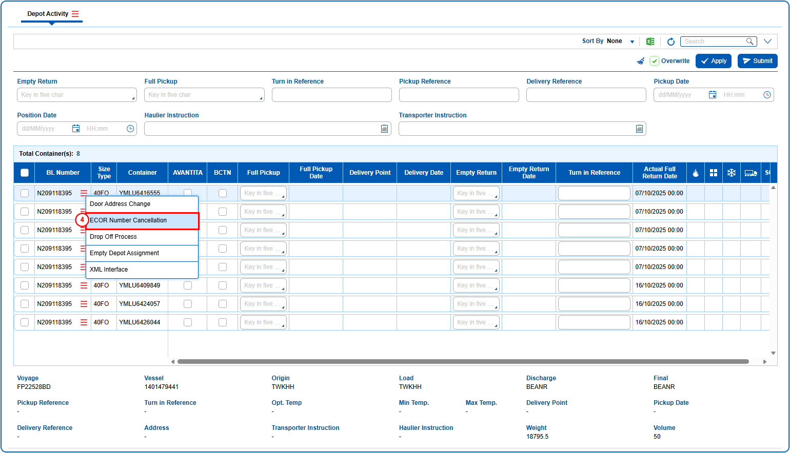
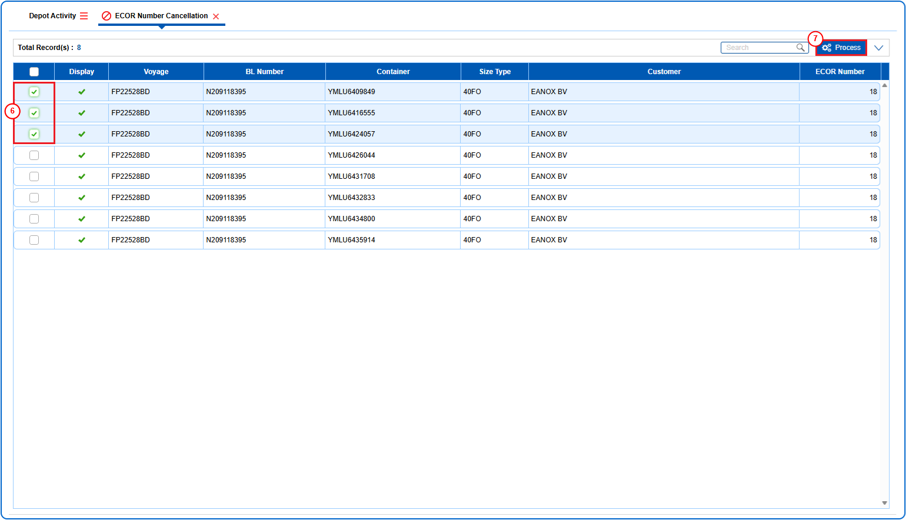
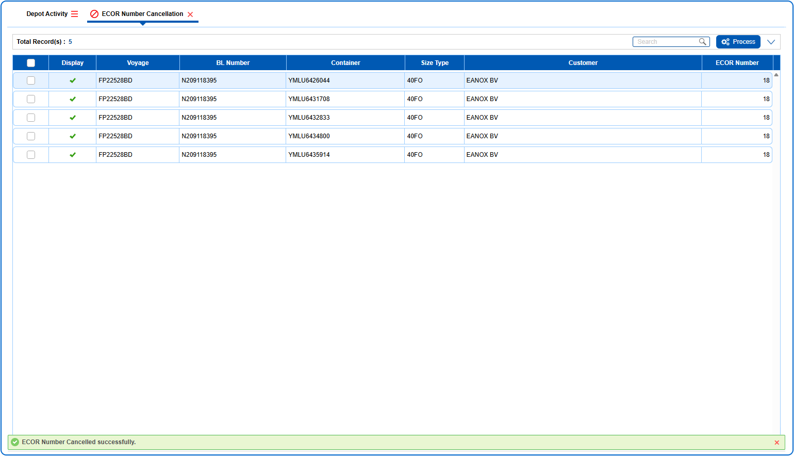
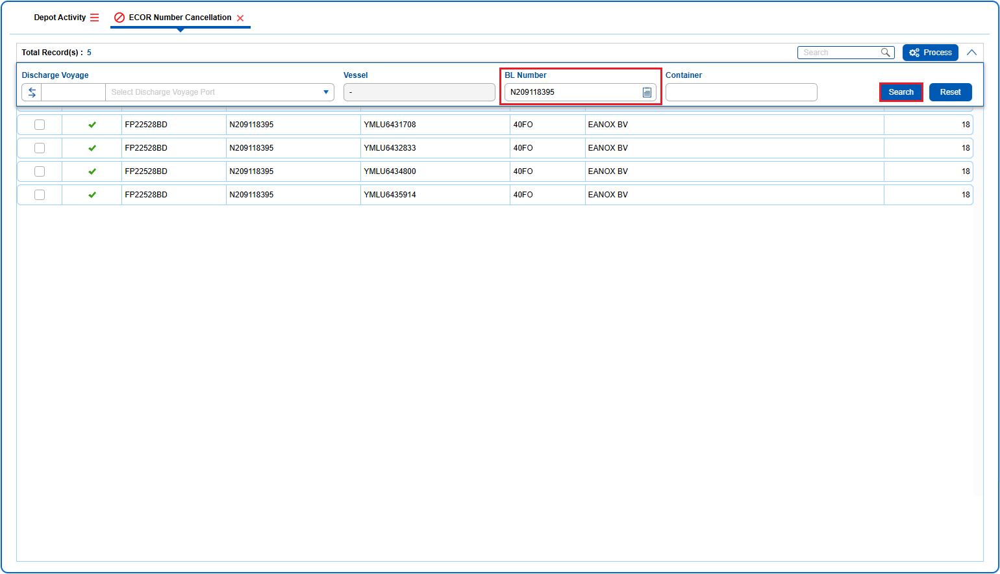
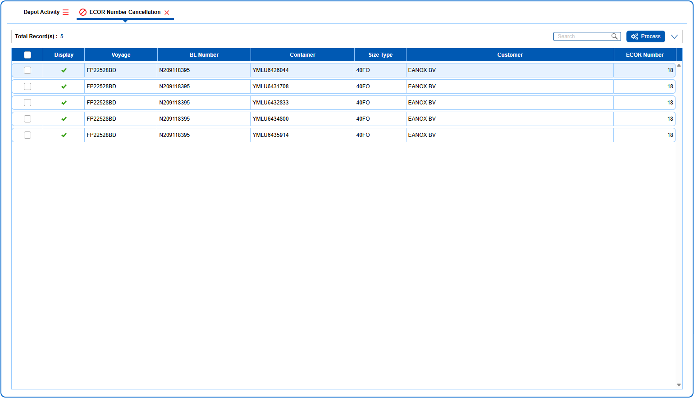

## Steps
**Step 1:** Enter the required query parameters in the search fields and click on {img:img/How_to_Cancel_ECOR_Number_01.png}.
**Step 2:** Upon clicking {img:img/How_to_Cancel_ECOR_Number_02.png}, BL records matching the entered criteria will be returned in the data grid.
**Step 3:** Once the data is queried, click on the {img:img/How_to_Cancel_ECOR_Number_03.png} icon given in desired BL record.
**Step 4:** From the menu, select **ECOR Number Cancellation** function from the menu. This will open the **ECOR Number Cancellation** screen.

**Step 5:** Upon clicking {img:img/How_to_Cancel_ECOR_Number_05.png}, records matching the entered criteria will be returned in the data grid.
**Step 6:** Select the desirable record(s) by either clicking on {img:img/How_to_Cancel_ECOR_Number_06.png} select all checkbox or {img:img/How_to_Cancel_ECOR_Number_07.png} individual selection checkbox of the respective records.
**Step 7:** Click on {img:img/How_to_Cancel_ECOR_Number_08.png}.

If cancelled successfully, the cancelled records are removed and a success message is displayed.

@11 **Note:** Alternatively the user can filter out data using the query fields.

