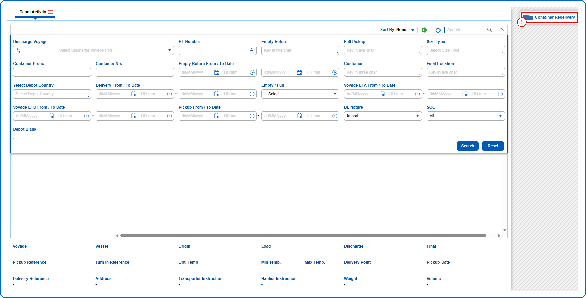
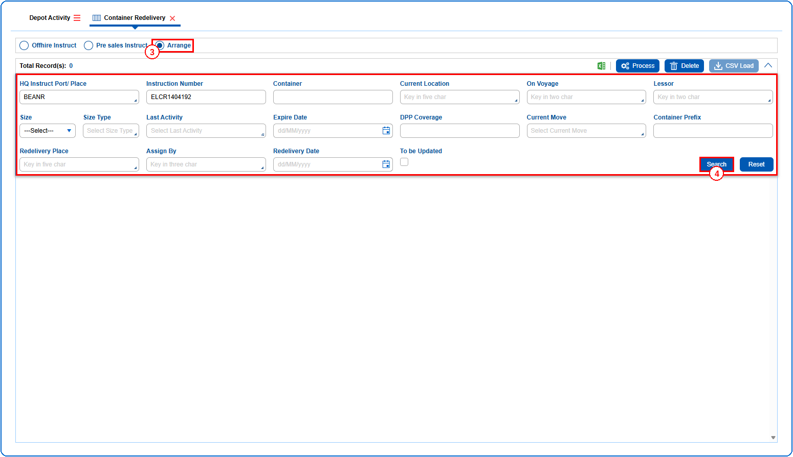
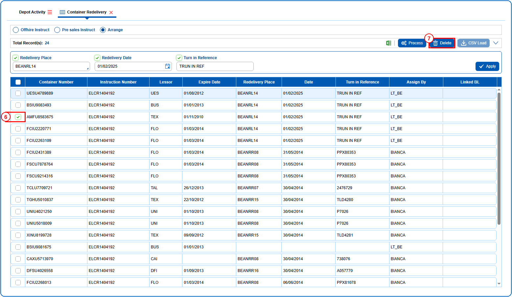
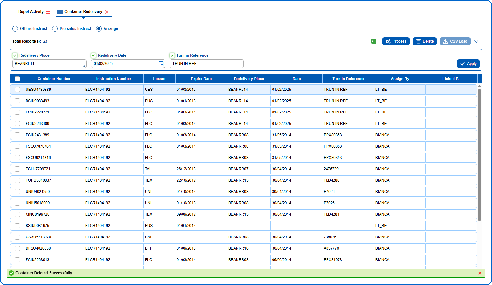

## Steps
**Step 1** : Click on the {img:../img/cr_icon_side.png} (Container Redelivery side icon) given on the right side of the Import Depot Activity screen.

**Step 2** : Upon clicking {img:../img/cr_icon_side.png}, User will be shown the Container Redelivery screen.
**Step 3** : Select the "**Arrange**" option.
**Step 4** : Enter the query fields with desirable input for querying data and click on {img:../img/cr_btn_search.png}.

**Step 5** : Upon clicking {img:../img/cr_btn_search.png}, containers with matching information are returned.
**Step 6** : Either select all containers available by clicking on {img:../img/cr_chk_all.png} or select individual containers by clicking on {img:../img/cr_chk_single.png}.
**Step 7** : Click on {img:../img/cr_btn_delete.png}.

If successfully deleted, a success message is shown as given below.

