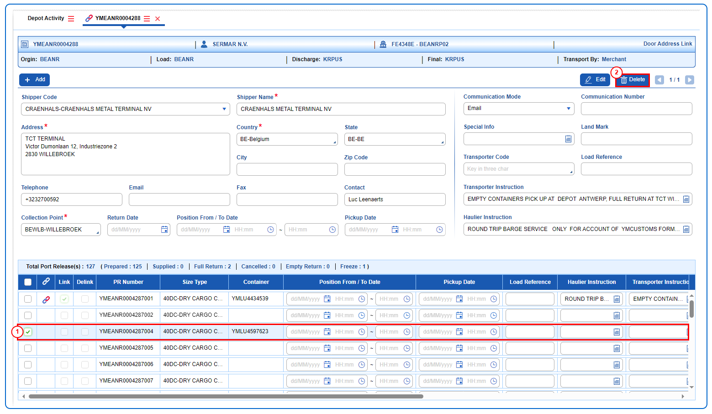
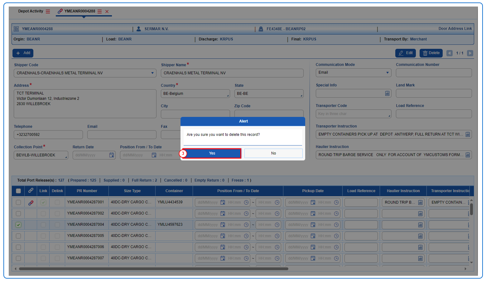
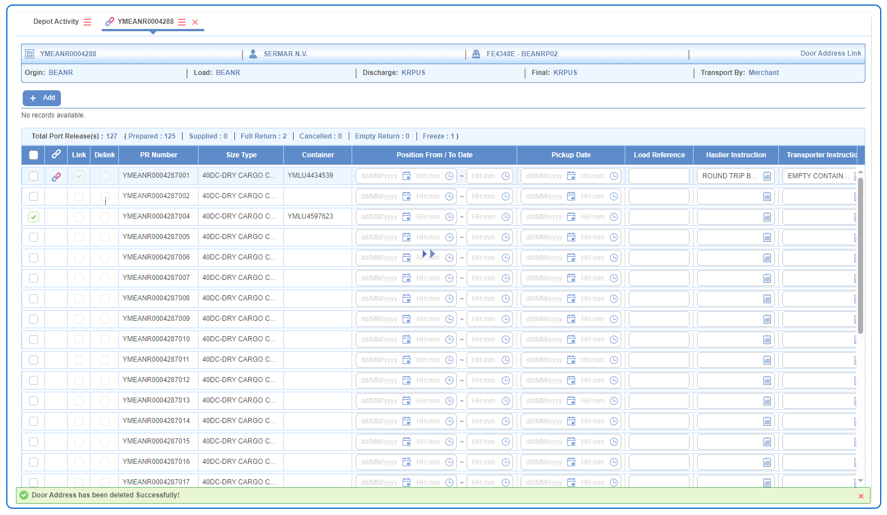

## Pre defined conditions

The Booking to be saved with one or more Requirement Details.
The Booking status be in Entered Status or Entry Complete Status.
The door address should be linked to PR

## Steps

**Step 1** : To delete a linked address, The user should select records by clicking on check boxes of respective records.
**Step 2** : Once the user has selected the records, the user should click on "**Delete**" button in door address link screen .

**Step 3** : On clicking "**Delete**" button, the user is shown a conformation alert in which the user should click "**Yes**".

If process is successful, a success message is shown as given below and the deleted record is removed.

