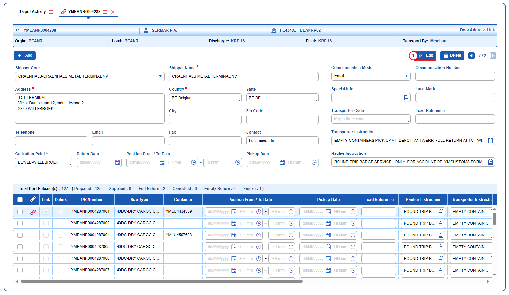
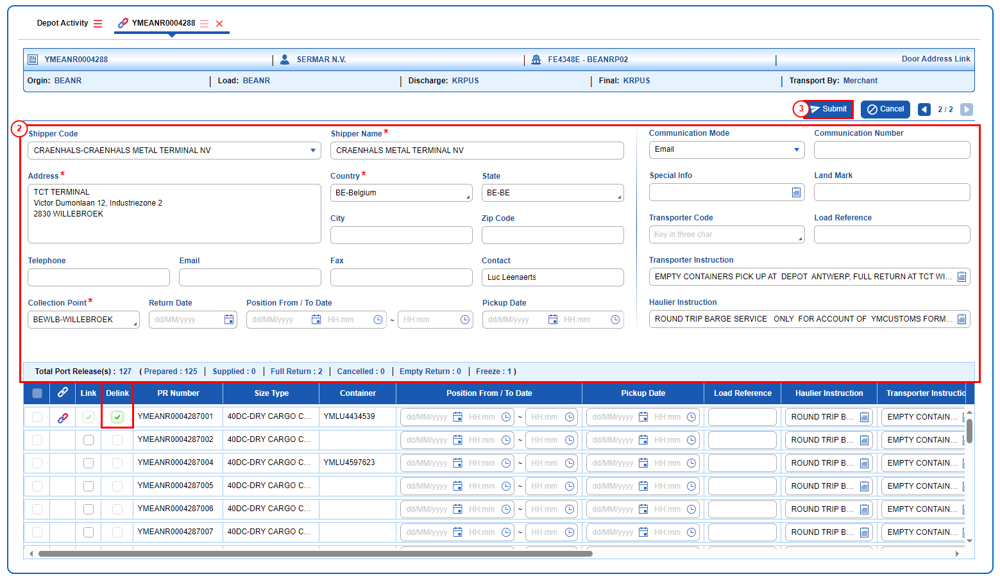
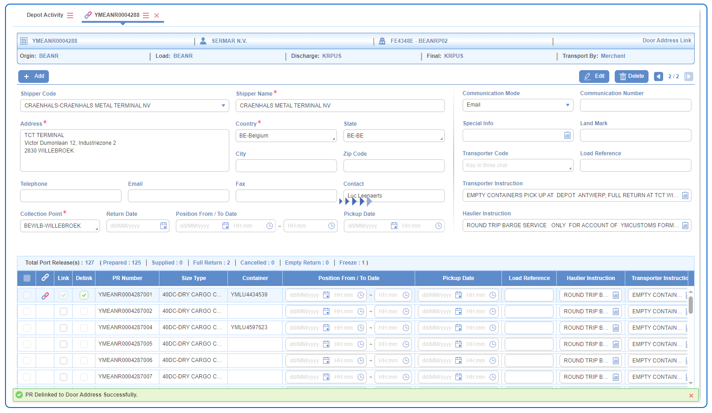
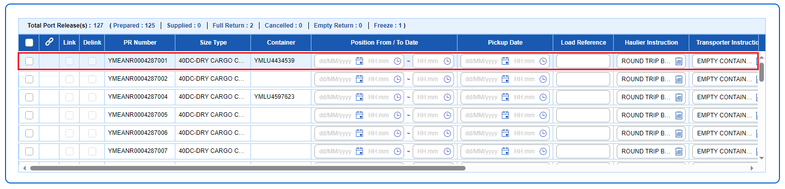

## Pre defined conditions

The Booking to be saved with one or more Requirement Details.
The Booking status be in Entered Status or Entry Complete Status.
Door address should be linked to PR number.

## Steps

**Step 1** : To delink a linked address, The user should click on "**Edit**" button in door address link screen .

**Step 2** : On clicking "**Edit**" button the delink column is enabled, the user can select required records (to be delinked) by clicking on checkboxes in delink column.
**Step 3** : Once the user has clicked the checkboxes, the user should click on "**Submit**" to delink Door Address.

If process is successful, a success message is shown and delink column is disabled and  {img:img/How_to_Delink_door_address_from_PR_03.png}  is removed indicating that the door address is delinked as given below.

