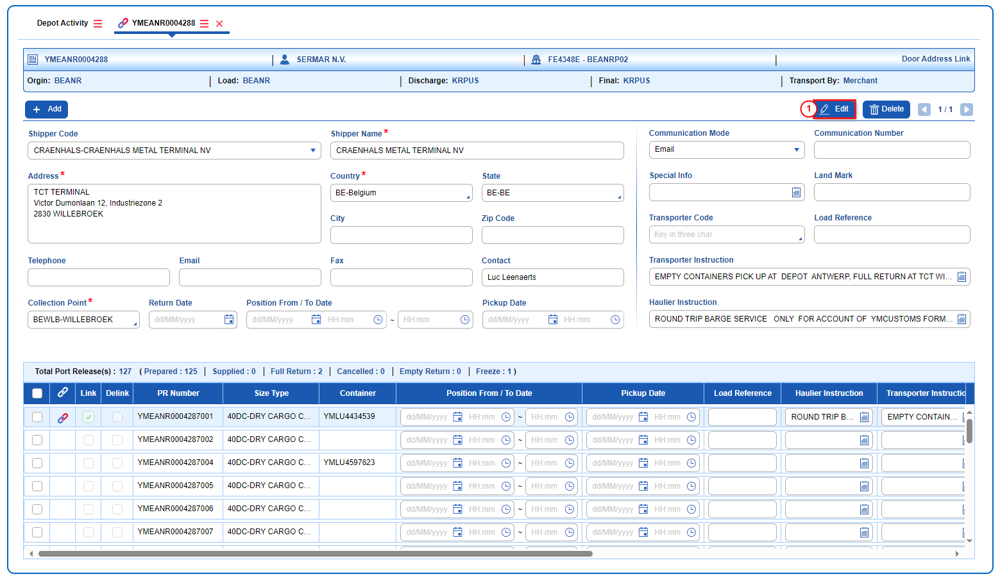
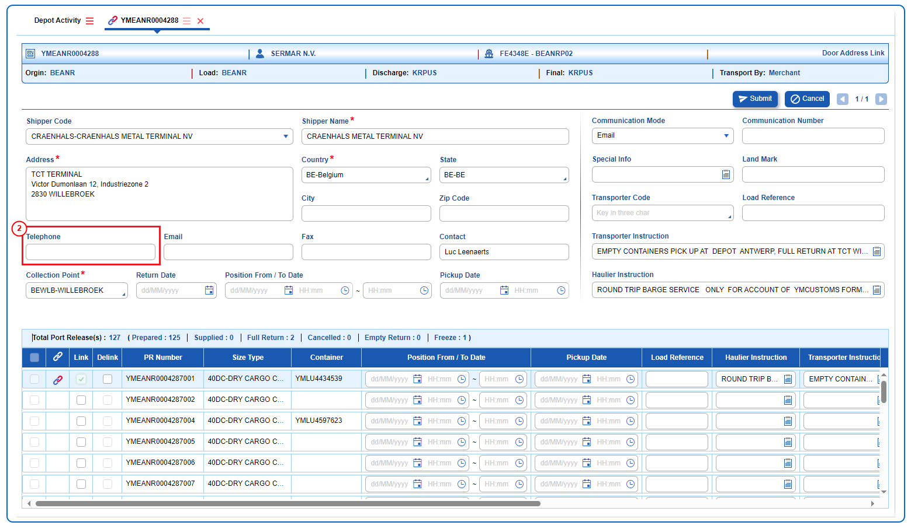
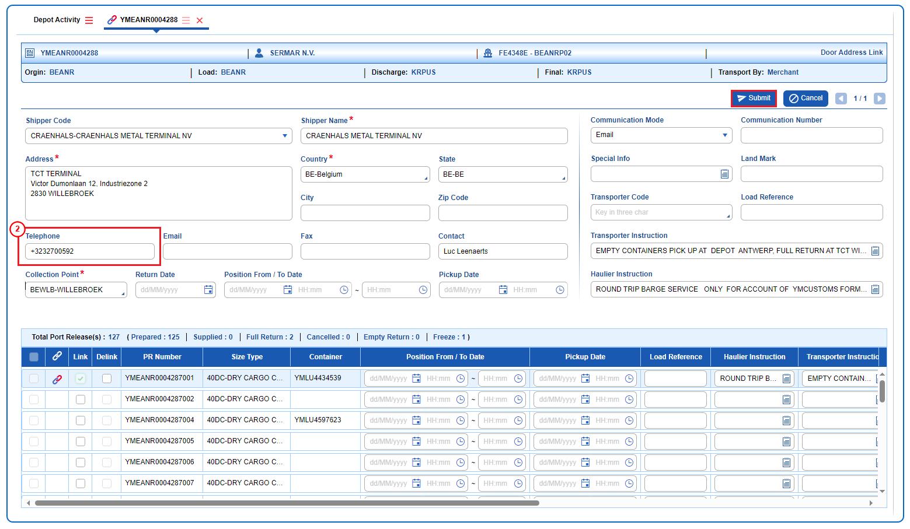
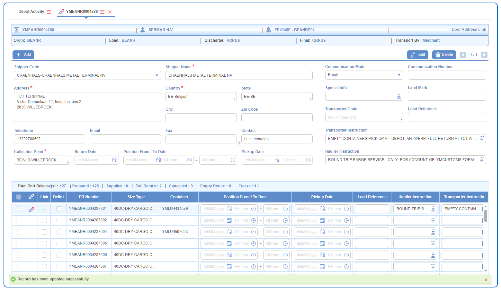

## Pre defined conditions

The Booking to be saved with one or more Requirement Details.
The Booking status be in Entered Status or Entry Complete Status.

## Steps

**Step 1** : To edit a linked address, The user should click on "**Edit**" button in door address link screen ..

**Step 2** : On clicking "**Edit**" button, the address fields are enabled for editing. The user can edit address fields as per requirement and click on submit.

If process is successful, a success message is shown as given below.

