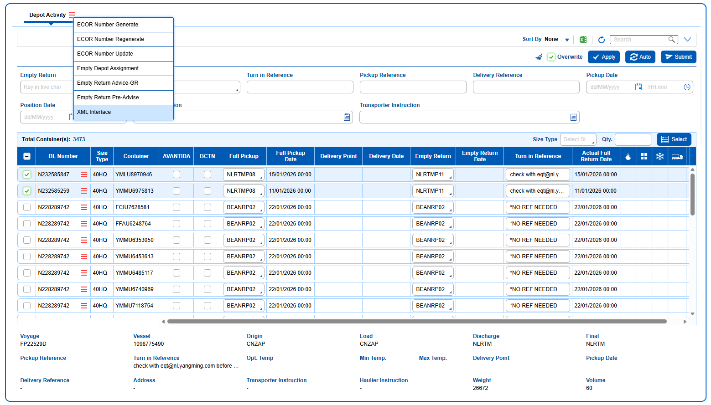
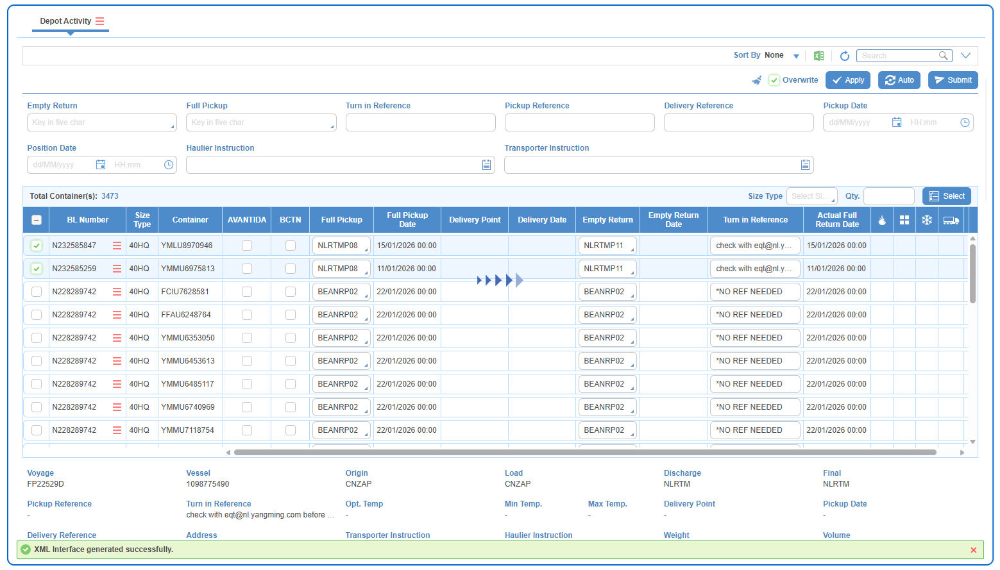

## Steps
**Step 1:** Enter the required query parameters in the search fields and click on {img:img/How_to_Generate_XML_Interface_01.png}.
**Step 2:** Upon clicking {img:img/How_to_Generate_XML_Interface_02.png}, BL records matching the entered criteria will be returned in the data grid.
**Step 3:** Select the desirable record(s) by either clicking on {img:img/How_to_Generate_XML_Interface_03.png} select all checkbox or {img:img/How_to_Generate_XML_Interface_04.png} individual selection individual selection checkbox of the respective BL.
**Step 4:** Click on the {img:img/How_to_Generate_XML_Interface_05.png} icon (Voyage level) and then select **XML Interface** function from the menu.

If process is successful, a success message is shown as given below.

