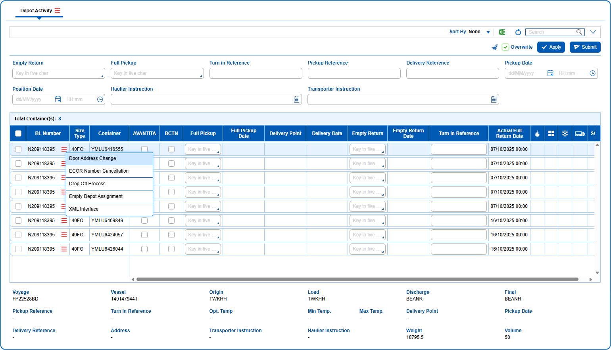
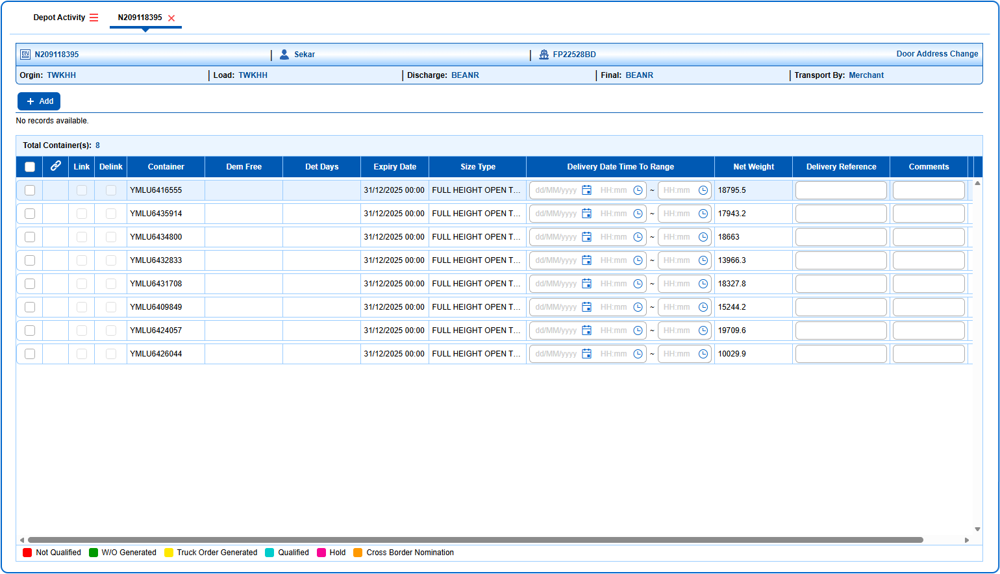
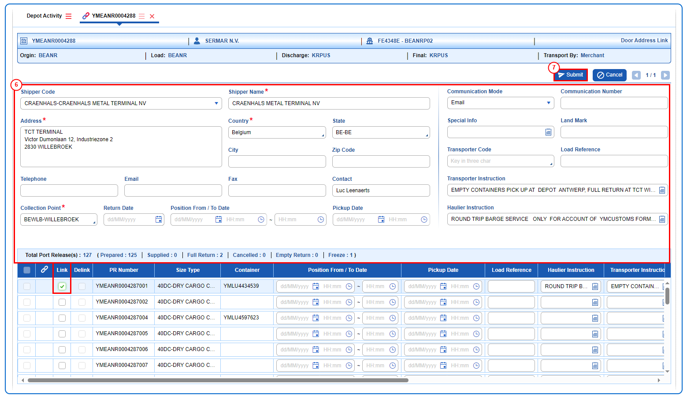
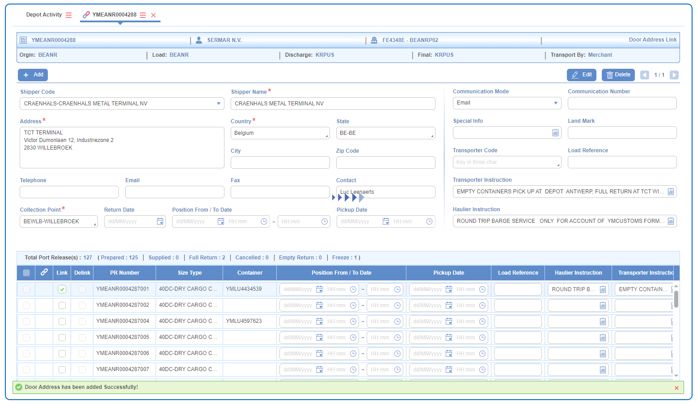
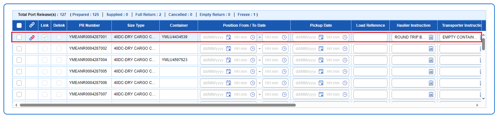

## Pre defined conditions

The Booking to be saved with one or more Requirement Details.
The Booking status be in Entered Status or Entry Complete Status.
@11 When config ADDRESS_LINK_FOR_NON_DOOR_REQ is set as Y then Valid PR with status other than cancelled should exist
@11 When config ADDRESS_LINK_FOR_NON_DOOR_REQ is set as N then Valid PR with status other than cancelled should exist and also Transport by to be C - Carrier

## Steps

## Steps
**Step 1:** Enter the required query parameters in the search fields and click on {img:img/How_to_Link_door_address_to_PR_01.png}.
**Step 2:** Upon clicking {img:img/How_to_Link_door_address_to_PR_02.png}, BL records matching the entered criteria will be returned in the data grid.
**Step 3:** Once the data is queried, click on the {img:img/How_to_Link_door_address_to_PR_03.png} icon given in desired BL record.
**Step 4:** From the menu, select **Door Address Link** function from the menu. This will open the **Door Address Link** screen.

**Step 5** : If data is queried, click on "**Add**" button. This will display Address fields.

**Step 6** : Enter necessary details in the fields and select required records (to be linked) by clicking on checkboxes in Link column.
**Step 7** : After Selection, the user should click on "**Submit**" to link Door Address to PR Number.

If process is successful, a success message is shown and link column is disabled and  {img:img/How_to_Link_door_address_to_PR_07.png}  is shown indicating that the door address is linked as given below.

