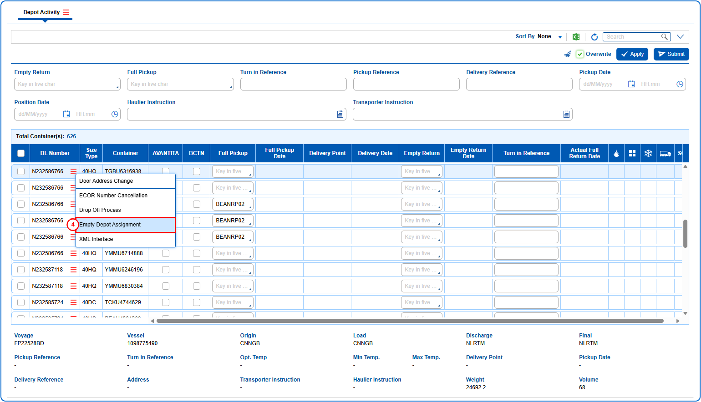
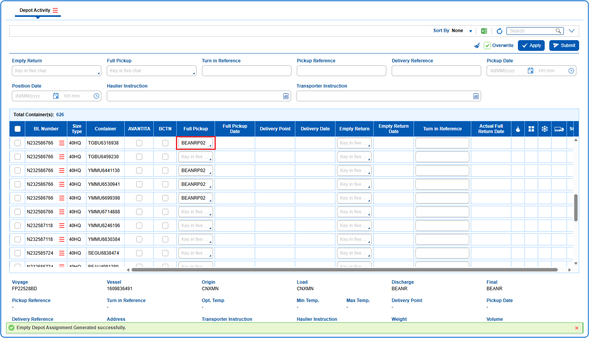

## Pre defined conditions

@11 Selected container should not be in Prepared, Cancelled or Freeze status.

## Steps
**Step 1:** Enter the required query parameters in the search fields and click on {img:img/How_to_process_Empty_Depot_Assignment_2_01.png}.
**Step 2:** Upon clicking {img:img/How_to_process_Empty_Depot_Assignment_2_02.png}, BL records matching the entered criteria will be returned in the data grid.
**Step 3:** Once the data is queried, click on the {img:img/How_to_process_Empty_Depot_Assignment_2_03.png} icon given in desired BL record.
**Step 4:** From the menu, select **Empty Depot Assignment** function from the menu. This will open the **Empty Depot Assignment** screen.

If process is successful, a success message is shown as given below and the records will be updated on the basis of Empty Pickup and Return setup.
>> 
