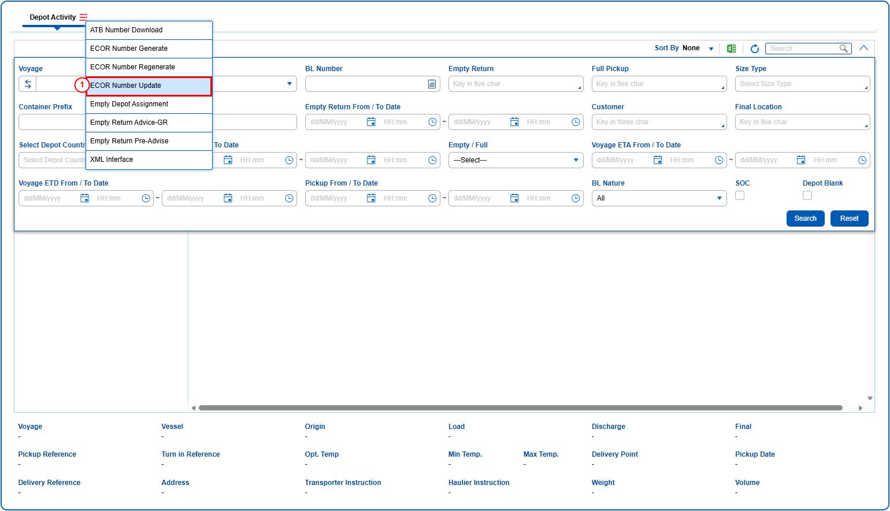
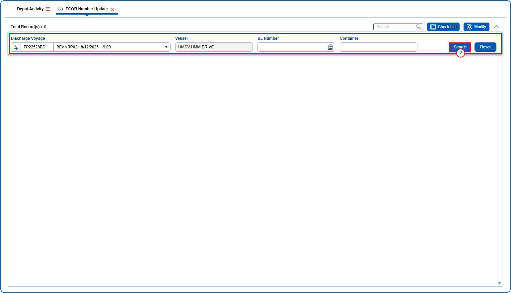
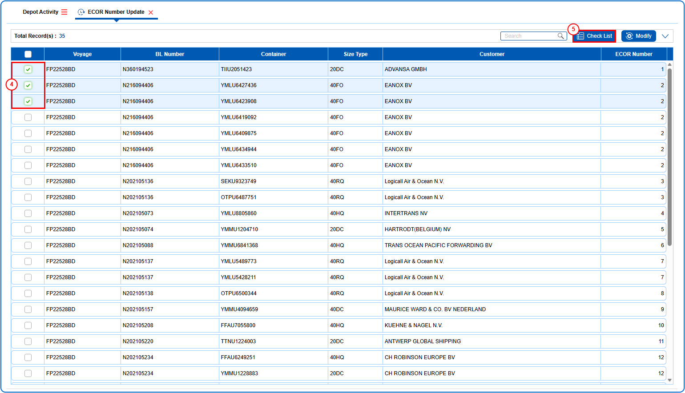
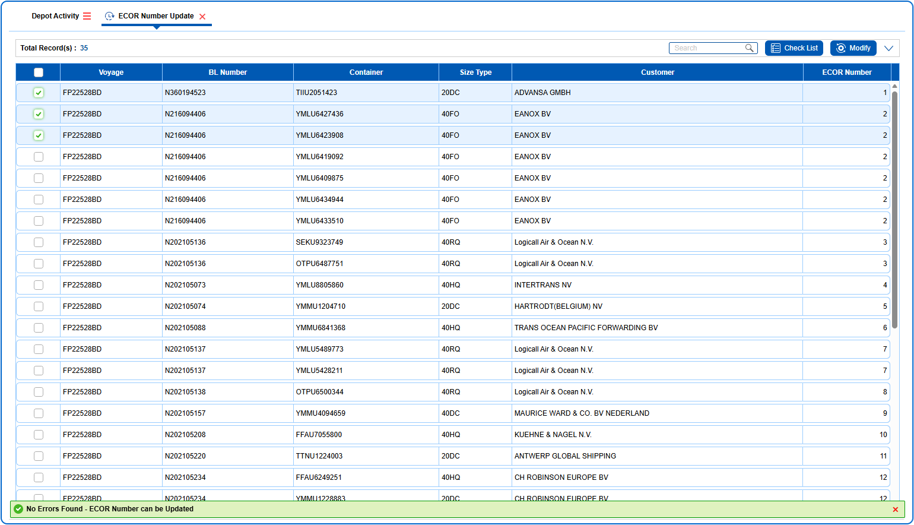
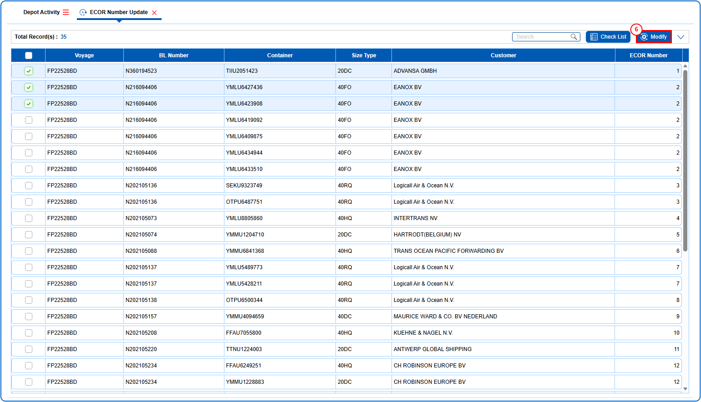
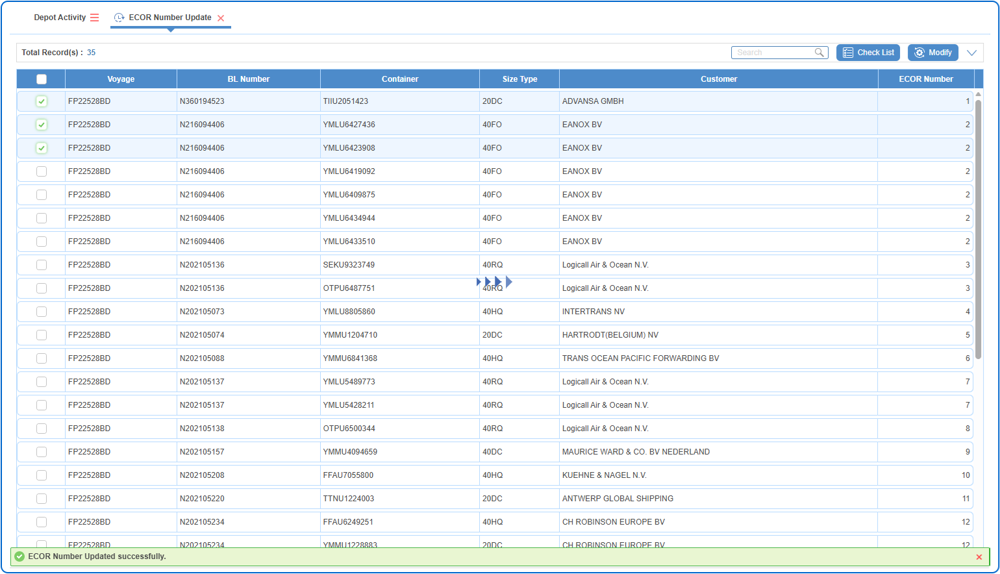

## Steps
**Step 1:** Click on the {img:img/How_to_update_ECOR_Number_01.png} icon (Voyage level) and select **ECOR Number Update** function from the menu. This will open the ECOR Number Update screen.

**Step 2:** In the ECOR Number Update query screen, Enter the required query parameters in the search fields and click on {img:img/How_to_update_ECOR_Number_03.png}.

**Step 3:** Upon clicking {img:img/How_to_update_ECOR_Number_05.png}, records matching the entered criteria will be returned in the data grid.
**Step 4:** Select the desirable record(s) by either clicking on {img:img/How_to_update_ECOR_Number_06.png} select all checkbox or {img:img/How_to_update_ECOR_Number_07.png} individual selection checkbox of the respective records.
**Step 5:** Click on {img:img/How_to_update_ECOR_Number_08.png}.

If Checklist is processed without errors, a success message is displayed.

Step 6: Click on {img:img/How_to_update_ECOR_Number_11.png}.

If Updated successfully, a success message is displayed.
>> 
