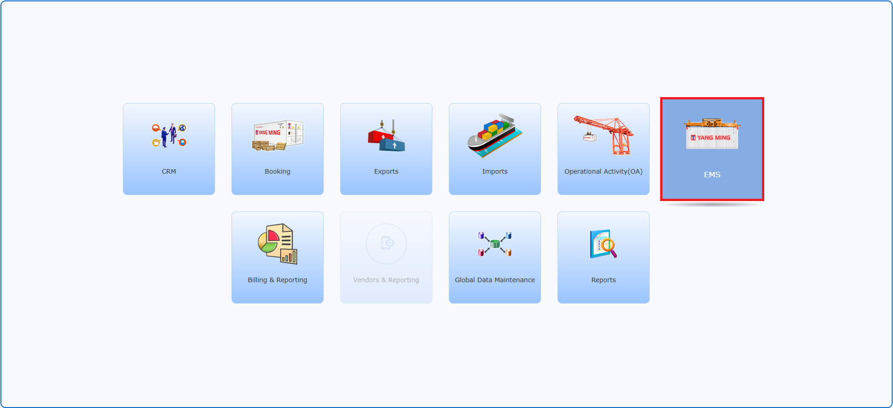
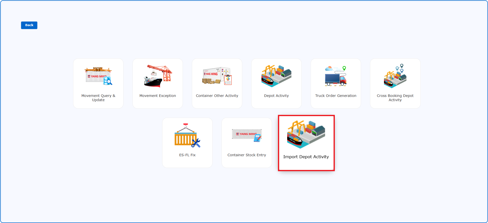
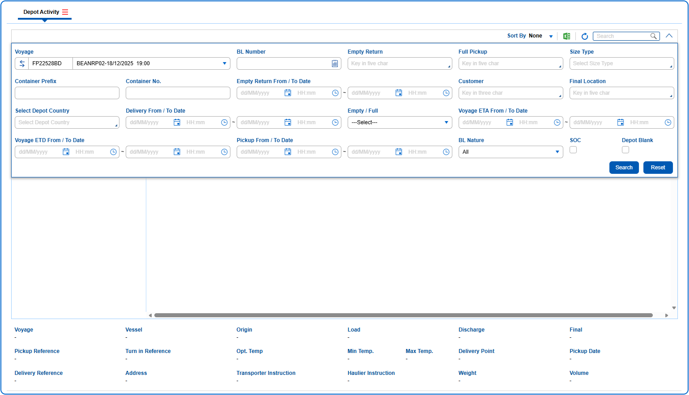
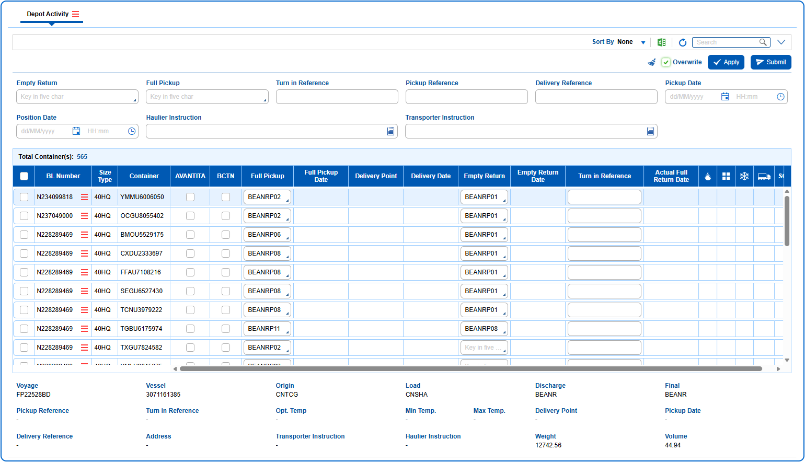

@11 The Import Depot Activity screen is used to:
1. @11 Manage container depot operations.
1. @11 Assign Full Pickup and Empty Return depots.
1. @11 Enter operational references (Pickup, Turn-in, Delivery).
1. @11 Record depot movement dates.
1. @11 Trigger depot-related processes (ECOR, Drop-off, Assignment, etc.).
1. @11 Track container status at discharge port.
1. @11 Supports other post-discharge container movement control and depot coordination.
1.

