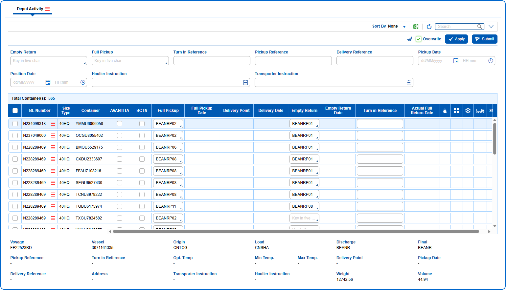
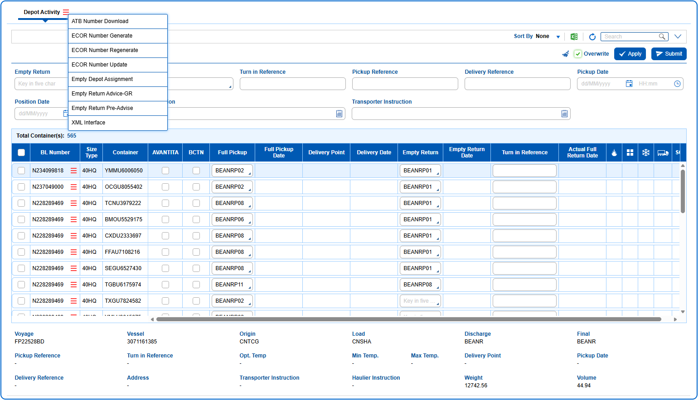
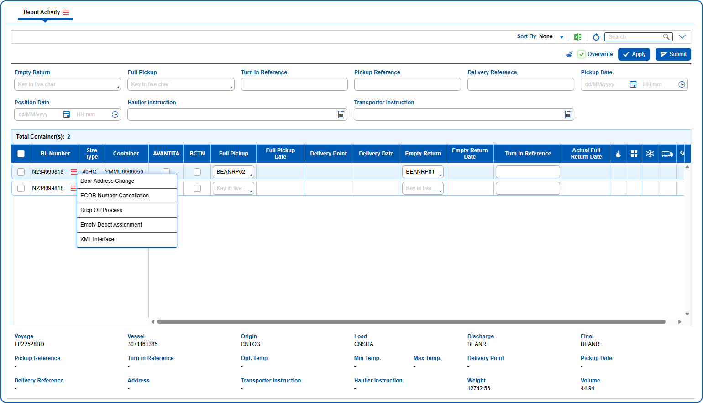

@11 Data screen is used to view the results gathered from querying using depot activity query fields. Apart from this the screen gives access to all the voyage level and BL level functions that can be processed on the retrieved BLs

Depot Activity has the following **Group Functions**.
1.
    1. ATB Number Download
    1. ECOR Number Generate
    1. ECOR Number Regenerate
    1. ECOR Number Update
    1. Empty Depot Assignment
    1. Empty Return Advice-GR
    1. Empty Return Pre-Advise
    1. XML Interface

Depot Activity has the following **Single Functions**.

1. Door Address Change
1. ECOR Number Cancellation
1. Drop Off Process
1. Empty Depot Assignment
1. XML Interface
1.

