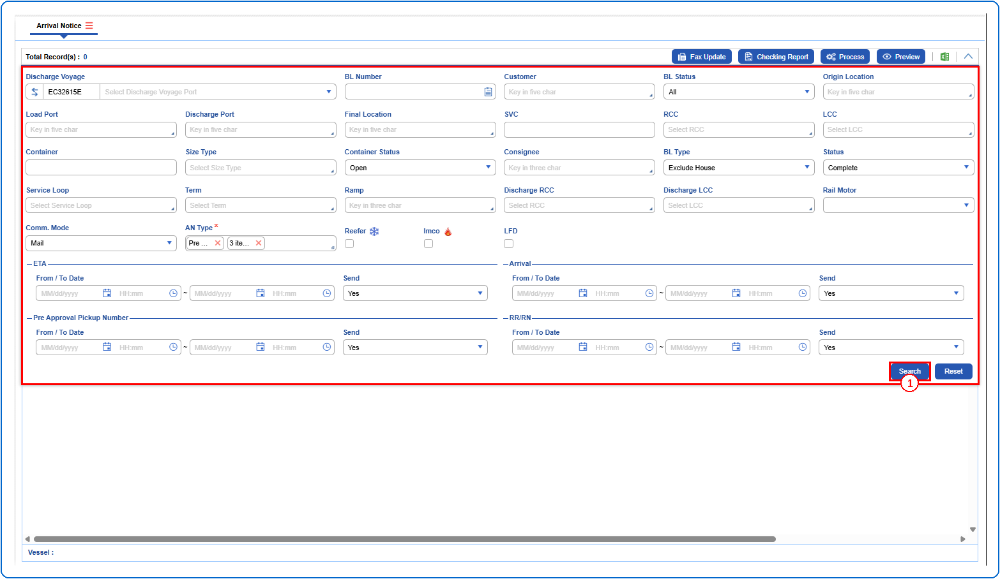
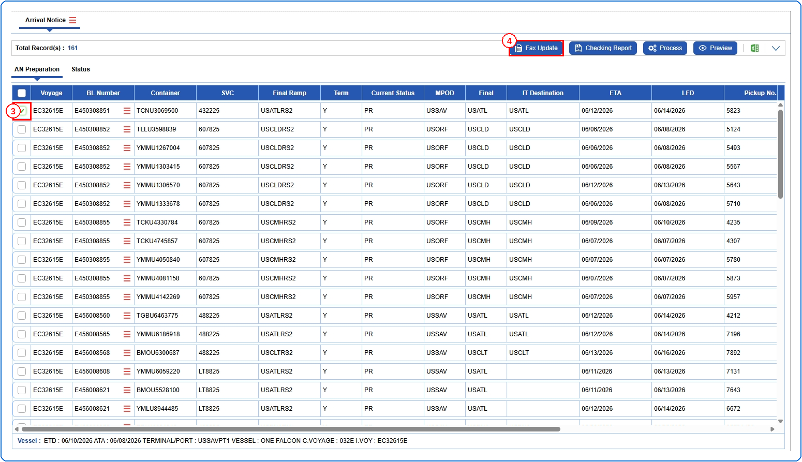
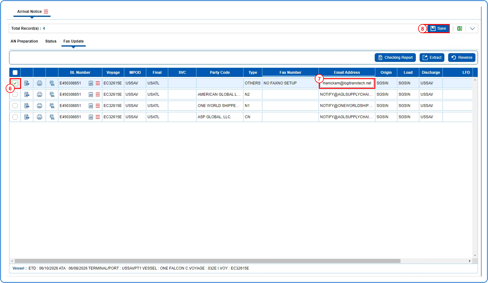
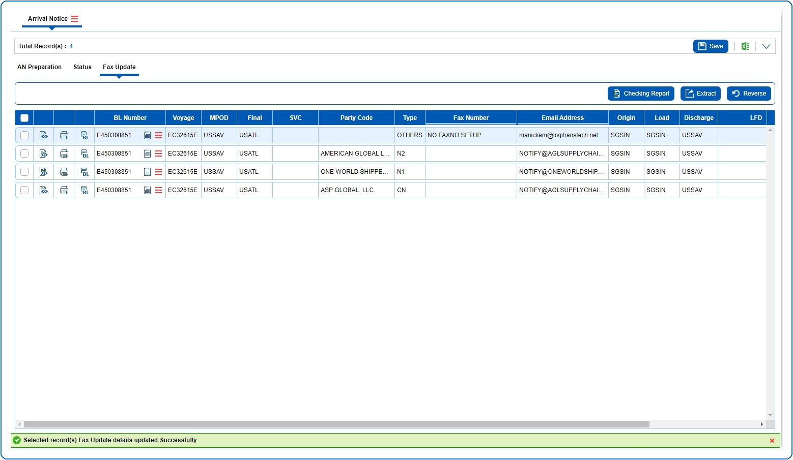

## Steps
**Step 1** : Enter the query fields with desirable input for querying data and click on {img:../img/btn_search_q.png}.

**Step 2** : Upon clicking {img:../img/btn_search_q.png}, records with matching information are returned.
**Step 3** : Either select all records available by clicking on {img:../img/cb_select_all.png}(select all checkbox) or select individual records by clicking on {img:../img/cb_single_select.png}(single select checkbox).
**Step 4** : Click on {img:../img/btn_fax_update.png}.

**Step 5** : Upon clicking {img:../img/btn_fax_update.png}, User will be shown the Fax Update screen.
**Step 6** : Either select all records available by clicking on {img:../img/cb_select_all_es.png}(select all checkbox) or select individual records by clicking on {img:../img/cb_single_select_es.png}(single select checkbox).
**Step 7** : Enter the "**Email Address**" as given below.
**Step 8** : Click on {img:../img/btn_save.png}.

If successfully saved, a success message is shown as given below.

