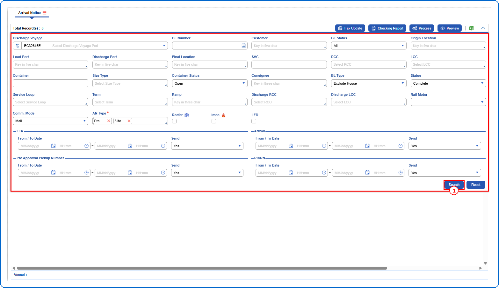
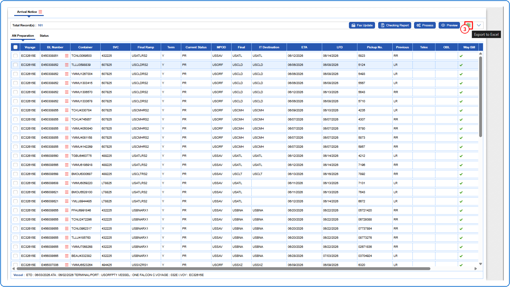
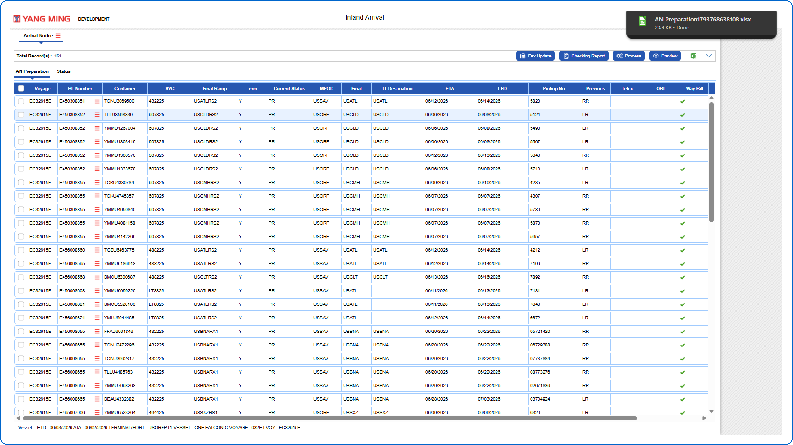
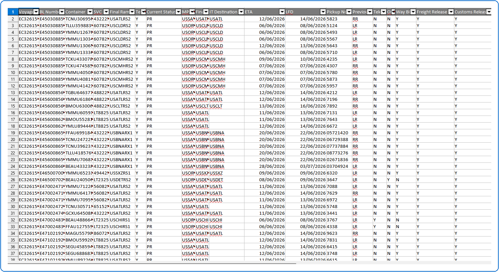

## Steps
**Step 1** : Enter the query fields with desirable input for querying data and click on {img:../img/btn_search_q.png}.

**Step 2** : Upon clicking {img:../img/btn_search_q.png}, records with matching information are returned.
**Step 3** : Click on {img:../img/btn_excel.png}(Export to Excel icon).

On clicking {img:../img/btn_excel.png}, the excel file is downloaded as given below.

The downloaded excel file is displayed as given below.

