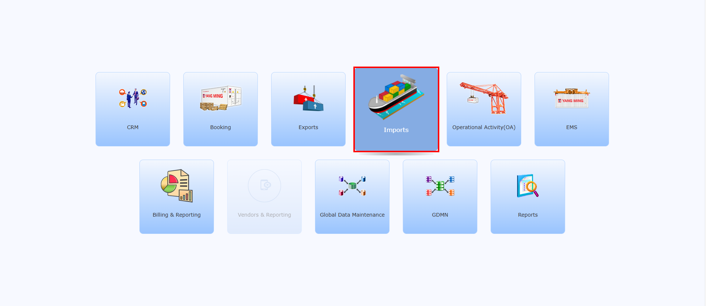
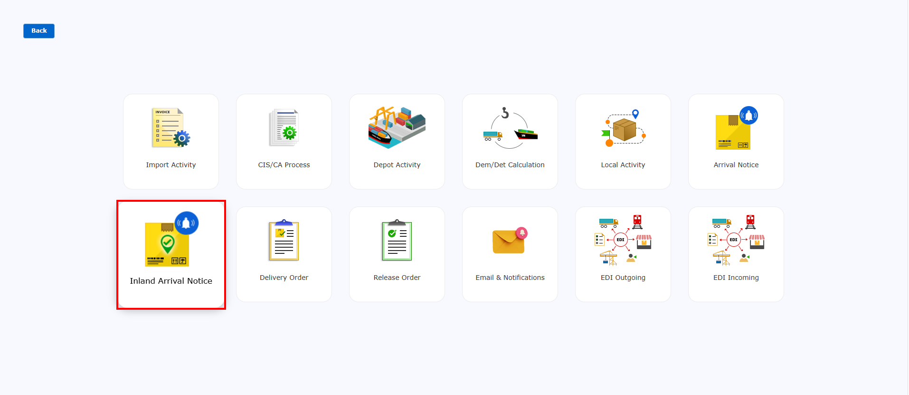
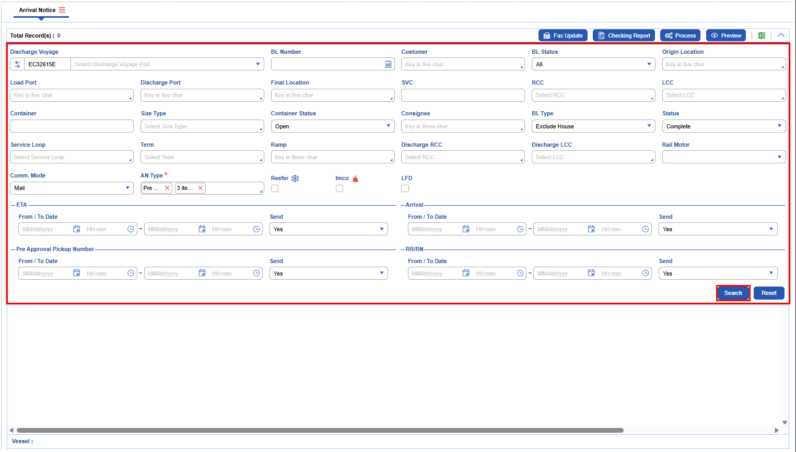
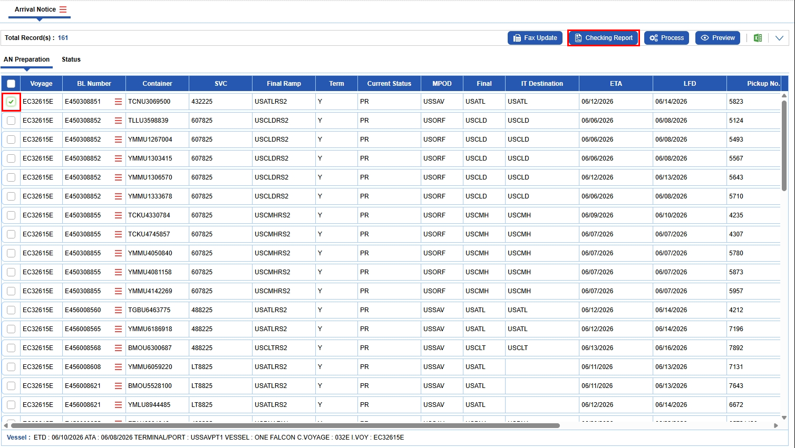
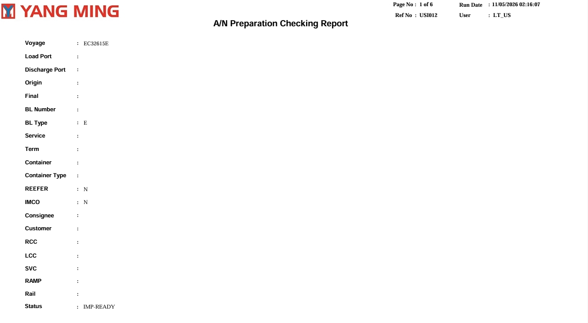

Checking Report is used to cross-verify the details of the current search for data accuracy.

**Afsys**

>> {img:../img/afsys_fu_01_main.png}
>> {img:../img/afsys_fu_02_inland_arrival.png}
>> {img:../img/afsys_fu_03_query.png}
>> {img:../img/afsys_fu_04_result.png}
>> {img:../img/afsys_cr_05_select_checking_report.png}
>> {img:../img/afsys_cr_06_report.png}
>> {img:../img/afsys_cr_07_report_page2.png}

**ILISCyber**

