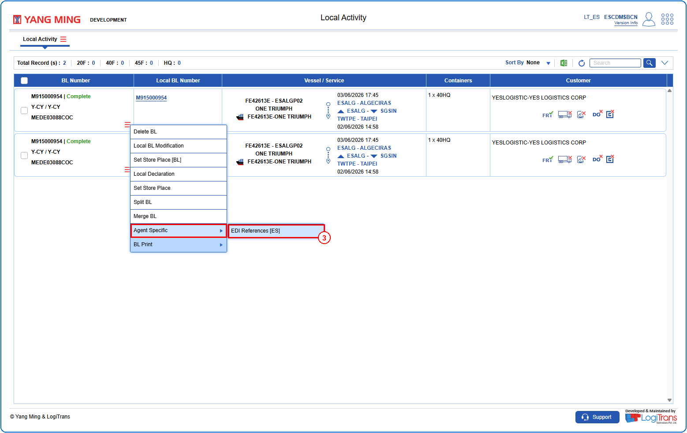
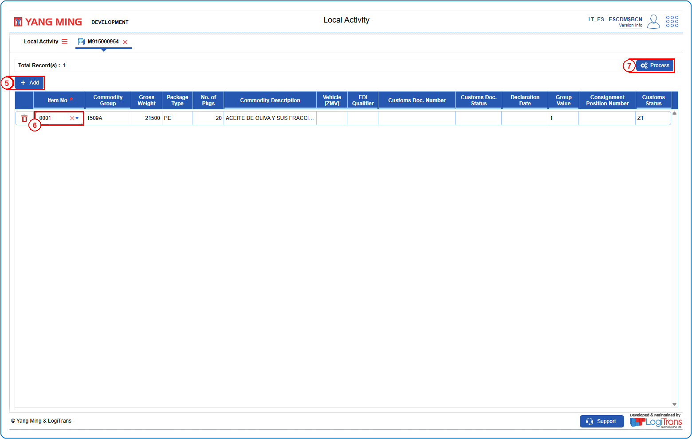
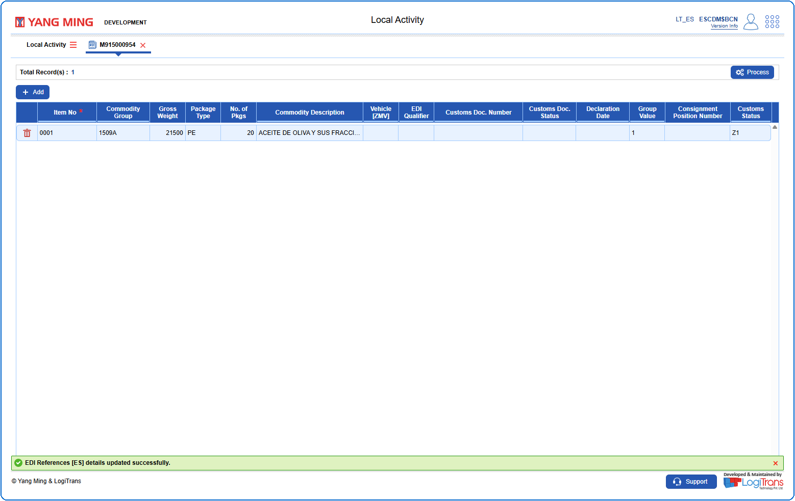

## Steps
**Step 1** : Enter the query fields with desirable input for querying data and click on {img:../img/btn_search.png}.
**Step 2** : Upon clicking {img:../img/btn_search.png}, BLs with matching information are returned.
**Step 3** : The user should drag the cursor to the record menu icon {icon:record_menu} in the respective record, click on it, and then select "**Agent Specific**" >> "**EDI References [ES]**" from the menu.

**Step 4** : Upon clicking "**EDI References [ES]**" User will be shown the EDI References [ES] screen.
**Step 5** : Click on {img:../img/btn_add.png} to add a new row.
**Step 6** : Choose the Item number from the "**Item No.**" drop down; based on the Item No. chosen the rest of the fields are autopopulated. This field is mandatory.
**Step 7** : Click on {img:../img/btn_process.png}.

If successfully processed, a success message is shown as given below.

