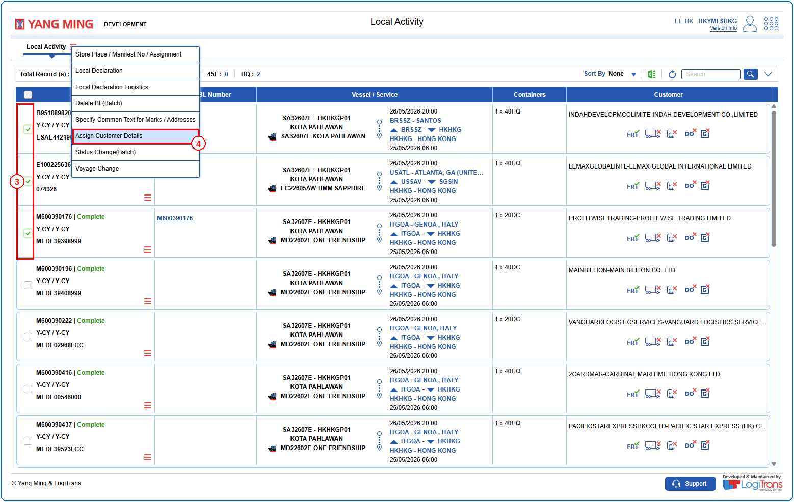
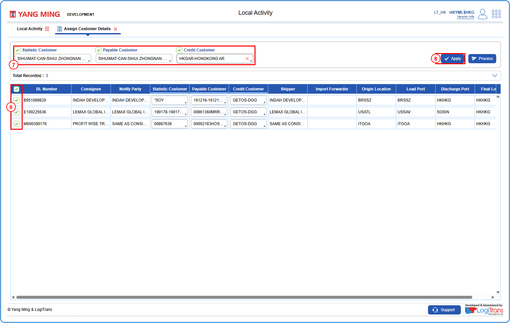
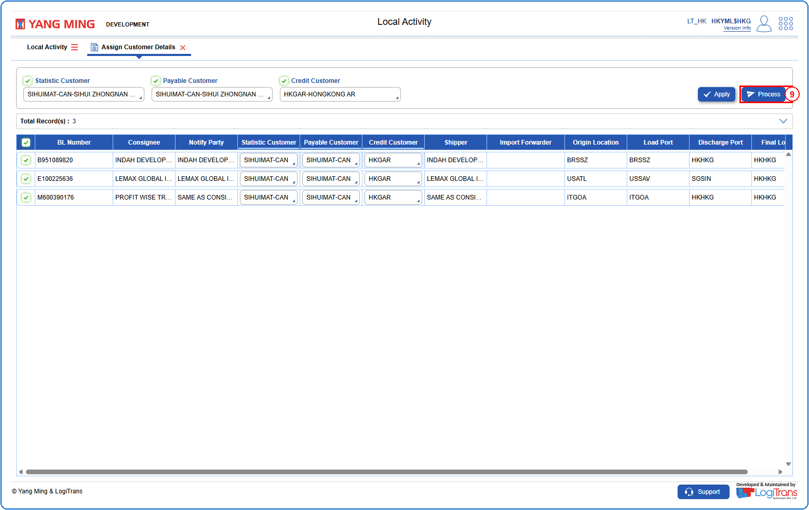
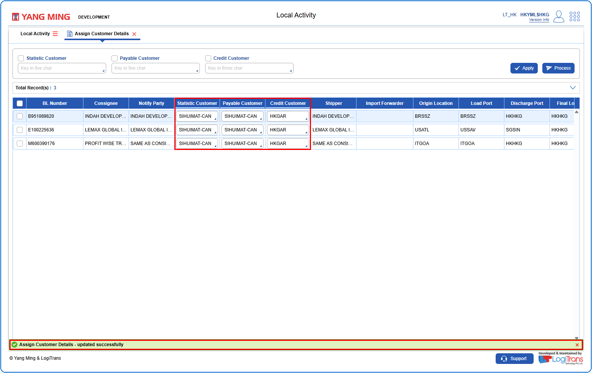

## Steps
**Step 1** : Enter the query fields with desirable input for querying data and click on {img:../img/btn_search.png}.
**Step 2** : Upon clicking {img:../img/btn_search.png}, BLs with matching information are returned.
**Step 3** : Either select all records available by clicking on {icon:select_all} or select individual records by clicking on {icon:single_select}.
**Step 4** : The user should drag the cursor to the batch function menu icon {icon:batch_menu}, click on it, and then select "**Assign Customer Details**" from the menu.

**Step 5** : Upon clicking "**Assign Customer Details**" User will be shown the Assign Customer Details screen.
**Step 6** : Either select all records available by clicking on {img:../img/acd_select_all.png} or select individual records by clicking on {img:../img/acd_single_select.png}.
**Step 7** : Select the required customer fields and enter the data as shown below.
**Step 8** : Click on {img:../img/btn_apply.png}.

**Step 9** : Upon clicking {img:../img/btn_apply.png}, the entered customer details are applied to the selected records. Click on {img:../img/btn_process.png}.

If successfully processed, a success message is shown as given below and the "**Statistic Customer**", "**Payable Customer**" and "**Credit Customer**" are updated.

