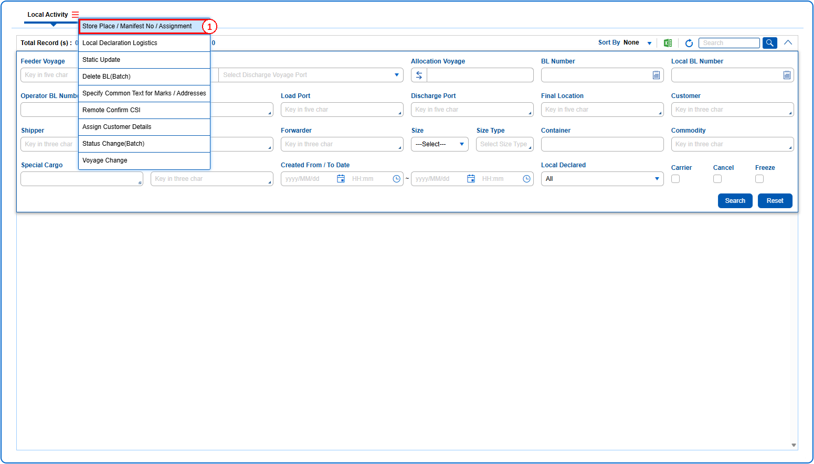
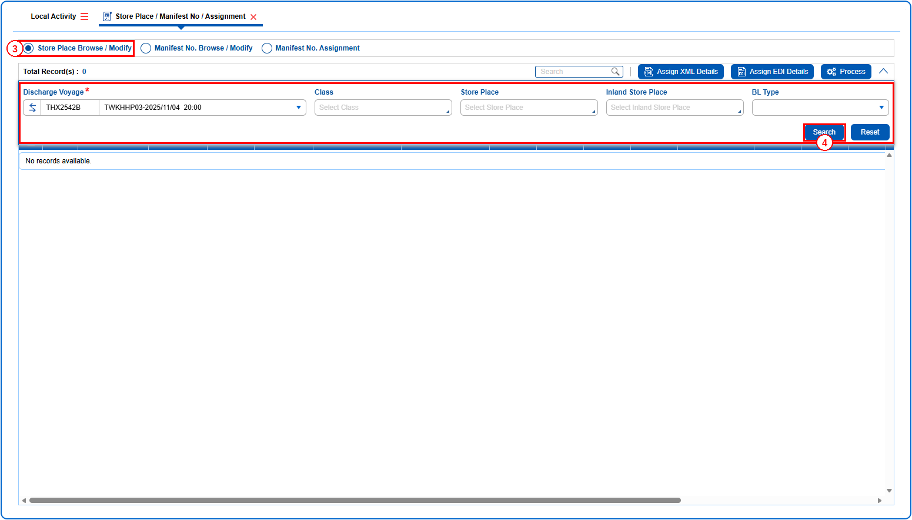
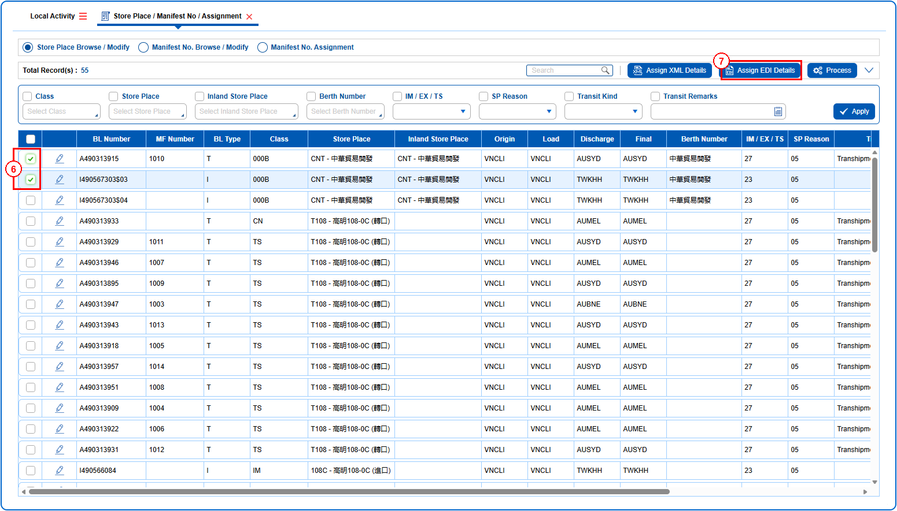
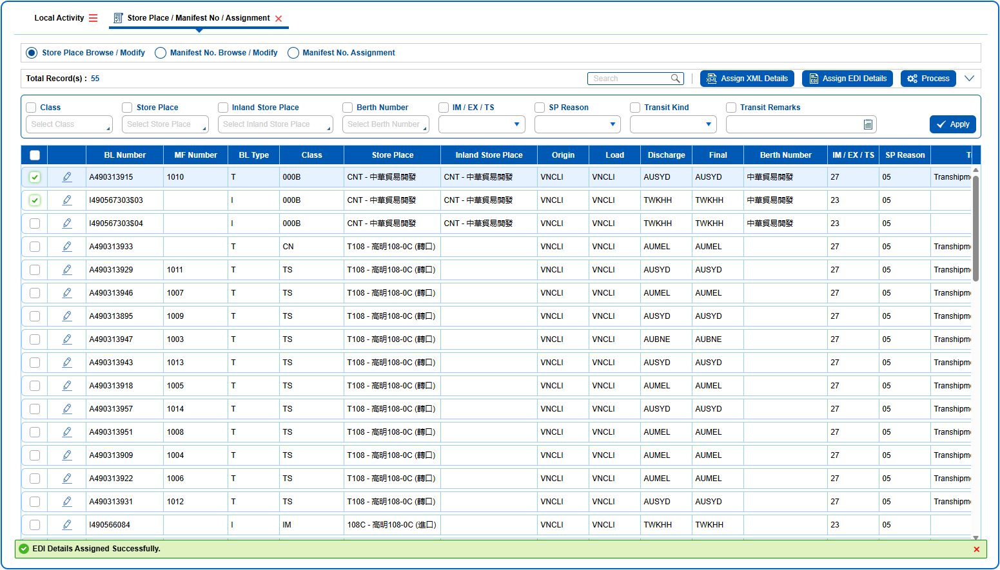

## Steps
**Step 1** : The user should drag the cursor to the batch function menu icon {icon:batch_menu}, click on it, and then select "**Store Place / Manifest No / Assignment**" from the menu.

**Step 2** : Upon clicking "**Store Place / Manifest No / Assignment**" User will be shown the Store Place / Manifest No / Assignment screen.
**Step 3** : Select the {img:../img/How_to_Assign_EDI_Details_03.png} radio button.
**Step 4** : Enter the query fields with desirable input for querying data and click on {img:../img/btn_search.png}.

**Step 5** : Upon clicking {img:../img/btn_search.png}, BLs with matching information are returned.
**Step 6** : Either select all BLs available by clicking on {img:../img/How_to_Assign_EDI_Details_06.png} or select individual BLs by clicking on {img:../img/How_to_Assign_EDI_Details_07.png}.
**Step 7** : Click on {img:../img/How_to_Assign_EDI_Details_08.png}.

If successfully assigned, a success message is shown as given below.

