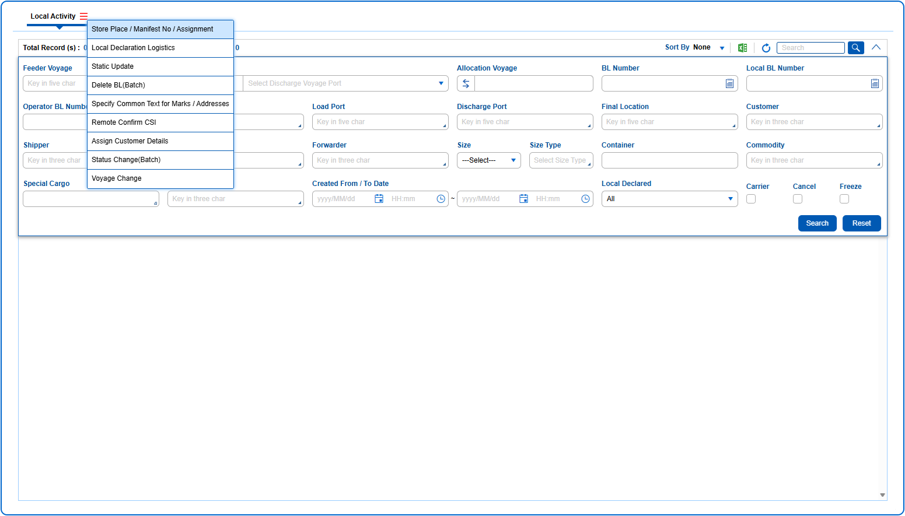
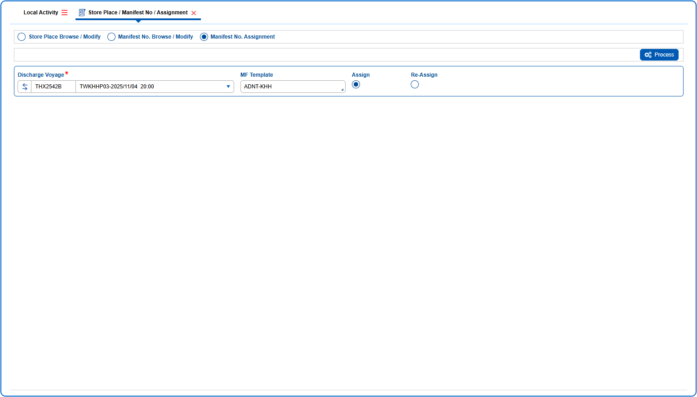
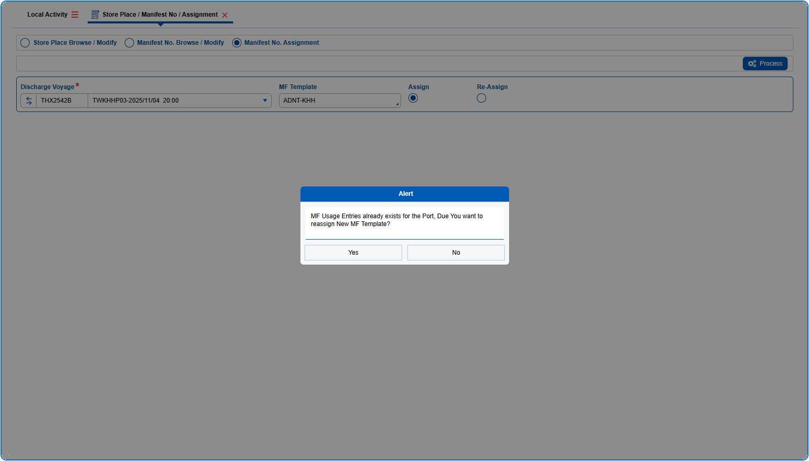
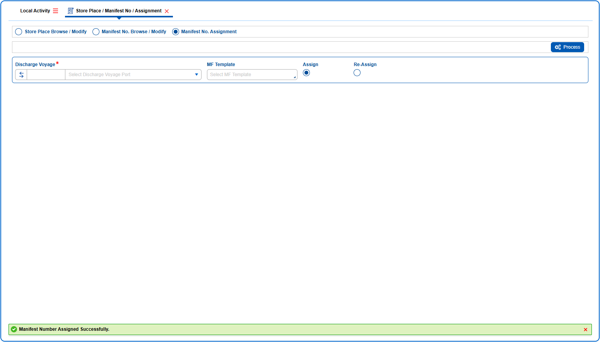

## Steps

1. **Step 1** : Drag the cursor to the {img:../img/How_to_Assign_Manifest_Template_01.png} icon, click on it, and then select "**Store Place / Manifest No / Assignment**" from the menu. This will open the Store Place / Manifest No / Assignment screen.

1. **Step 2** : In Store Place / Manifest No / Assignment screen, select on the {img:../img/How_to_Assign_Manifest_Template_03.png} radio button to display the query fields for Manifest No. Assignment.
1. **Step 3** : Select an option for MF template.
1. **Step 4** : Select {img:../img/How_to_Assign_Manifest_Template_04.png}radio button.
1. **Step 5** : Click on {img:../img/How_to_Assign_Manifest_Template_05.png}

>> 1.
1. **Step 6** : A confirmation pop up will be shown to confirm assignment of New Template. Click on Yes.

>> 1.
If processed successfully, a success message is shown as given below.

>> 1.
