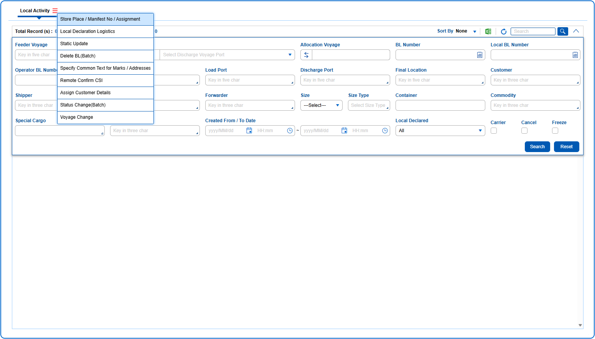
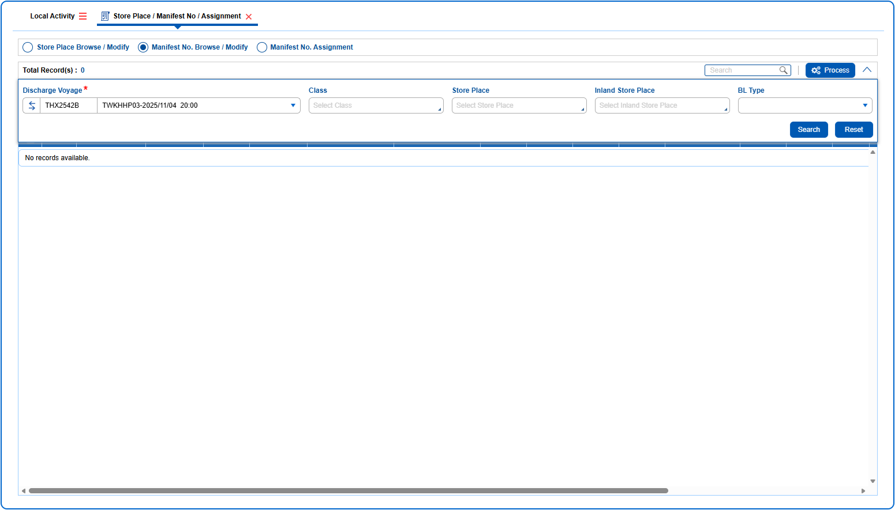
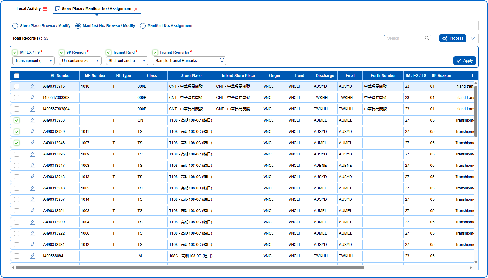
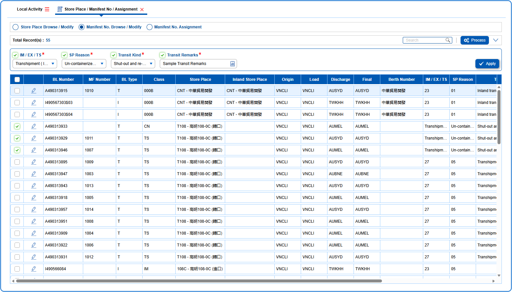
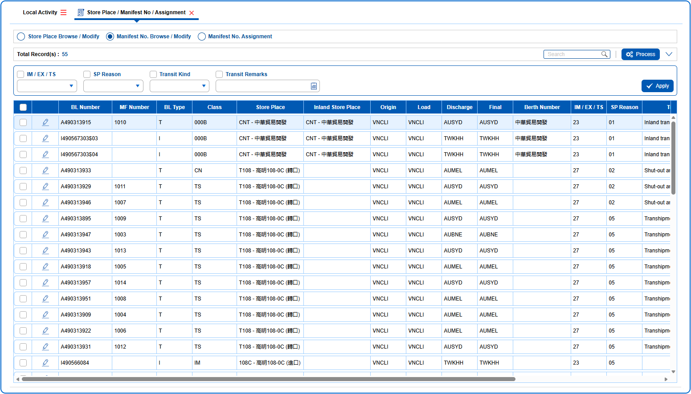

## Steps

1. **Step 1** : Drag the cursor to the {img:../img/How_to_Browse_and_Modify_Manifest_Number_01.png} icon, click on it, and then select "**Store Place / Manifest No / Assignment**" from the menu. This will open the Store Place / Manifest No / Assignment screen.

1. **Step 2** : In Store Place / Manifest No / Assignment screen, select on the {img:../img/How_to_Browse_and_Modify_Manifest_Number_03.png} radio button to display the query fields for Manifest No. Browse / Modify.
1. **Step 3** : Enter data in query fields and click on {img:../img/How_to_Browse_and_Modify_Manifest_Number_04.png}.

1. **Step 4** : If the data is queried, enter details in the batch apply fields and select the fields using the checkboxes.
1. **Step 5** : Either select all BL records by clicking on {img:../img/How_to_Browse_and_Modify_Manifest_Number_06.png}(select all checkbox) or select individual records by clicking on {img:../img/How_to_Browse_and_Modify_Manifest_Number_07.png}(single select checkbox).
1. **Step 6** : Click on {img:../img/How_to_Browse_and_Modify_Manifest_Number_08.png}

>> 1.
1. **Step 7** : On clicking {img:../img/How_to_Browse_and_Modify_Manifest_Number_10.png}, the changes are applied.
1. **Step 8** : Click on {img:../img/How_to_Browse_and_Modify_Manifest_Number_11.png}

>> 1.
If processed successfully, saved changes are displayed.

>> 1.
