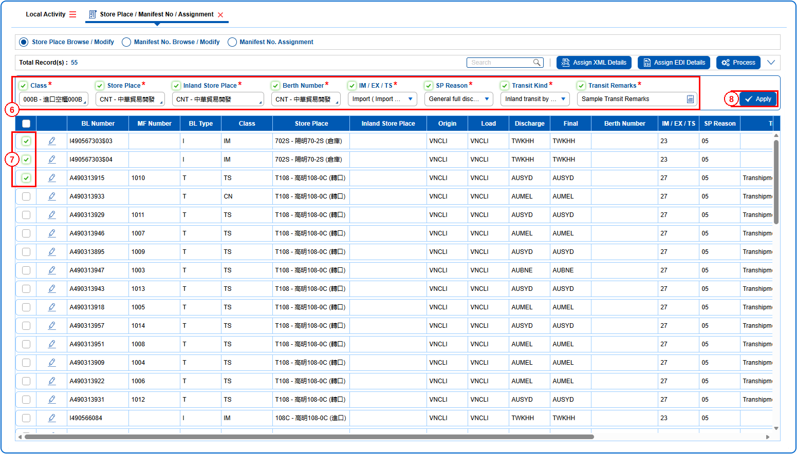
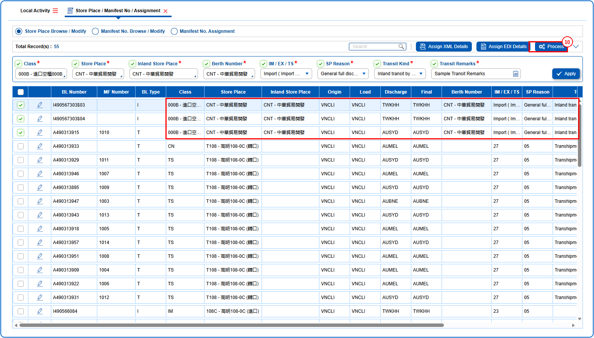
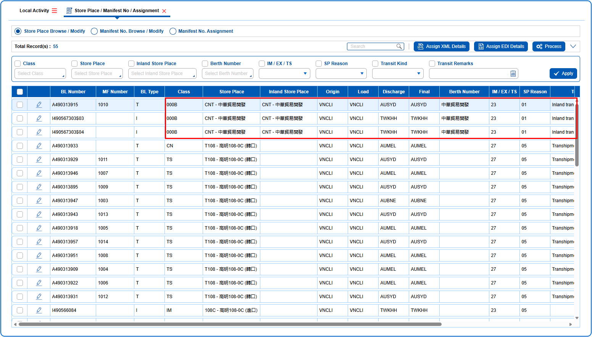

## Steps
**Step 1** : The user should drag the cursor to the batch function menu icon {icon:batch_menu}, click on it, and then select "**Store Place / Manifest No / Assignment**" from the menu.

**Step 2** : Upon clicking "**Store Place / Manifest No / Assignment**" User will be shown the Store Place / Manifest No / Assignment screen.
**Step 3** : Select the {img:../img/How_to_Browse_and_Modify_Store_Place_03.png} radio button.
**Step 4** : Enter the query fields with desirable input for querying data and click on {img:../img/btn_search.png}.

**Step 5** : Upon clicking {img:../img/btn_search.png}, BLs with matching information are returned.
**Step 6** : Enter the details in the batch apply fields and tick the checkboxes of the fields to be applied.
**Step 7** : Either select all BLs available by clicking on {img:../img/How_to_Browse_and_Modify_Store_Place_06.png} or select individual BLs by clicking on {img:../img/How_to_Browse_and_Modify_Store_Place_07.png}.
**Step 8** : Click on {img:../img/btn_apply.png}.

**Step 9** : Upon clicking {img:../img/btn_apply.png}, the details are applied to the selected BLs as shown below.
**Step 10** : Click on {img:../img/btn_process.png}.

If successfully processed, the saved changes are displayed as given below.

