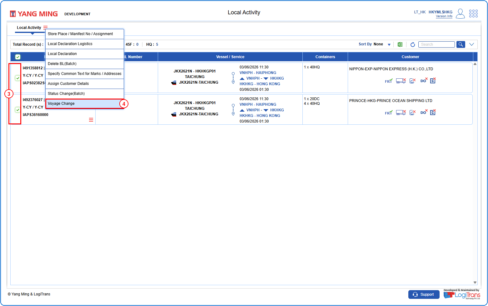
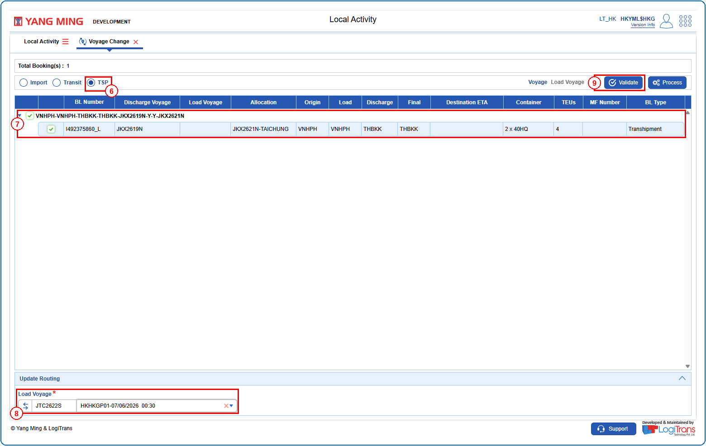
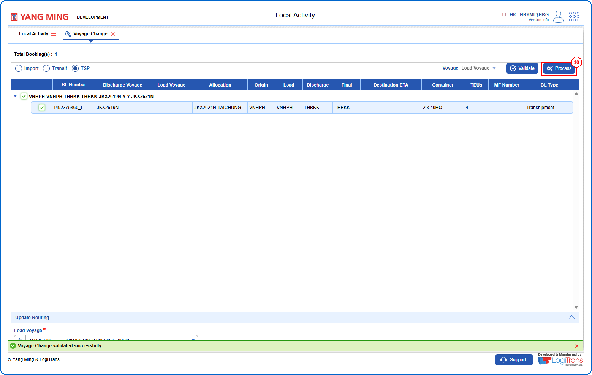
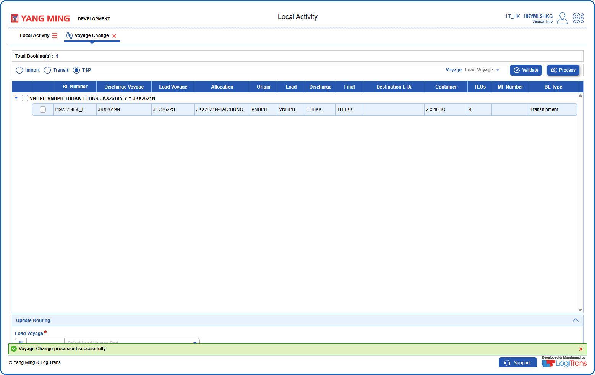

## Steps
**Step 1** : Enter the query fields with desirable input for querying data and click on {img:../img/btn_search.png}.
**Step 2** : Upon clicking {img:../img/btn_search.png}, BLs with matching information are returned.
**Step 3** : Either select all records available by clicking on {icon:select_all} or select individual records by clicking on {icon:single_select}.
**Step 4** : The user should drag the cursor to the batch function menu icon {icon:batch_menu}, click on it, and then select "**Voyage Change**" from the menu.

**Step 5** : Upon clicking "**Voyage Change**" User will be shown the Voyage Change screen.
**Step 6** : Select the "**TSP**" radio button.
**Step 7** : Either select all records available by clicking on {img:../img/vcp_select_all.png} or select individual records by clicking on {img:../img/vcp_single_select.png}.
**Step 8** : Select the "**Load Voyage**" in the Update Routing section.
**Step 9** : Click on {img:../img/btn_validate.png}.

If successfully validated, a success message is shown as given below.
**Step 10** : Click on {img:../img/btn_process.png}.

If successfully processed, a success message is shown as given below.

