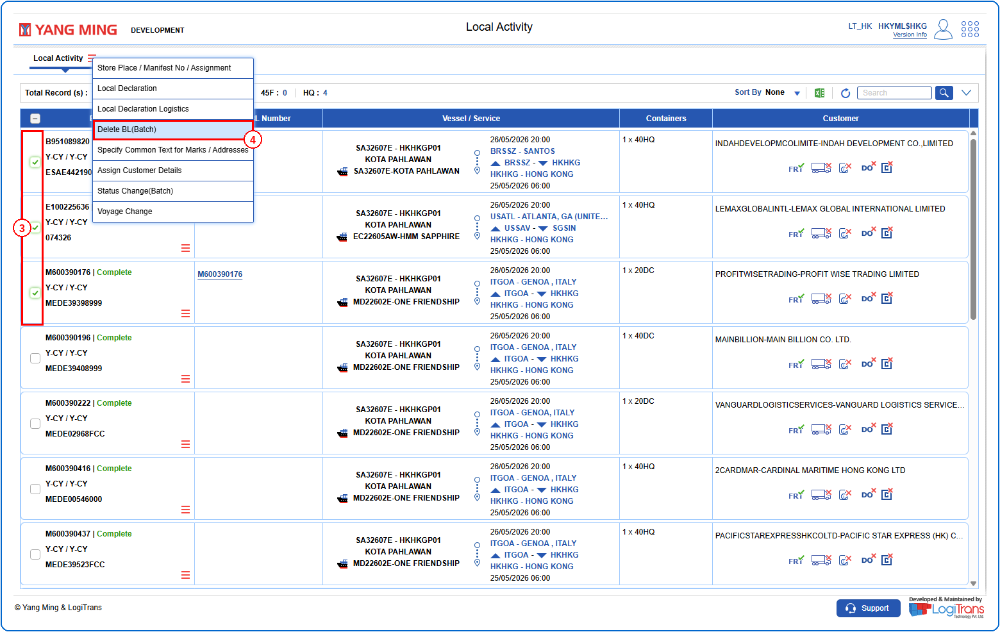
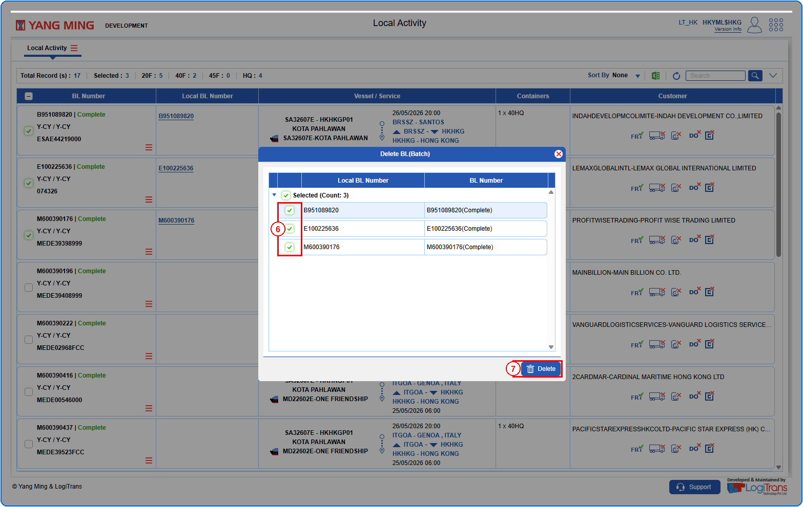
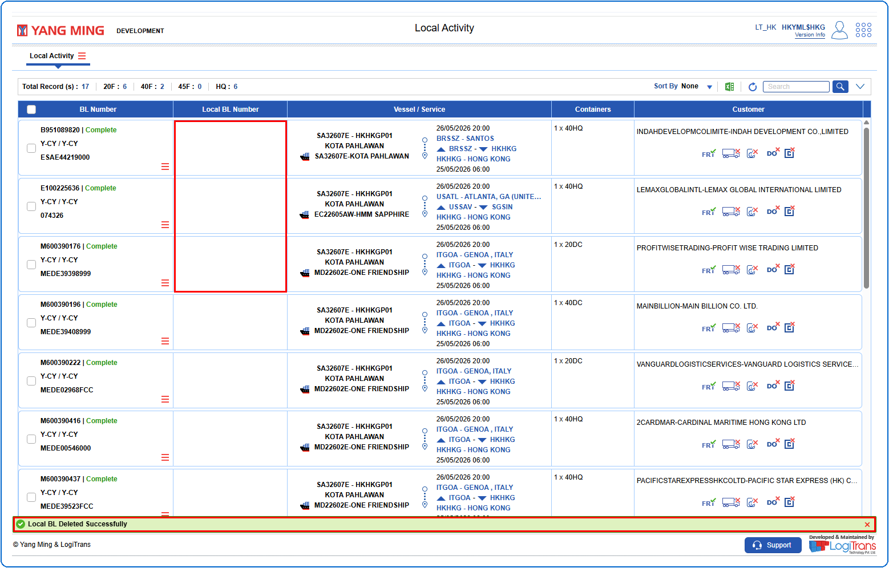

## Steps
**Step 1** : Enter the query fields with desirable input for querying data and click on {img:../img/btn_search.png}.
**Step 2** : Upon clicking {img:../img/btn_search.png}, BLs with matching information are returned.
**Step 3** : Either select all records available by clicking on {icon:select_all} or select individual records by clicking on {icon:single_select}.
**Step 4** : The user should drag the cursor to the batch function menu icon {icon:batch_menu}, click on it, and then select "**Delete BL(Batch)**" from the menu.

**Step 5** : Upon clicking "**Delete BL(Batch)**" the user is shown Delete BL(Batch) pop up screen.
**Step 6** : Either select all records available by clicking on {img:../img/dbl_select_all.png} or select individual records by clicking on {img:../img/dbl_single_select.png}.
**Step 7** : Click on {img:../img/btn_delete.png}.

If successfully deleted, a success message is shown and for the selected the Local BL Numbers are removed as shown below.

