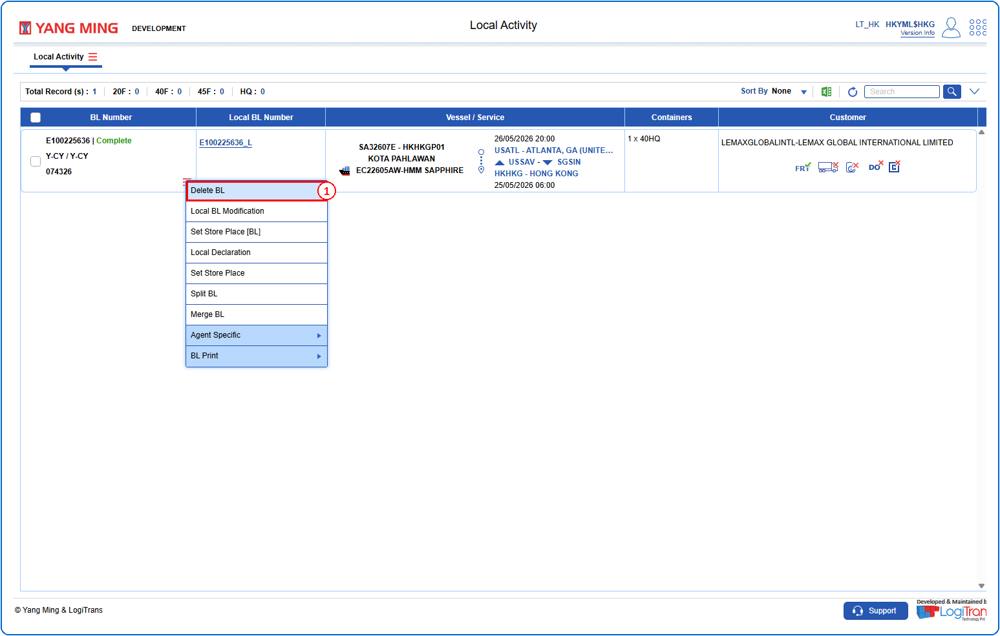
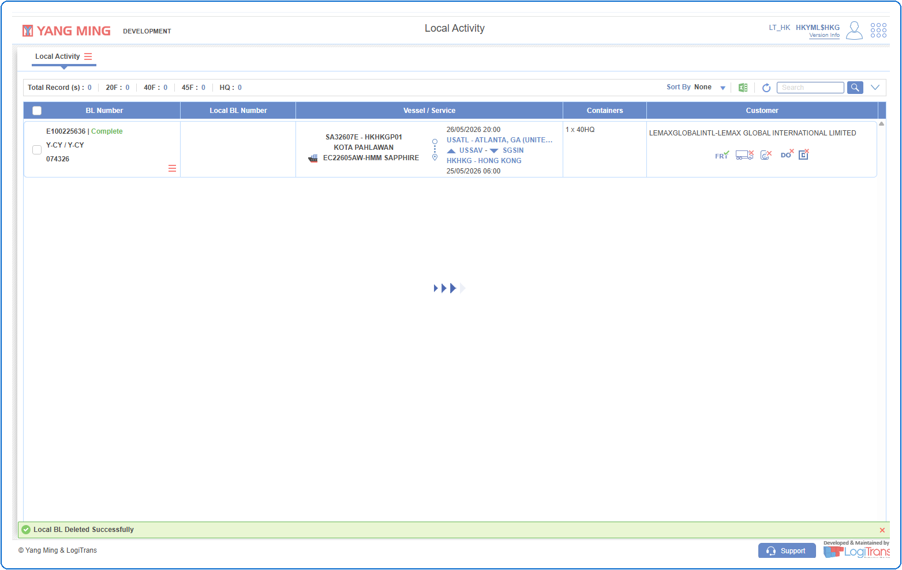

## Steps
**Step 1** : The user should drag the cursor to the record menu icon {icon:record_menu} in the respective record, click on it, and then select "**Delete BL**" from the menu.

If successfully deleted, a success message is shown and the Local BL Number is removed as shown below.

