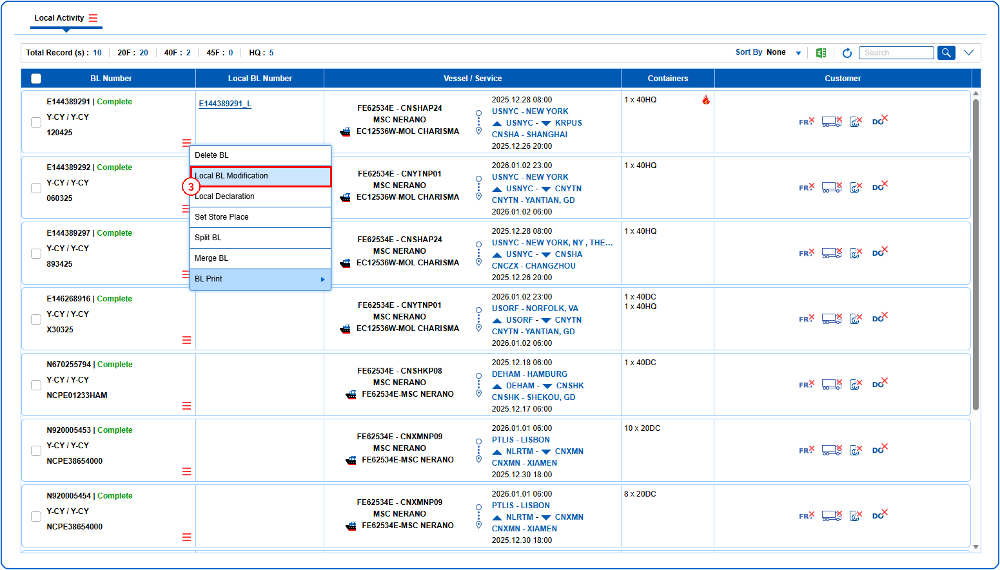
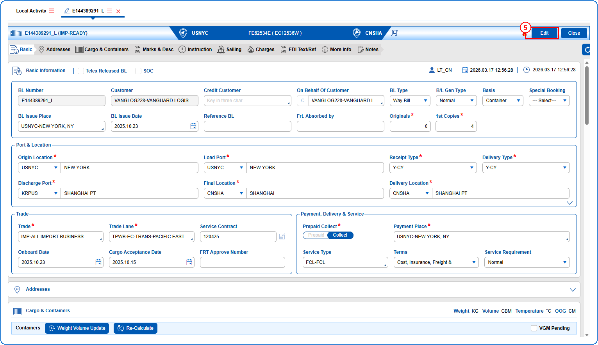
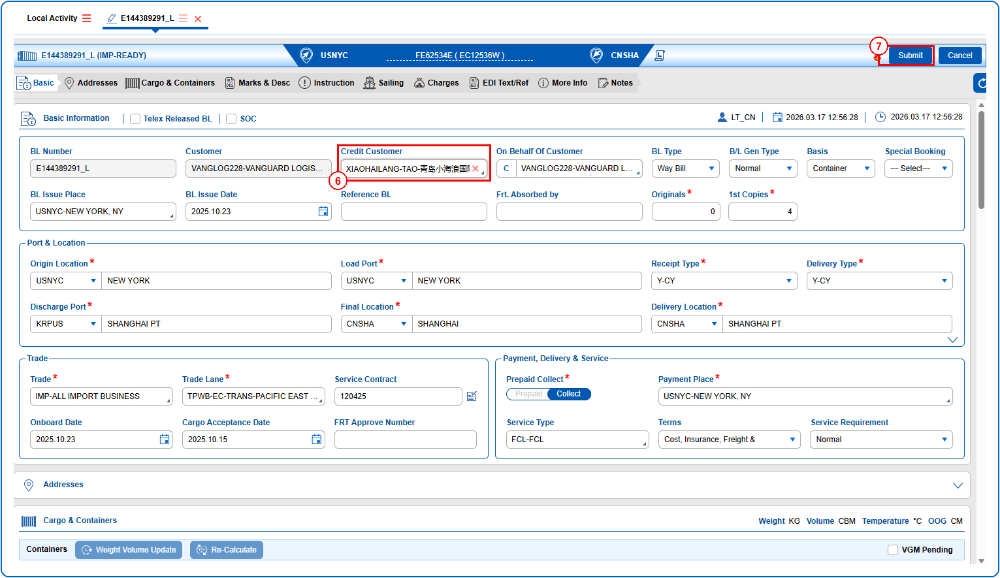
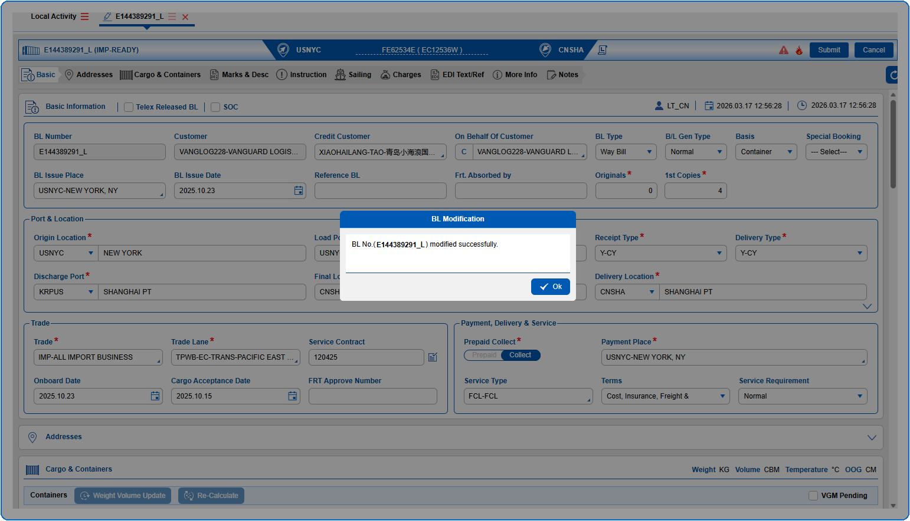

## Pre defined conditions
@11 Local BL must exist to view Local BL Modification screen.

## Steps
**Step 1** : Enter the query fields with desirable input for querying data and click on {img:../img/btn_search.png}.
**Step 2** : Upon clicking {img:../img/btn_search.png}, BLs with matching information are returned.
**Step 3** : The user should drag the cursor to the record menu icon {icon:record_menu} in the respective record, click on it, and then select "**Local BL Modification**" from the menu.

**Step 4** : Upon clicking "**Local BL Modification**" User will be shown the Local BL Modification screen.
**Step 5** : Click on {img:../img/btn_edit.png} to edit the existing Local BL data.
**Note:** On clicking {img:../img/btn_edit.png}, all fields are editable and {img:../img/btn_submit_lbm.png} and {img:../img/btn_cancel.png} are found on the top right corner.

**Step 6** : Edit the required details.
**Step 7** : Click on {img:../img/btn_submit_lbm.png}.

If successfully submitted, an alert is shown as given below.

