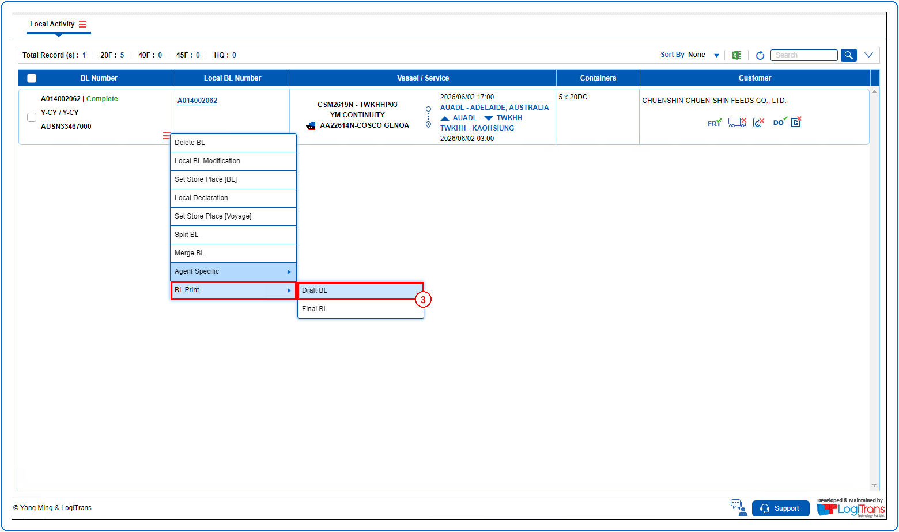
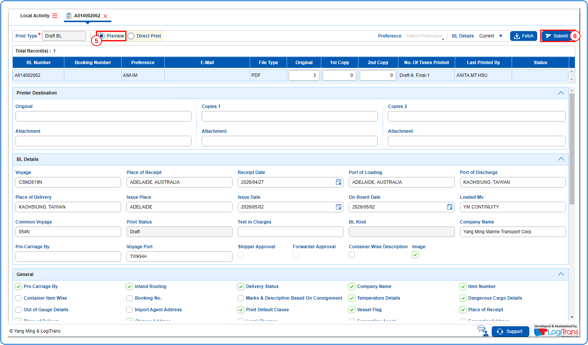
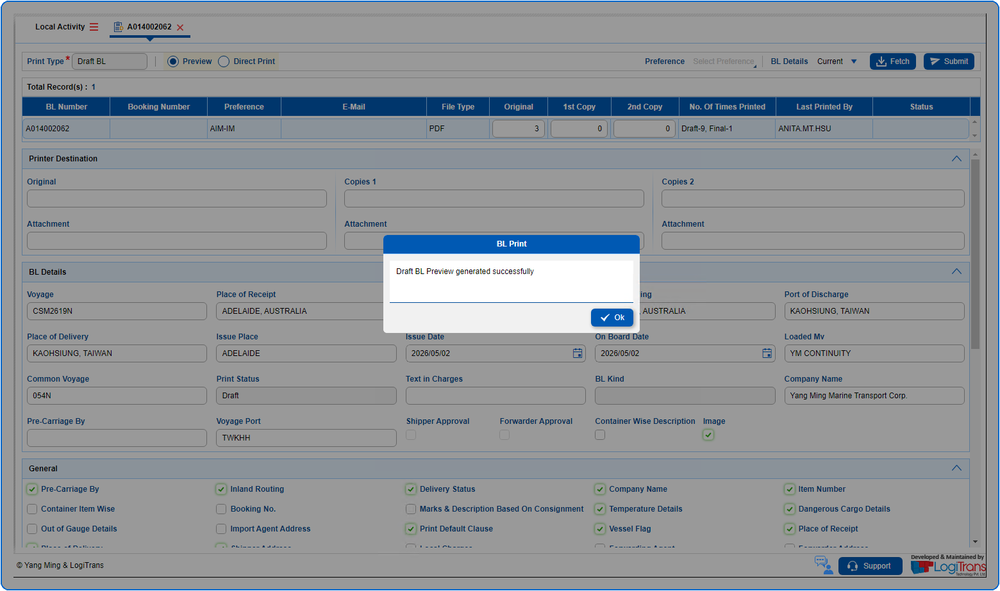
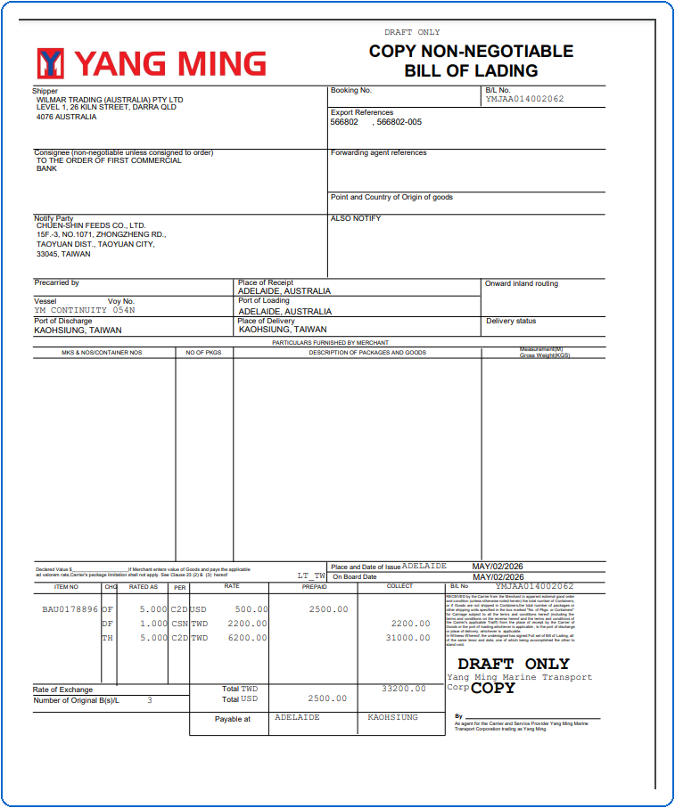

## Steps
**Step 1** : Enter the query fields with desirable input for querying data and click on {img:../img/btn_search.png}.
**Step 2** : Upon clicking {img:../img/btn_search.png}, BLs with matching information are returned.
**Step 3** : The user should drag the cursor to the record menu icon {icon:record_menu} in the respective record, click on it, and then select "**BL Print**" >> "**Draft BL**" from the menu.

**Step 4** : Upon clicking "**Draft BL**" User will be shown the Draft BL screen.
**Step 5** : Select the {img:../img/dbp_radio_preview.png} radio button.
**Step 6** : Click on {img:../img/btn_submit.png}.

If successfully submitted, an alert is shown as given below and pdf is displayed.

