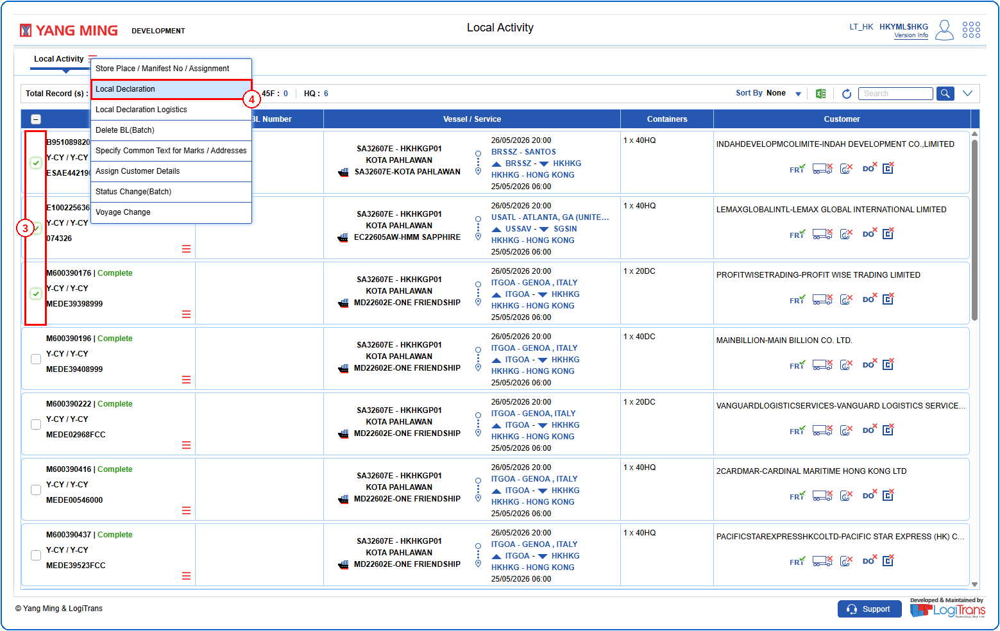
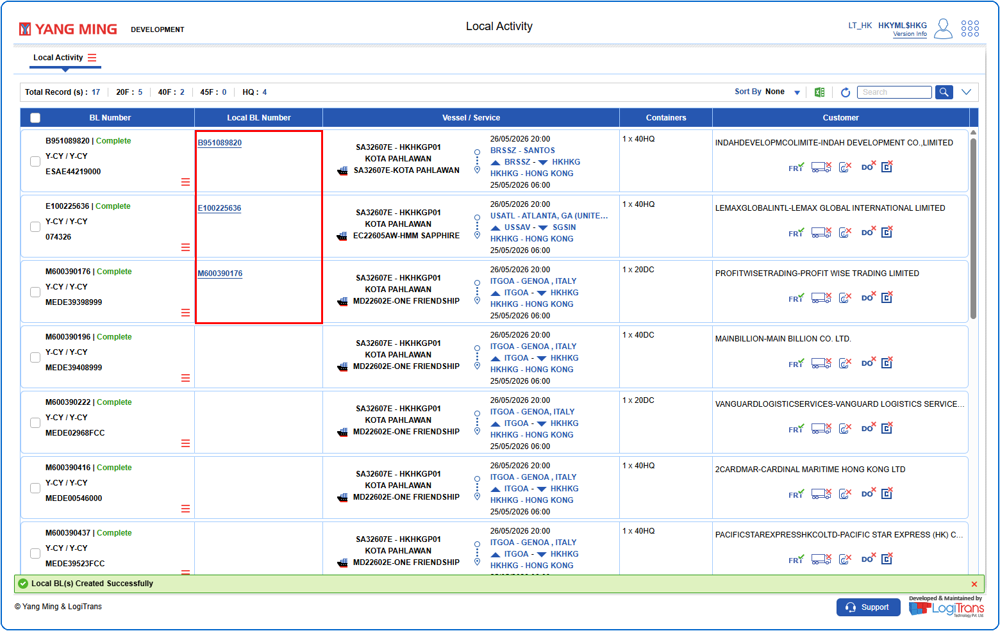

## Steps
**Step 1** : Enter the query fields with desirable input for querying data and click on {img:../img/btn_search.png}.
**Step 2** : Upon clicking {img:../img/btn_search.png}, BLs with matching information are returned.
**Step 3** : Either select all records available by clicking on {icon:select_all} or select individual records by clicking on {icon:single_select}.
**Step 4** : The user should drag the cursor to the batch function menu icon {icon:batch_menu}, click on it, and then select "**Local Declaration**" from the menu.

If successfully declared, a success message is shown and for the selected records the Local BL Numbers are created as shown below.

