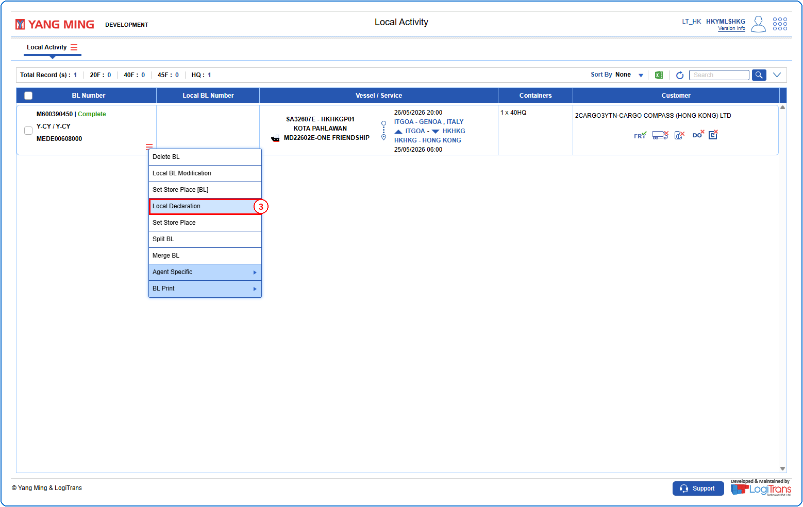
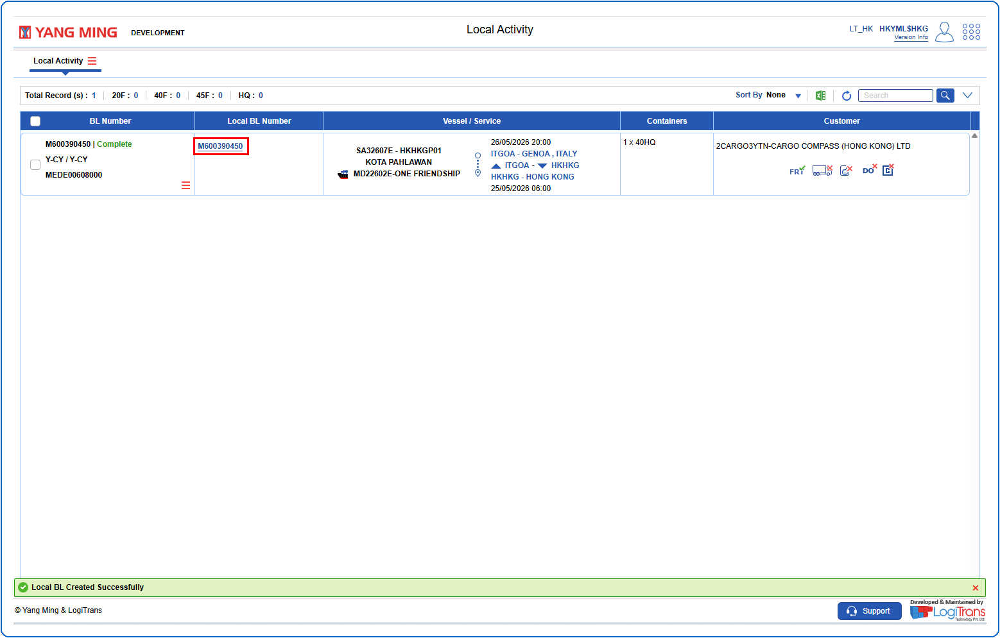

## Steps
**Step 1** : Enter the query fields with desirable input for querying data and click on {img:../img/btn_search.png}.
**Step 2** : Upon clicking {img:../img/btn_search.png}, BLs with matching information are returned.
**Step 3** : The user should drag the cursor to the record menu icon {icon:record_menu} in the respective record, click on it, and then select "**Local Declaration**" from the menu.

If successfully declared, a success message is shown and the Local BL Number is created as shown below.

