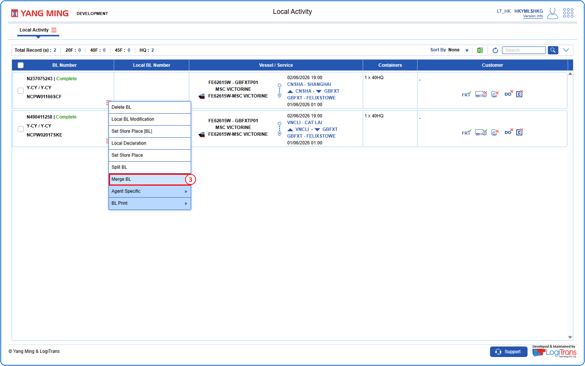
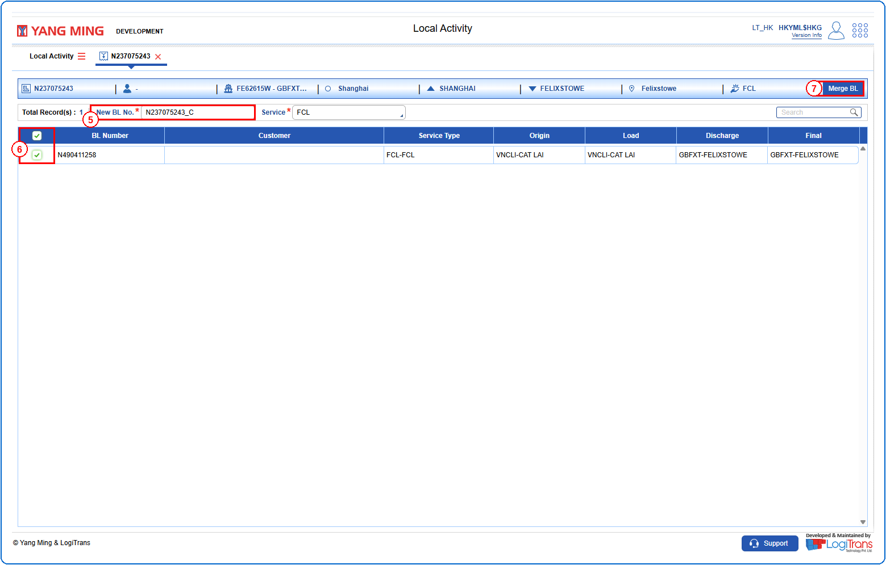
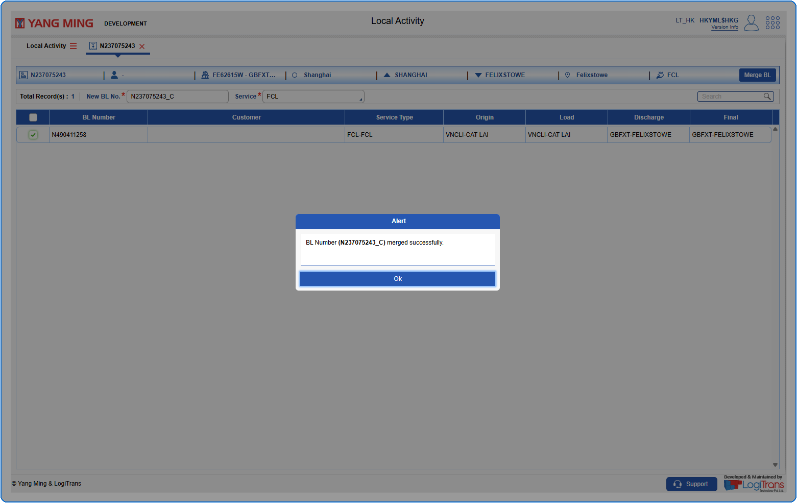

## Steps
**Step 1** : Enter the query fields with desirable input for querying data and click on {img:../img/btn_search.png}.
**Step 2** : Upon clicking {img:../img/btn_search.png}, BLs with matching information are returned.
**Step 3** : The user should drag the cursor to the record menu icon {icon:record_menu} in the respective record, click on it, and then select "**Merge BL**" from the menu.

**Step 4** : Upon clicking "**Merge BL**" User will be shown the Merge BL screen.
**Step 5** : Enter the data in "**New BL No.**" field. This field is mandatory.
**Step 6** : Either select all BLs available by clicking on {img:../img/mbl_select_all.png} or select individual BLs by clicking on {img:../img/mbl_single_select.png}.
**Step 7** : Click on {img:../img/btn_merge_bl.png}.

If successfully merged, an alert is shown as given below.

