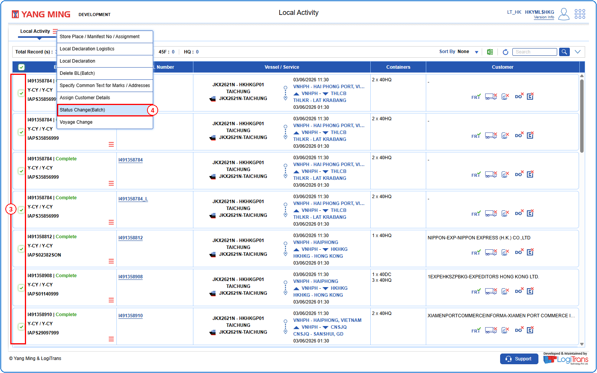
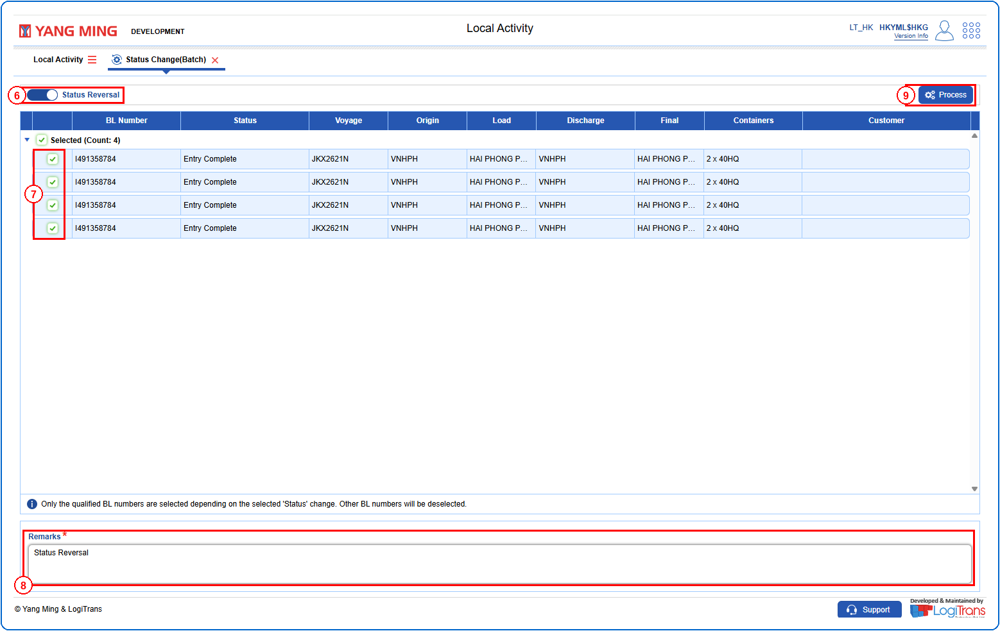
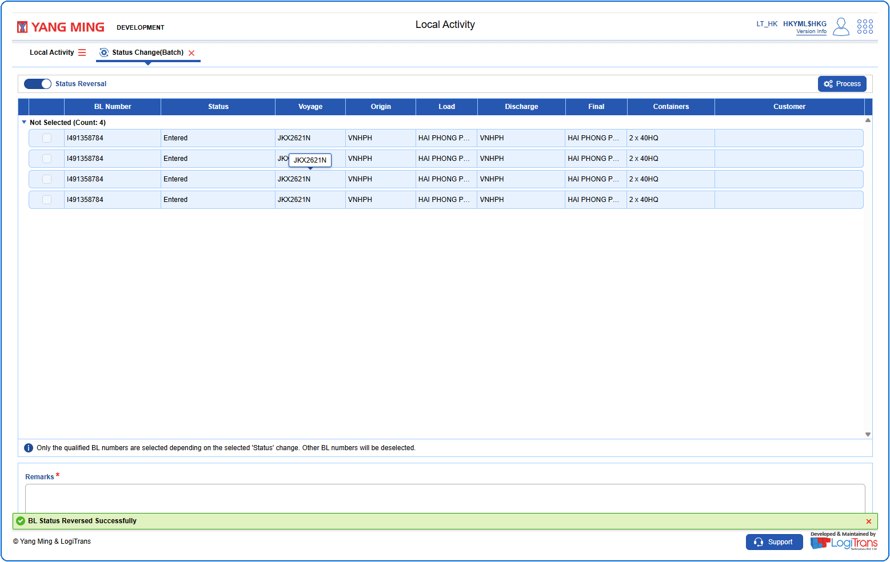

## Steps
**Step 1** : Enter the query fields with desirable input for querying data and click on {img:../img/btn_search.png}.
**Step 2** : Upon clicking {img:../img/btn_search.png}, BLs with matching information are returned.
**Step 3** : Either select all records available by clicking on {icon:select_all} or select individual records by clicking on {icon:single_select}.
**Step 4** : The user should drag the cursor to the batch function menu icon {icon:batch_menu}, click on it, and then select "**Status Change(Batch)**" from the menu.

**Step 5** : Upon clicking "**Status Change(Batch)**" User will be shown the Status Change(Batch) screen.
**Step 6** : Click on the "**Status Reversal**" toggle.
**Step 7** : Either select all records available by clicking on {img:../img/rsc_select_all.png} or select individual records by clicking on {img:../img/rsc_single_select.png}.
**Step 8** : Enter the "**Remarks**".
**Step 9** : Click on {img:../img/btn_process.png}.

If successfully processed, a success message is shown as given below.

