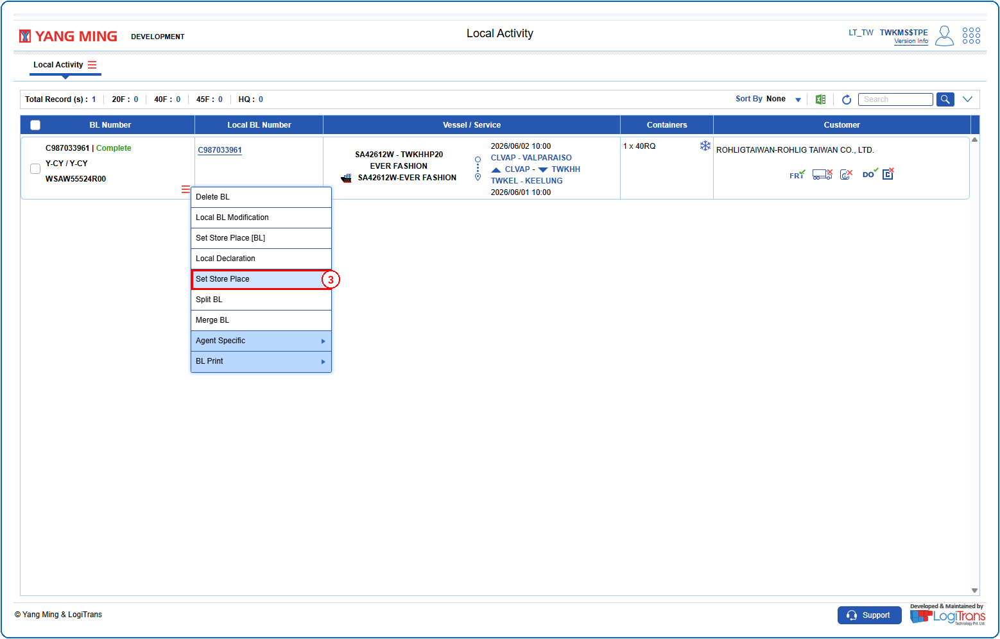
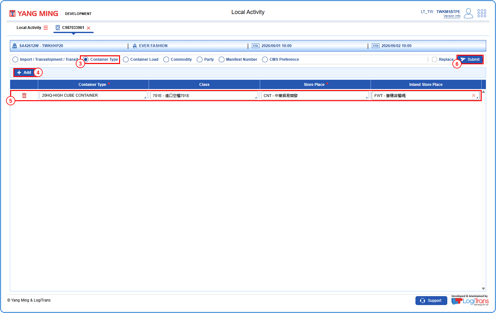
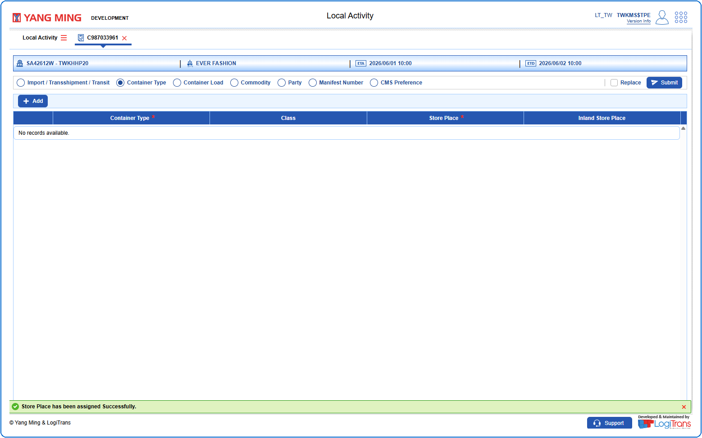

## Steps
**Step 1** : The user should drag the cursor to the record menu icon {icon:record_menu} in the respective record, click on it, and then select "**Set Store Place**" from the menu.

**Step 2** : Upon clicking "**Set Store Place**" User will be shown the Set Store Place screen.
**Step 3** : Select the {img:../img/sps_radio_container_type.png} radio button.
**Step 4** : Click on {img:../img/btn_add.png} to add a new row.
**Step 5** : Enter all the necessary fields in the row. "**Container Type**" and "**Store Place**" fields are mandatory.
**Step 6** : Click on {img:../img/btn_submit.png}.

If successfully submitted, a success message is shown as given below.

