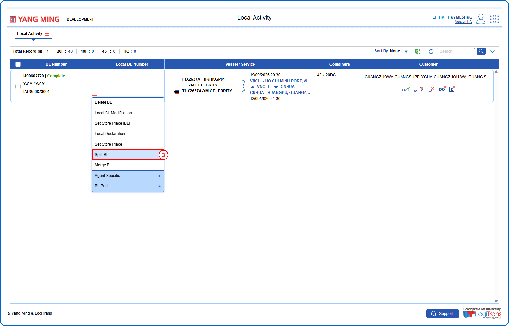
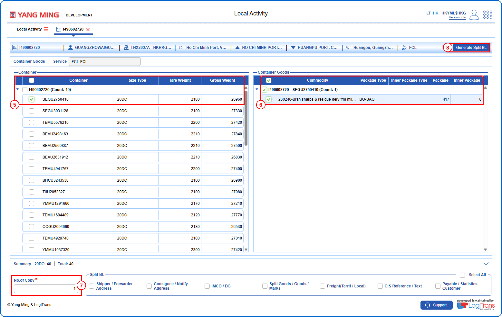
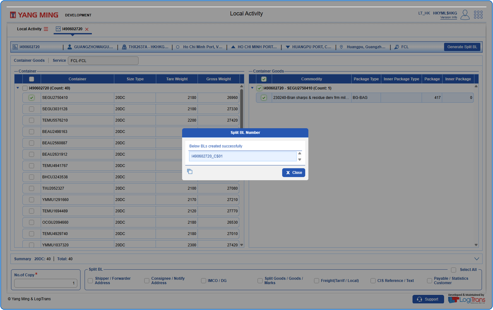

## Steps
**Step 1** : Enter the query fields with desirable input for querying data and click on {img:../img/btn_search.png}.
**Step 2** : Upon clicking {img:../img/btn_search.png}, BLs with matching information are returned.
**Step 3** : The user should drag the cursor to the record menu icon {icon:record_menu} in the respective record, click on it, and then select "**Split BL**" from the menu.

**Step 4** : Upon clicking "**Split BL**" User will be shown the Split BL Generation screen.
**Step 5** : Either select all containers available by clicking on {img:../img/sbl_select_all.png} or select individual containers by clicking on {img:../img/sbl_single_select.png}.
**Step 6** : Either select all container goods available by clicking on {img:../img/sbl_select_all.png} or select individual container goods by clicking on {img:../img/sbl_single_select.png}.
**Step 7** : Enter the data in "**No.of Copy**" field. This field is mandatory.
**Step 8** : Click on {img:../img/btn_generate_split_bl.png}.

If successfully generated, an alert is shown with the new Split BL Number as given below.

