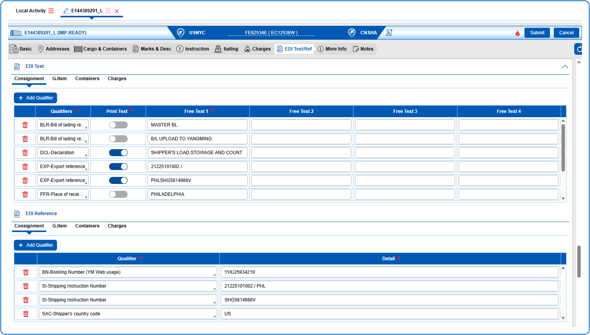

**EDI Text** is to add additional information that cannot be entered in any other tabs.
This information is related to BL, a qualifier is required to give it a specific meaning.
When EDI Text is applied to an item, an identifier must be specified to indicate the item to which the text information applies.

**EDI Reference** is devised to provide field for reference numbers which are not covered otherwise.
A qualifier gives each reference number specific meaning.
When a reference number is related to an article, an item identifier will be specified for identification.

