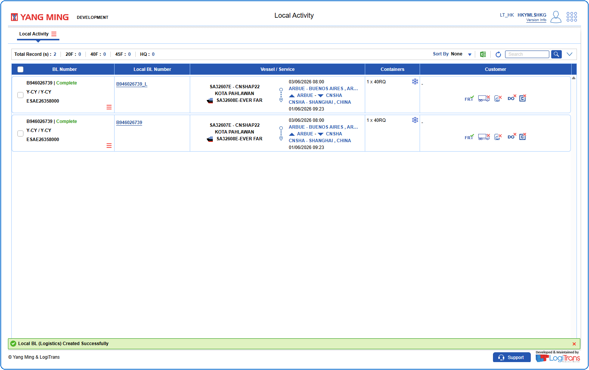

@11 Local Declaration Logistics allows the agency user to directly create Local BL from Manifest BL in batch. When the local BL number is created using Local Declaration Logistics, the BL number will be followed by a **"_L"** suffix.

